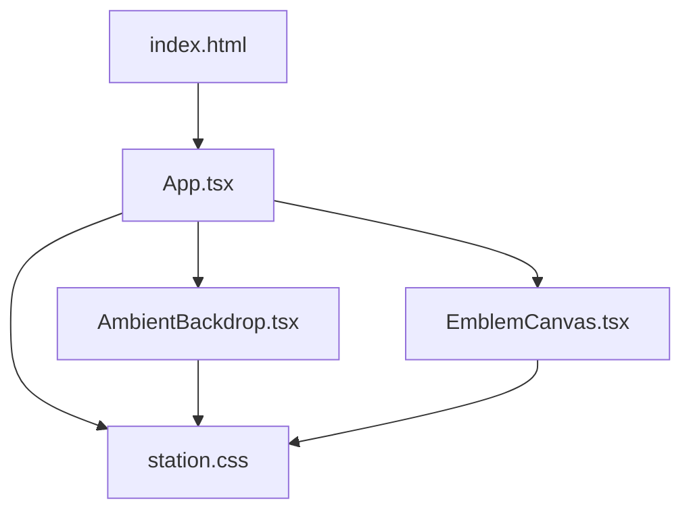
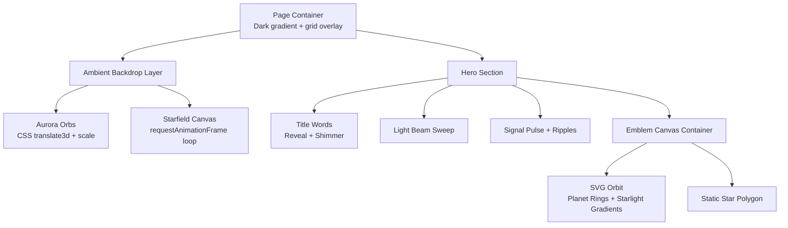
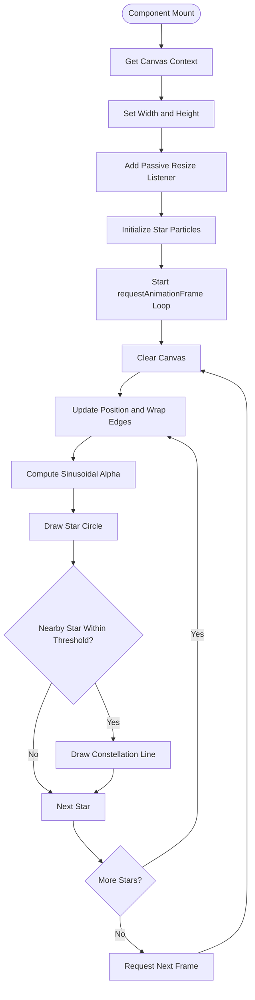
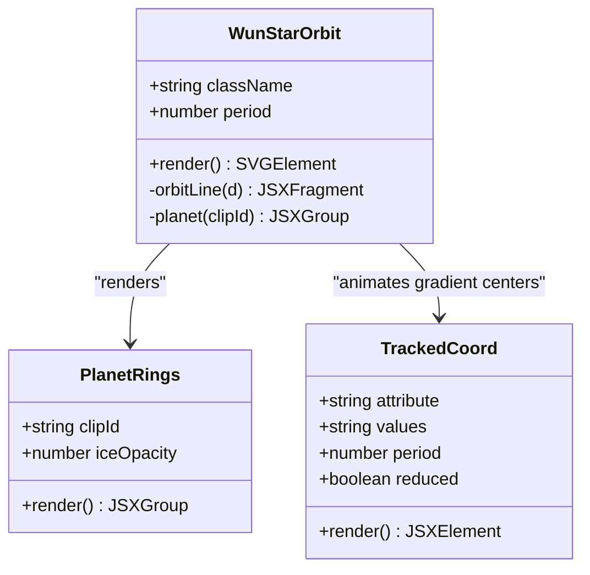
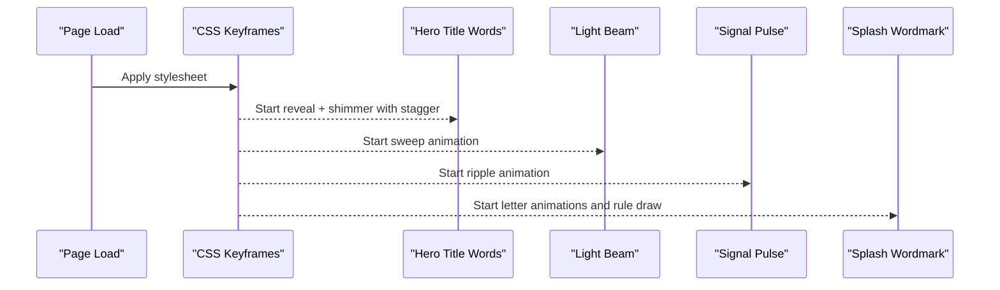
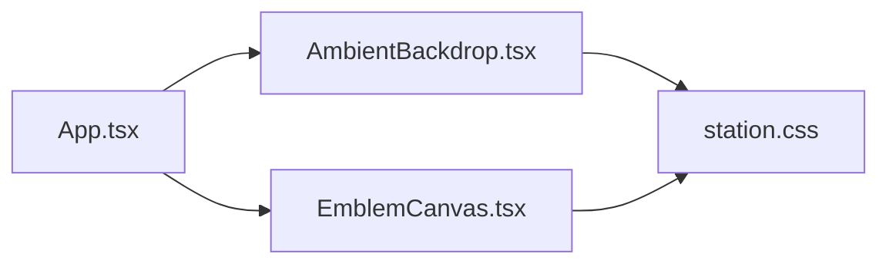

# Animation System & Visual Effects

<cite>
**Referenced Files in This Document**
- [index.html](file://index.html)
- [App.tsx](file://src/App.tsx)
- [AmbientBackdrop.tsx](file://src/AmbientBackdrop.tsx)
- [EmblemCanvas.tsx](file://src/EmblemCanvas.tsx)
- [station.css](file://src/station.css)
</cite>

## Table of Contents
1. [Introduction](#introduction)
2. [Project Structure](#project-structure)
3. [Core Components](#core-components)
4. [Architecture Overview](#architecture-overview)
5. [Detailed Component Analysis](#detailed-component-analysis)
6. [Dependency Analysis](#dependency-analysis)
7. [Performance Considerations](#performance-considerations)
8. [Cross-Browser Compatibility and Accessibility](#cross-browser-compatibility-and-accessibility)
9. [Troubleshooting Guide](#troubleshooting-guide)
10. [Conclusion](#conclusion)

## Introduction
This document explains the WUN Gazette animation system, focusing on two complementary rendering approaches:

- Canvas-based starfield background with a lightweight particle system and subtle constellation lines.
- SVG-based orbit animation for the brand emblem, including rotating planet rings, animated lighting gradients, and accessibility-aware motion reduction.
- CSS keyframe animations for hero text reveals, signal pulses, ambient aurora lighting, and splash-screen wordmark effects.

The goal is to make these visual systems understandable for both developers and designers while providing concrete references to the source files that implement them.

## Project Structure
The animation system lives primarily in three React components and one stylesheet:

| Area | File | Responsibility |
|---|---|---|
| Application shell | [App.tsx](file://src/App.tsx) | Composes the page, mounts the backdrop, renders the hero section, and embeds the emblem canvas. |
| Starfield background | [AmbientBackdrop.tsx](file://src/AmbientBackdrop.tsx) | Draws stars, twinkling, drift, and nearby constellation lines on a full-screen canvas. |
| Brand emblem | [EmblemCanvas.tsx](file://src/EmblemCanvas.tsx) | Renders the SVG orbit, planet rings, starlight gradients, and splash card layout. |
| Styles and keyframes | [station.css](file://src/station.css) | Defines colors, layout, ambient aurora, hero text animations, signal pulses, and reduced-motion overrides. |
| Entry point | [index.html](file://index.html) | Loads fonts and mounts the React application. |

**Diagram sources**
- [index.html:19-22](file://index.html#L19-L22)
- [App.tsx:15-17](file://src/App.tsx#L15-L17)
- [App.tsx:178-184](file://src/App.tsx#L178-L184)
- [App.tsx:285-288](file://src/App.tsx#L285-L288)

**Section sources**
- [index.html:1-24](file://index.html#L1-L24)
- [App.tsx:1-20](file://src/App.tsx#L1-L20)
- [AmbientBackdrop.tsx:1-15](file://src/AmbientBackdrop.tsx#L1-L15)
- [EmblemCanvas.tsx:1-18](file://src/EmblemCanvas.tsx#L1-L18)
- [station.css:1-21](file://src/station.css#L1-L21)

## Core Components
The animation system has four main responsibilities:

1. **Background layering:** A fixed backdrop holds CSS aurora orbs and a canvas starfield.
2. **Starfield particles:** A small set of drifting stars with sinusoidal twinkle and proximity-based constellation lines.
3. **SVG orbit emblem:** A tilted elliptical orbit with a moving planet, layered rings, animated gradients, and a static star polygon.
4. **CSS hero and splash animations:** Keyframes for title words, shimmer, light beams, signal ripples, and letter-by-letter wordmark reveals.

**Section sources**
- [AmbientBackdrop.tsx:13-101](file://src/AmbientBackdrop.tsx#L13-L101)
- [EmblemCanvas.tsx:123-327](file://src/EmblemCanvas.tsx#L123-L327)
- [station.css:69-130](file://src/station.css#L69-L130)
- [station.css:322-539](file://src/station.css#L322-L539)

## Architecture Overview
At runtime, the page composes multiple visual layers:

- The root page container provides a dark gradient background.
- The ambient backdrop is fixed behind content and contains:
  - Three blurred aurora orbs animated with CSS `translate3d` and scaling.
  - A full-size canvas drawing the starfield.
- The hero section includes:
  - Animated title words with staggered delays.
  - A sweeping light beam.
  - A pulsing signal dot with expanding rings.
  - The emblem canvas showing the orbit animation.
- The emblem itself uses SVG gradients, clip paths, filters, and SMIL animations.

**Diagram sources**
- [station.css:58-67](file://src/station.css#L58-L67)
- [station.css:69-130](file://src/station.css#L69-L130)
- [station.css:322-539](file://src/station.css#L322-L539)
- [AmbientBackdrop.tsx:93-100](file://src/AmbientBackdrop.tsx#L93-L100)
- [EmblemCanvas.tsx:180-325](file://src/EmblemCanvas.tsx#L180-L325)

## Detailed Component Analysis

### Canvas Starfield Background
The starfield is implemented as a React component that manages a `<canvas>` element through a ref. On mount, it:

- Gets the 2D context.
- Sets canvas dimensions to the viewport size.
- Adds a passive resize listener.
- Creates a fixed number of star particles with random position, radius, velocity, alpha, and phase.
- Starts a `requestAnimationFrame` loop that clears the canvas, updates positions, wraps off-screen stars, computes twinkle using a sine function, draws circles, and optionally draws faint lines between nearby stars.
- Cleans up the animation frame and resize listener on unmount.

**Diagram sources**
- [AmbientBackdrop.tsx:16-91](file://src/AmbientBackdrop.tsx#L16-L91)

Key implementation details:

| Aspect | Behavior |
|---|---|
| Particle model | Each star stores position, radius, velocity, base alpha, and phase. |
| Movement | Velocity is small and centered around zero; stars wrap at canvas edges. |
| Twinkle | Uses a time variable incremented per frame and a sine wave modulated by phase. |
| Constellation lines | Only drawn when distance between two stars is below a threshold; line opacity decreases with distance. |
| Performance | Fixed particle count, simple geometry, no DOM mutations inside the render loop. |
| Cleanup | Cancels the animation frame and removes the resize listener. |

**Section sources**
- [AmbientBackdrop.tsx:3-11](file://src/AmbientBackdrop.tsx#L3-L11)
- [AmbientBackdrop.tsx:16-91](file://src/AmbientBackdrop.tsx#L16-L91)

### SVG Orbit Animation for the Brand Emblem
The emblem is an SVG component that renders:

- A tilted coordinate group.
- Two orbital arcs representing back and front halves.
- A planet composed of atmospheric glow, cloud pattern, starlight gradient, sheen gradient, and layered ring ellipses.
- A static multi-point star polygon.
- SMIL animations for orbit motion, gradient center tracking, and pattern scrolling.
- A reduced-motion mode that disables continuous motion and freezes the planet at a visible position.

**Diagram sources**
- [EmblemCanvas.tsx:123-128](file://src/EmblemCanvas.tsx#L123-L128)
- [EmblemCanvas.tsx:76-107](file://src/EmblemCanvas.tsx#L76-L107)
- [EmblemCanvas.tsx:52-74](file://src/EmblemCanvas.tsx#L52-L74)

Important behaviors:

| Feature | Implementation |
|---|---|
| Tilted orbit | A group rotation is applied around the ellipse center. |
| Orbital path | An elliptical arc string defines the full loop; separate back and front paths create depth. |
| Planet motion | `animateMotion` follows the loop path when reduced motion is disabled. |
| Lighting | Radial gradients track the star-facing side using precomputed coordinates and SMIL `animate`. |
| Cloud texture | A repeating pattern scrolls horizontally via `animateTransform`. |
| Reduced motion | Disables `animateMotion`, gradient tracking, and pattern scrolling; freezes the planet at a readable offset. |
| Accessibility | The outer splash card uses `role="img"` and an accessible label; the SVG itself is marked `aria-hidden="true"` where appropriate. |

**Section sources**
- [EmblemCanvas.tsx:19-50](file://src/EmblemCanvas.tsx#L19-L50)
- [EmblemCanvas.tsx:109-121](file://src/EmblemCanvas.tsx#L109-L121)
- [EmblemCanvas.tsx:123-178](file://src/EmblemCanvas.tsx#L123-L178)
- [EmblemCanvas.tsx:180-325](file://src/EmblemCanvas.tsx#L180-L325)
- [EmblemCanvas.tsx:333-377](file://src/EmblemCanvas.tsx#L333-L377)

### CSS Keyframe Animations
The stylesheet defines several animation families:

| Animation Family | Purpose | Key Properties |
|---|---|---|
| Aurora drift | Ambient background lighting | `translate3d`, `scale`, long durations, alternating directions. |
| Hero title reveal | Staggered entrance for each word | `opacity`, `transform`, `filter`, staggered `animation-delay`. |
| Hero shimmer | Subtle gradient sweep over title text | `background-position` with `background-clip: text`. |
| Light beam sweep | Diagonal light passing across the hero title | `skewX` and `translate3d`. |
| Signal pulse | Central dot with expanding rings | `box-shadow`, pseudo-element rings, scaling, fading. |
| Splash rule draw | Rule line expanding under the emblem | `scaleX` from hidden to visible. |
| Splash letter animation | Letter-by-letter wordmark effect | Per-letter delay and infinite visibility cycle. |
| Splash shape drift | Floating geometric shapes behind the emblem | Entrance and slow drift animations. |

**Diagram sources**
- [station.css:335-539](file://src/station.css#L335-L539)
- [station.css:695-791](file://src/station.css#L695-L791)

**Section sources**
- [station.css:120-130](file://src/station.css#L120-L130)
- [station.css:335-539](file://src/station.css#L335-L539)
- [station.css:695-791](file://src/station.css#L695-L791)

### Code Examples and Patterns

#### Canvas API Usage
The starfield demonstrates:

- Canvas context acquisition.
- Dynamic width and height assignment.
- Drawing circles with `beginPath`, `arc`, `fillStyle`, and `fill`.
- Drawing lines with `moveTo`, `lineTo`, `strokeStyle`, `lineWidth`, and `stroke`.
- Time-based animation state managed outside the DOM.

Reference locations:
- [AmbientBackdrop.tsx:16-91](file://src/AmbientBackdrop.tsx#L16-L91)

#### requestAnimationFrame Usage
The animation loop:

- Stores the frame ID.
- Calls itself recursively.
- Clears the previous frame on cleanup.
- Updates a time variable incrementally.

Reference locations:
- [AmbientBackdrop.tsx:42-85](file://src/AmbientBackdrop.tsx#L42-L85)

#### SVG Transform and Animation
The emblem uses:

- Group rotation for tilt.
- Elliptical arc paths for orbits.
- `animateMotion` for planet movement.
- `animateTransform` for pattern scrolling.
- SMIL `animate` for gradient center tracking.

Reference locations:
- [EmblemCanvas.tsx:180-325](file://src/EmblemCanvas.tsx#L180-L325)

#### CSS Animation Properties
The hero and splash animations use:

- `@keyframes` definitions.
- `animation-name`, `animation-duration`, `animation-delay`, `animation-timing-function`, and `animation-fill-mode`.
- `background-clip: text` for gradient text.
- Pseudo-elements for expanding signal rings.
- `prefers-reduced-motion` media queries to disable or simplify animations.

Reference locations:
- [station.css:335-539](file://src/station.css#L335-L539)
- [station.css:695-791](file://src/station.css#L695-L791)

## Dependency Analysis
The animation system has clear boundaries:

- `App.tsx` imports and mounts `AmbientBackdrop` and `EmblemCanvas`.
- `AmbientBackdrop.tsx` depends only on browser APIs (`window`, `requestAnimationFrame`, `HTMLCanvasElement`).
- `EmblemCanvas.tsx` depends on React hooks and SVG capabilities.
- `station.css` styles all visual layers and exposes reusable animation classes.

**Diagram sources**
- [App.tsx:15-17](file://src/App.tsx#L15-L17)
- [App.tsx:178-184](file://src/App.tsx#L178-L184)
- [App.tsx:285-288](file://src/App.tsx#L285-L288)

**Section sources**
- [App.tsx:15-17](file://src/App.tsx#L15-L17)
- [App.tsx:178-184](file://src/App.tsx#L178-L184)
- [App.tsx:285-288](file://src/App.tsx#L285-L288)

## Performance Considerations
The current implementation favors simplicity and low overhead:

- **Fixed star count:** The starfield uses a small constant number of particles, avoiding dynamic allocation during the render loop.
- **Minimal geometry:** Stars are circles; constellation lines are only drawn for nearby pairs.
- **No DOM updates in the loop:** Canvas drawing avoids React reconciliation.
- **Passive resize listener:** Prevents scroll jank on resize events.
- **SMIL-based motion:** The SVG emblem relies on declarative animations rather than JavaScript-driven transforms.
- **Reduced motion support:** Both the SVG emblem and CSS hero animations provide fallback behavior for users who prefer reduced motion.

Potential optimization opportunities:

| Area | Current Approach | Possible Optimization |
|---|---|---|
| Constellation lines | O(n²) distance checks per frame | Spatial partitioning or distance threshold culling if star count increases. |
| Canvas resolution | Matches viewport pixels | Consider device pixel ratio scaling for sharper rendering on high-DPI displays. |
| Starfield particle count | Fixed at 46 | Make configurable based on performance metrics or user preference. |
| SVG filters | Gaussian blur on orbit glow | Limit filter usage or reduce complexity on lower-end devices. |
| CSS animations | Multiple overlapping animations | Monitor repaint cost on mobile; consider disabling nonessential effects under performance budgets. |

[No sources needed since this section provides general guidance]

## Cross-Browser Compatibility and Accessibility

### prefers-reduced-motion Support
The codebase explicitly supports reduced motion in two places:

1. **SVG emblem:** A hook reads `prefers-reduced-motion: reduce` and disables `animateMotion`, gradient tracking, and pattern scrolling. It also freezes the planet at a readable position.
2. **CSS hero animations:** A media query disables title word animations, light beam sweeps, and signal pulse animations, restoring readable text color and removing decorative effects.

Reference locations:
- [EmblemCanvas.tsx:109-121](file://src/EmblemCanvas.tsx#L109-L121)
- [EmblemCanvas.tsx:164-175](file://src/EmblemCanvas.tsx#L164-L175)
- [EmblemCanvas.tsx:210-219](file://src/EmblemCanvas.tsx#L210-L219)
- [EmblemCanvas.tsx:221-265](file://src/EmblemCanvas.tsx#L221-L265)
- [station.css:521-539](file://src/station.css#L521-L539)

### Accessibility Notes
- The emblem canvas wrapper uses `role="img"` and an accessible label so screen readers can describe the visual branding.
- Decorative elements such as the light beam and signal pulse use `aria-hidden="true"` to avoid being announced.
- The SVG itself is marked `aria-hidden="true"` because its meaning is conveyed by the surrounding card.
- Focus styles are defined globally for keyboard navigation.

Reference locations:
- [EmblemCanvas.tsx:333-377](file://src/EmblemCanvas.tsx#L333-L377)
- [App.tsx:217-239](file://src/App.tsx#L217-L239)
- [station.css:53-56](file://src/station.css#L53-L56)

### Browser Compatibility Considerations
- **Canvas API:** Widely supported in modern browsers; ensure graceful handling when `getContext("2d")` returns null.
- **requestAnimationFrame:** Standard for smooth animation loops; already used correctly with cleanup.
- **SVG SMIL animations:** Generally supported, but some older or constrained environments may ignore them; reduced-motion logic helps mitigate issues.
- **CSS features:** Uses `backdrop-filter`, `background-clip: text`, `translate3d`, and custom properties; vendor prefixes are present for text clipping.
- **Media queries:** `prefers-reduced-motion` is widely supported; the implementation falls back gracefully when animations are disabled.

**Section sources**
- [AmbientBackdrop.tsx:16-21](file://src/AmbientBackdrop.tsx#L16-L21)
- [EmblemCanvas.tsx:109-121](file://src/EmblemCanvas.tsx#L109-L121)
- [station.css:53-56](file://src/station.css#L53-L56)
- [station.css:521-539](file://src/station.css#L521-L539)

## Troubleshooting Guide

| Symptom | Likely Cause | Resolution |
|---|---|---|
| Starfield does not appear | Canvas context unavailable or component not mounted | Verify the canvas ref exists and `getContext("2d")` returns a valid context. |
| Starfield flickers or stops | Animation frame not cleaned up or memory leak | Ensure `cancelAnimationFrame` runs on unmount and event listeners are removed. |
| Constellation lines cause lag | Too many stars or expensive distance calculations | Reduce star count or increase the distance threshold. |
| SVG orbit appears frozen | Reduced motion enabled or unsupported environment | Check `prefers-reduced-motion` settings and test without motion preferences. |
| Gradient highlights do not move | SMIL `animate` ignored or reduced motion active | Inspect whether `reduced` mode is true or whether the browser ignores SMIL. |
| Hero text looks flat | Reduced motion override active | Confirm whether `prefers-reduced-motion: reduce` is enabled in the browser or OS. |
| Signal pulse not visible | Animation disabled or opacity set to zero | Check the reduced-motion CSS rules and verify the element is not hidden. |
| Aurora orbs not animating | CSS animation blocked or performance setting | Disable heavy visual effects in browser settings or test on a different device. |

**Section sources**
- [AmbientBackdrop.tsx:16-91](file://src/AmbientBackdrop.tsx#L16-L91)
- [EmblemCanvas.tsx:109-121](file://src/EmblemCanvas.tsx#L109-L121)
- [station.css:521-539](file://src/station.css#L521-L539)

## Conclusion
The WUN Gazette animation system combines a performant Canvas starfield with a rich SVG orbit emblem and layered CSS keyframe effects. The design balances visual appeal with accessibility by respecting `prefers-reduced-motion` and keeping animations optional for users who need simpler experiences. For future development, the most valuable improvements would be making particle counts configurable, adding device pixel ratio awareness for crisp canvas rendering, and monitoring repaint costs on mobile devices.

[No sources needed since this section summarizes without analyzing specific files]