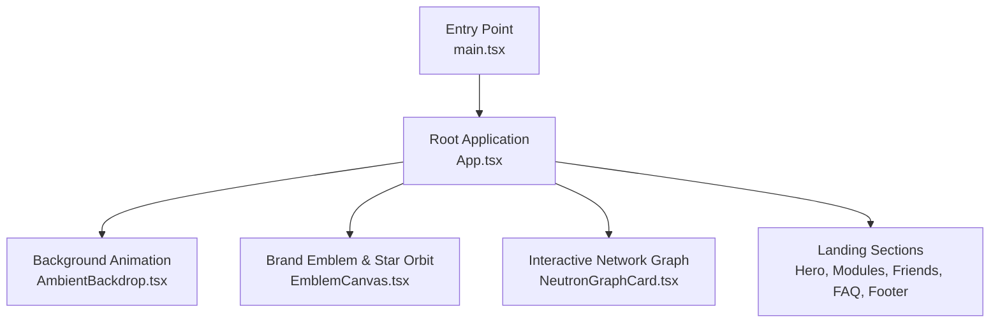
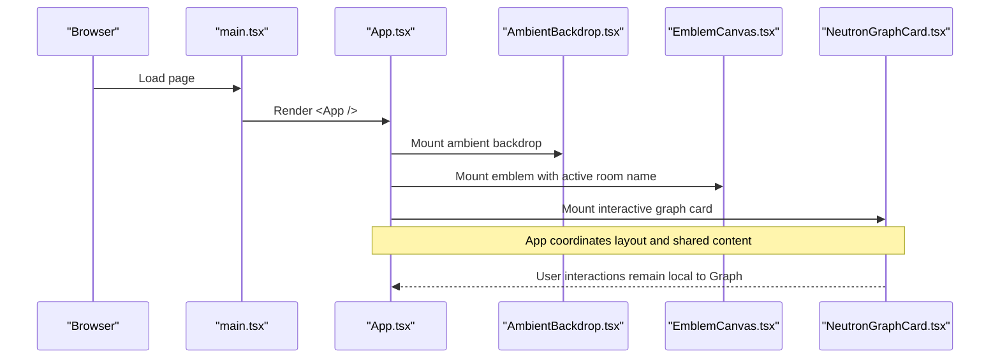
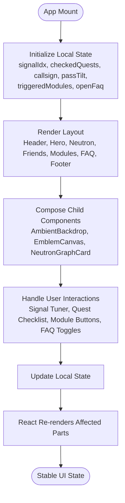
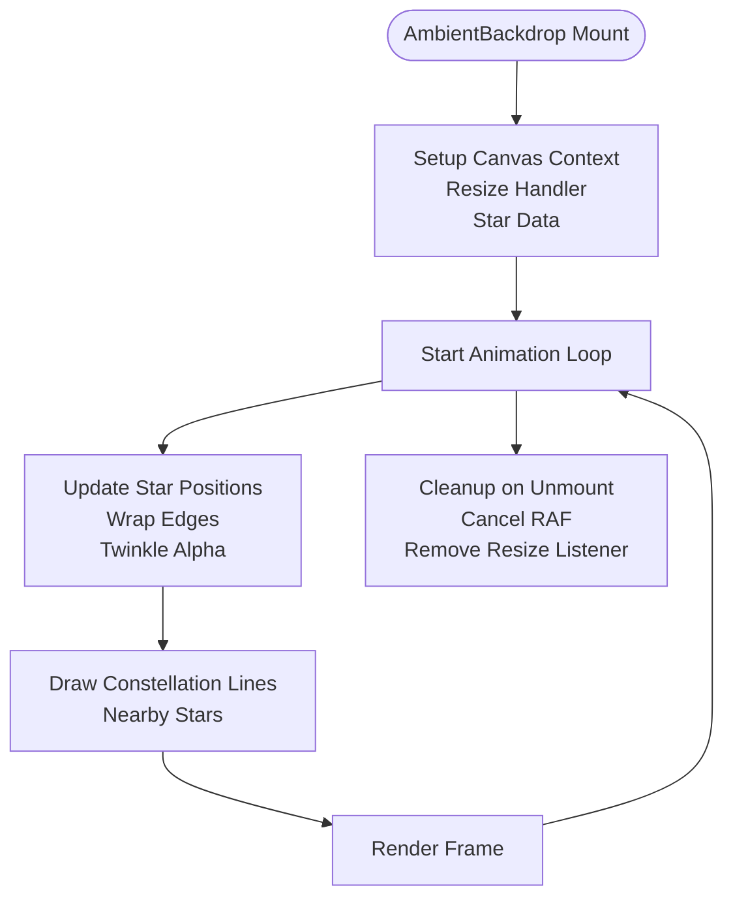
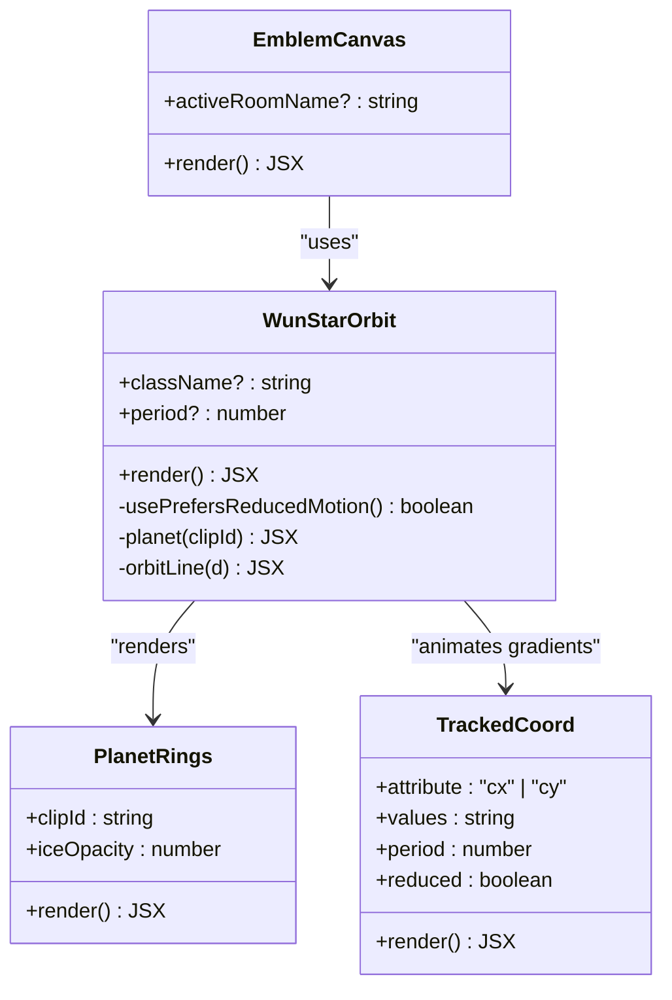
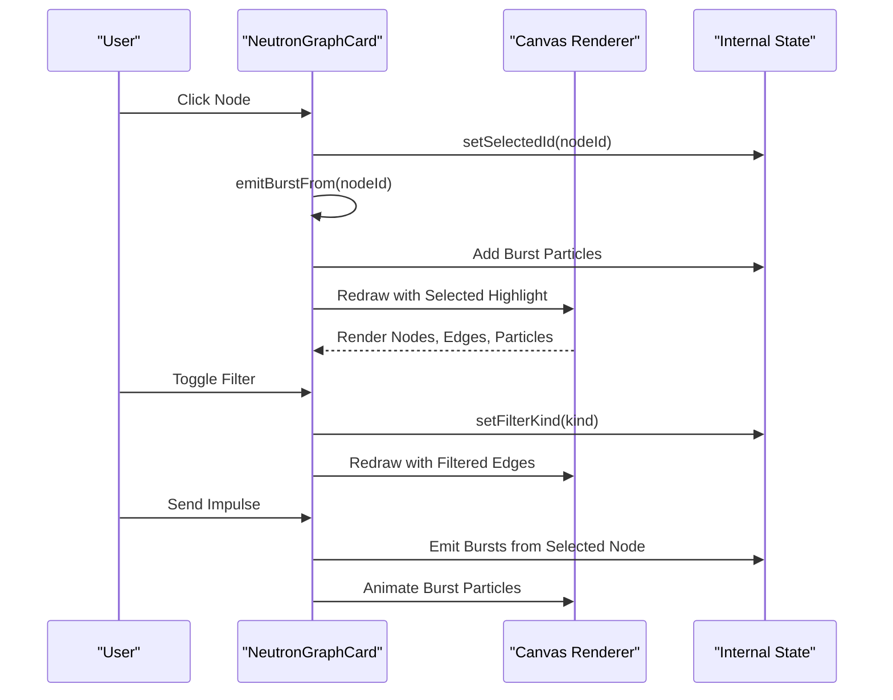
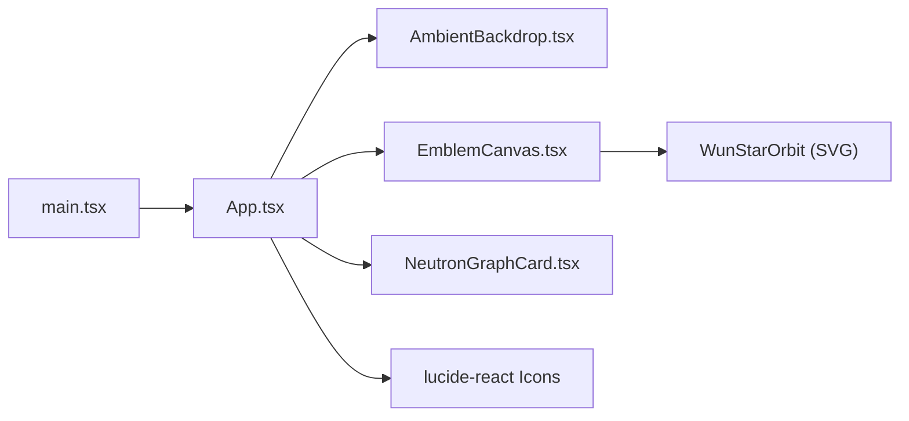

# Architecture Overview

<cite>
**Referenced Files in This Document**
- [main.tsx](file://src/main.tsx)
- [App.tsx](file://src/App.tsx)
- [AmbientBackdrop.tsx](file://src/AmbientBackdrop.tsx)
- [EmblemCanvas.tsx](file://src/EmblemCanvas.tsx)
- [NeutronGraphCard.tsx](file://src/NeutronGraphCard.tsx)
- [package.json](file://package.json)
</cite>

## Table of Contents
1. [Introduction](#introduction)
2. [Project Structure](#project-structure)
3. [Core Components](#core-components)
4. [Architecture Overview](#architecture-overview)
5. [Detailed Component Analysis](#detailed-component-analysis)
6. [Dependency Analysis](#dependency-analysis)
7. [Performance Considerations](#performance-considerations)
8. [Troubleshooting Guide](#troubleshooting-guide)
9. [Conclusion](#conclusion)

## Introduction
This document describes the architecture of the WUN Gazette application, focusing on its React-based component hierarchy, animation strategies using Canvas and SVG, state management patterns, and styling approach. The App component acts as the orchestrator for the landing page, composing visual and interactive sections while delegating specialized rendering to child components: AmbientBackdrop, EmblemCanvas, and NeutronGraphCard.

The application is a single-page showcase that communicates the WUN ecosystem through animated visuals, an interactive graph, and modular feature previews. It uses React 19 with Vite, TypeScript, Lucide icons, and optional Three.js types. Styling is centralized in a CSS file referenced by the entry point.

## Project Structure
At runtime, the application mounts the root React tree from `main.tsx`, which renders the `App` component under React Strict Mode. The `App` component composes the full landing experience, including navigation, hero section, Neutron Graph visualization, friend bonuses simulator, module cards, FAQ, and footer.

**Diagram sources**
- [main.tsx:6-9](file://src/main.tsx#L6-L9)
- [App.tsx:149-568](file://src/App.tsx#L149-L568)

**Section sources**
- [main.tsx:1-11](file://src/main.tsx#L1-L11)
- [package.json:1-26](file://package.json#L1-L26)

## Core Components
The application’s core components are:

- **App**: Orchestrates layout, shared data, user interactions, and composes child components. It manages local state for signal selection, friend quests, callsign input, passport tilt, triggered modules, and FAQ toggles.
- **AmbientBackdrop**: Renders a starfield background using the Canvas API with twinkling stars and subtle constellation lines.
- **EmblemCanvas**: Displays the brand emblem and reusable `WunStarOrbit` SVG illustration with animated rings, planet layers, and light effects.
- **NeutronGraphCard**: Implements an interactive network graph with Canvas-based nodes, edges, flowing particles, filtering, and click-to-burst animations.

These components separate concerns between business logic (state, interactions, data) and visual rendering (Canvas/SVG), keeping the UI responsive and maintainable.

**Section sources**
- [App.tsx:149-568](file://src/App.tsx#L149-L568)
- [AmbientBackdrop.tsx:13-101](file://src/AmbientBackdrop.tsx#L13-L101)
- [EmblemCanvas.tsx:128-377](file://src/EmblemCanvas.tsx#L128-L377)
- [NeutronGraphCard.tsx:87-396](file://src/NeutronGraphCard.tsx#L87-L396)

## Architecture Overview
The high-level architecture follows a unidirectional data flow pattern typical of React applications:

- The entry point mounts the root component.
- The `App` component holds most of the page state and passes props or callbacks to child components.
- Visual components (`AmbientBackdrop`, `EmblemCanvas`) render static or self-contained animations without requiring external state.
- Interactive components (`NeutronGraphCard`) manage their own internal state for rendering and user actions.

**Diagram sources**
- [main.tsx:6-9](file://src/main.tsx#L6-L9)
- [App.tsx:176-568](file://src/App.tsx#L176-L568)
- [AmbientBackdrop.tsx:13-101](file://src/AmbientBackdrop.tsx#L13-L101)
- [EmblemCanvas.tsx:333-377](file://src/EmblemCanvas.tsx#L333-L377)
- [NeutronGraphCard.tsx:87-396](file://src/NeutronGraphCard.tsx#L87-L396)

## Detailed Component Analysis

### App Component
The `App` component is the central orchestrator for the landing page. Responsibilities include:

- Managing local state for:
  - Signal tuner index
  - Friend quest checklist
  - Callsign input
  - Passport tilt angles
  - Triggered module states
  - Open FAQ item
- Rendering the top navigation, hero section, Neutron Graph section, friend bonuses section, modules deck, FAQ, and footer.
- Composing child components:
  - `AmbientBackdrop` for background animation
  - `EmblemCanvas` for the brand emblem and star orbit
  - `NeutronGraphCard` for the interactive network visualization

State management is primarily local via React hooks (`useState`). There is no global store; cross-component communication is minimal and mostly prop-driven or handled within individual components.

**Diagram sources**
- [App.tsx:149-175](file://src/App.tsx#L149-L175)
- [App.tsx:176-568](file://src/App.tsx#L176-L568)

**Section sources**
- [App.tsx:149-568](file://src/App.tsx#L149-L568)

### AmbientBackdrop Component
`AmbientBackdrop` provides a full-screen animated starfield background using the Canvas API. Key behaviors:

- Uses a `useRef` to access the canvas element.
- Initializes star positions, velocities, radii, alpha values, and phases.
- Handles window resize events to update canvas dimensions.
- Runs an animation loop with `requestAnimationFrame`:
  - Clears the canvas each frame.
  - Updates star positions and wraps them at screen edges.
  - Draws twinkling stars with varying alpha.
  - Draws subtle constellation lines between nearby stars.
- Cleans up animation frames and event listeners on unmount.

**Diagram sources**
- [AmbientBackdrop.tsx:16-91](file://src/AmbientBackdrop.tsx#L16-L91)

**Section sources**
- [AmbientBackdrop.tsx:1-102](file://src/AmbientBackdrop.tsx#L1-L102)

### EmblemCanvas and WunStarOrbit Components
`EmblemCanvas` renders the brand splash card containing decorative shapes, the wordmark, and the `WunStarOrbit` SVG illustration. `WunStarOrbit` is a reusable SVG component that draws:

- A tilted orbital ring with gradient strokes.
- A layered planet with atmospheric glow, cloud patterns, and starlight sheen.
- Animated motion along the orbit path.
- Reduced-motion support via a custom hook that checks `prefers-reduced-motion`.

Key implementation details:

- Constants define geometry, ring ratios, and lighting reach.
- Precomputed star-light vectors ensure the highlight stays on the star-facing side.
- SVG `<animateMotion>` and `<animateTransform>` drive continuous animations.
- Clip paths and gradients create depth and lighting effects.
- The component supports compact mode and accessibility attributes.

**Diagram sources**
- [EmblemCanvas.tsx:128-327](file://src/EmblemCanvas.tsx#L128-L327)
- [EmblemCanvas.tsx:76-107](file://src/EmblemCanvas.tsx#L76-L107)
- [EmblemCanvas.tsx:52-74](file://src/EmblemCanvas.tsx#L52-L74)
- [EmblemCanvas.tsx:333-377](file://src/EmblemCanvas.tsx#L333-L377)

**Section sources**
- [EmblemCanvas.tsx:1-378](file://src/EmblemCanvas.tsx#L1-L378)

### NeutronGraphCard Component
`NeutronGraphCard` implements an interactive network visualization representing the Neutron ecosystem. Responsibilities include:

- Defining node and edge data structures for system entities and citizen nodes.
- Managing local state for selected node, filter kind, and pulse count.
- Using a mutable state reference (`stateRef`) to hold animation-critical data such as node positions, particle list, dimensions, and current selections.
- Implementing a Canvas-based rendering loop:
  - Gentle breathing drift on nodes.
  - Curved edges with different styles based on filter and selection.
  - Flowing particles along edges, including burst effects triggered by user interaction.
  - Drawing system nodes with icons and citizen nodes with labels.
- Handling user interactions:
  - Click detection on nodes to select and emit bursts.
  - Filter pills to show specific stream kinds.
  - Pulse button to send impulses from the selected node.

**Diagram sources**
- [NeutronGraphCard.tsx:87-396](file://src/NeutronGraphCard.tsx#L87-L396)

**Section sources**
- [NeutronGraphCard.tsx:1-397](file://src/NeutronGraphCard.tsx#L1-L397)

## Dependency Analysis
The application has a clear dependency hierarchy:

- `main.tsx` depends on React DOM and imports `App`.
- `App.tsx` imports `AmbientBackdrop`, `EmblemCanvas`, and `NeutronGraphCard`.
- `EmblemCanvas.tsx` exports both `WunStarOrbit` and `EmblemCanvas`.
- External dependencies include React, ReactDOM, Lucide React icons, and optional Three.js types.

**Diagram sources**
- [main.tsx:1-4](file://src/main.tsx#L1-L4)
- [App.tsx:1-17](file://src/App.tsx#L1-L17)
- [EmblemCanvas.tsx:128-377](file://src/EmblemCanvas.tsx#L128-L377)
- [package.json:11-16](file://package.json#L11-L16)

**Section sources**
- [main.tsx:1-11](file://src/main.tsx#L1-L11)
- [App.tsx:1-17](file://src/App.tsx#L1-L17)
- [package.json:1-26](file://package.json#L1-L26)

## Performance Considerations
- **Canvas Animations**: Both `AmbientBackdrop` and `NeutronGraphCard` use `requestAnimationFrame` for smooth rendering. Ensure cleanup of animation frames and event listeners to prevent memory leaks.
- **Reduced Motion**: `EmblemCanvas` respects `prefers-reduced-motion` to disable animations for users who prefer reduced motion.
- **Resize Handling**: Both Canvas components handle resize events efficiently. `NeutronGraphCard` uses `ResizeObserver` for container changes.
- **State Management**: Local state in `App` keeps complexity manageable. Avoid lifting state unnecessarily to prevent re-renders across unrelated components.
- **Icon Caching**: `NeutronGraphCard` caches `Path2D` objects for icons to reduce repeated path creation overhead.

[No sources needed since this section provides general guidance]

## Troubleshooting Guide
Common issues and resolutions:

- **Canvas Not Rendering**:
  - Verify that the canvas element exists and the context is available.
  - Check for missing cleanup of animation frames and event listeners.
- **Animations Stuttering**:
  - Ensure `requestAnimationFrame` loops are properly cleaned up.
  - Reduce particle counts or simplify drawing operations if performance degrades.
- **Reduced Motion Not Applied**:
  - Confirm that `prefers-reduced-motion` media query is supported and correctly detected.
- **Node Click Detection Failing**:
  - Validate hit-testing logic against node radius and pointer coordinates.
  - Ensure canvas dimensions and device pixel ratio are correctly applied.

**Section sources**
- [AmbientBackdrop.tsx:16-91](file://src/AmbientBackdrop.tsx#L16-L91)
- [NeutronGraphCard.tsx:128-310](file://src/NeutronGraphCard.tsx#L128-L310)
- [EmblemCanvas.tsx:109-121](file://src/EmblemCanvas.tsx#L109-L121)

## Conclusion
The WUN Gazette application follows a clean React architecture with clear separation of concerns. The `App` component orchestrates the page layout and state, while specialized components handle visual and interactive responsibilities. Animations leverage both Canvas and SVG APIs, with careful attention to performance and accessibility. The result is a responsive, visually rich landing page that effectively communicates the WUN ecosystem.

[No sources needed since this section summarizes without analyzing specific files]