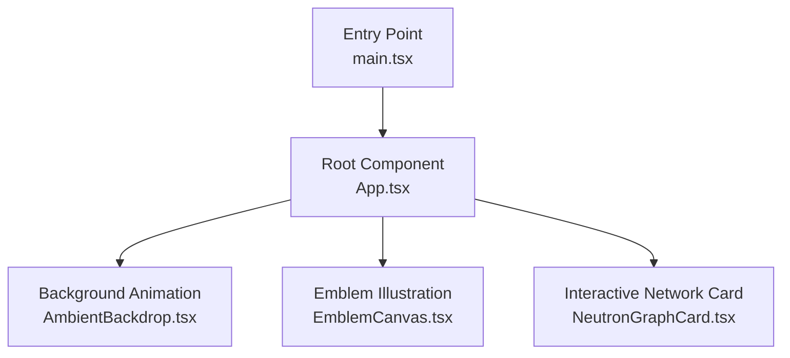
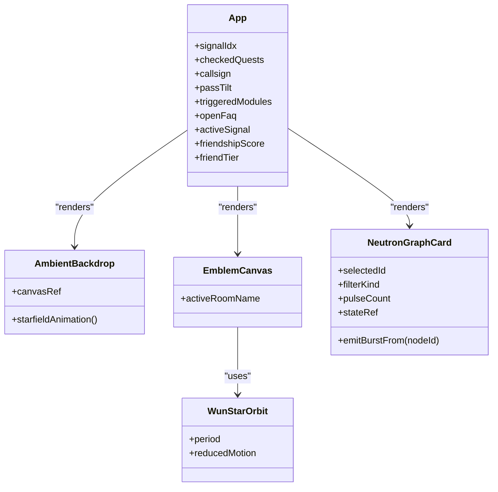
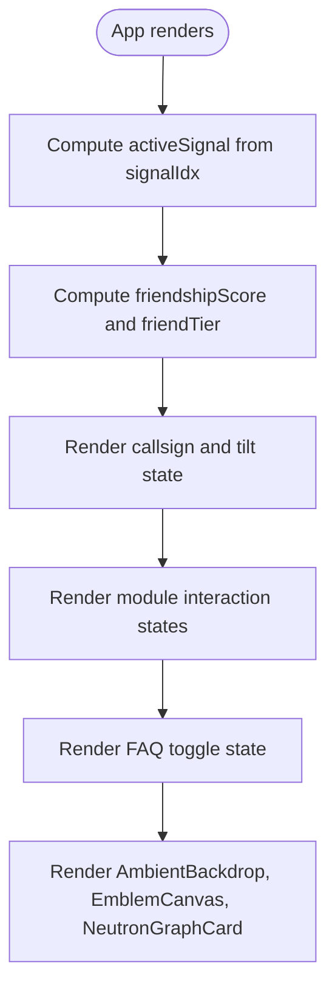
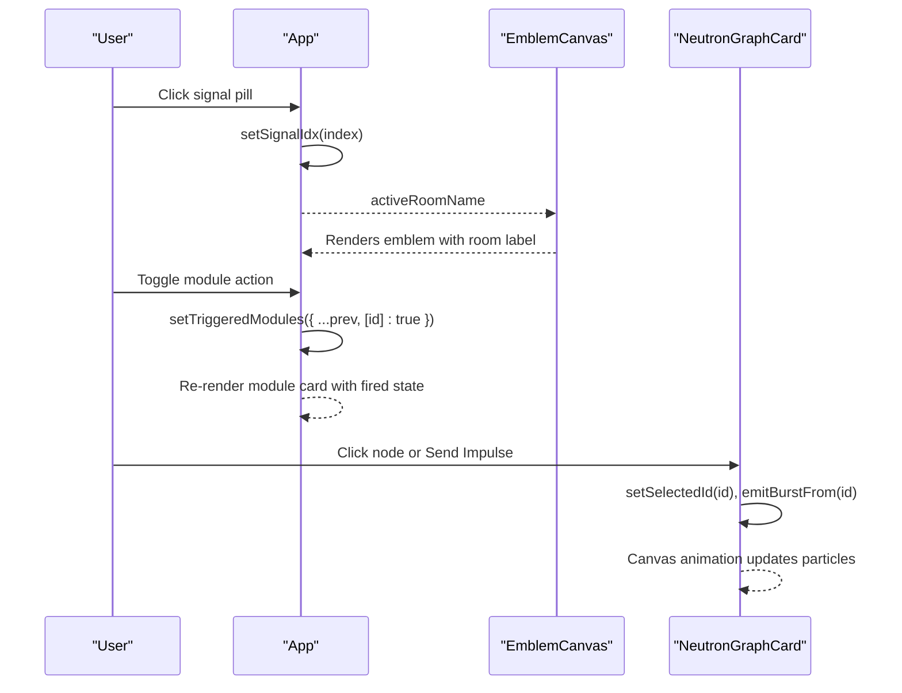
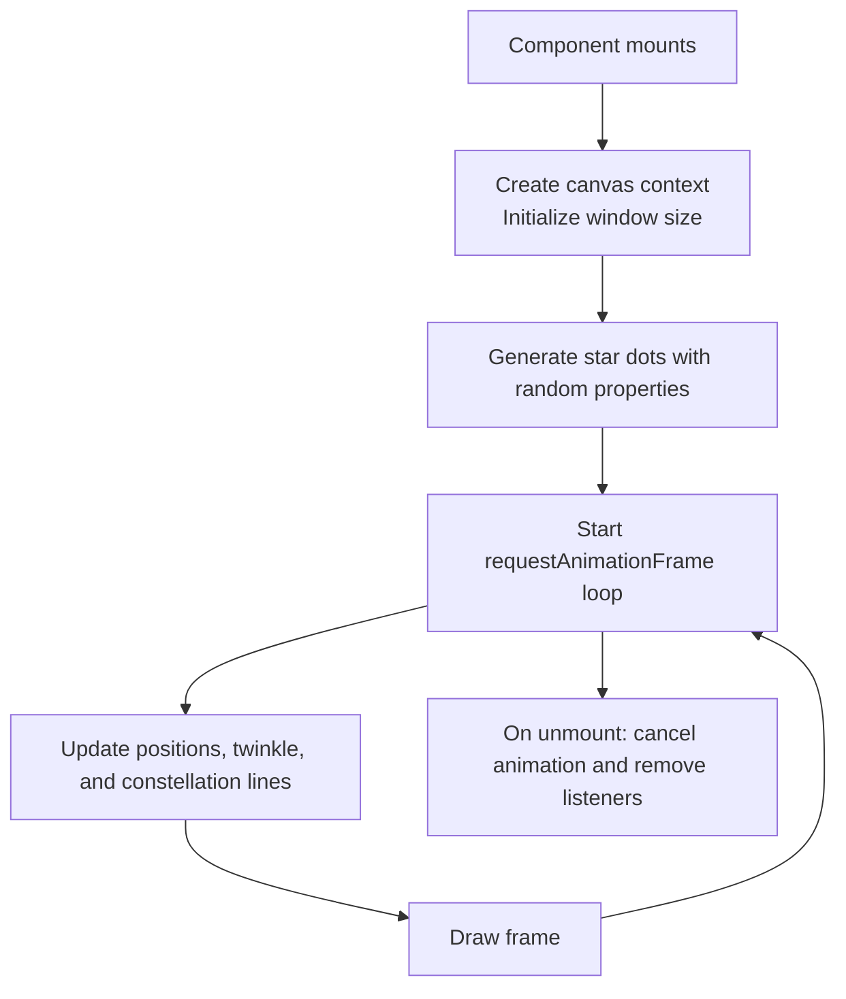
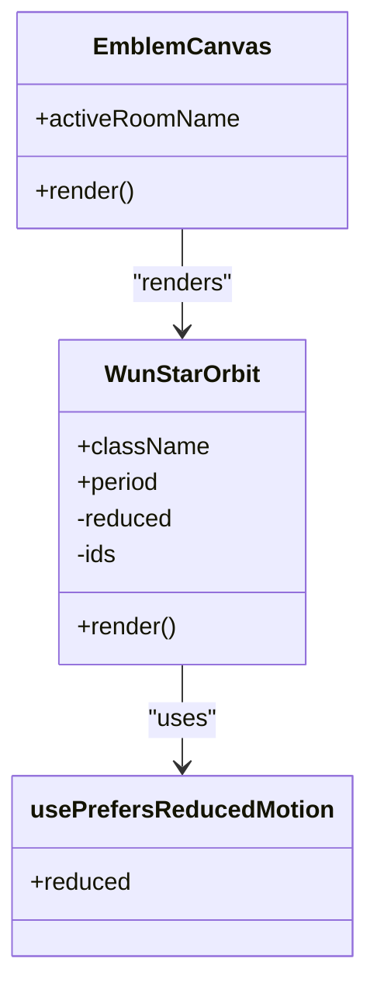
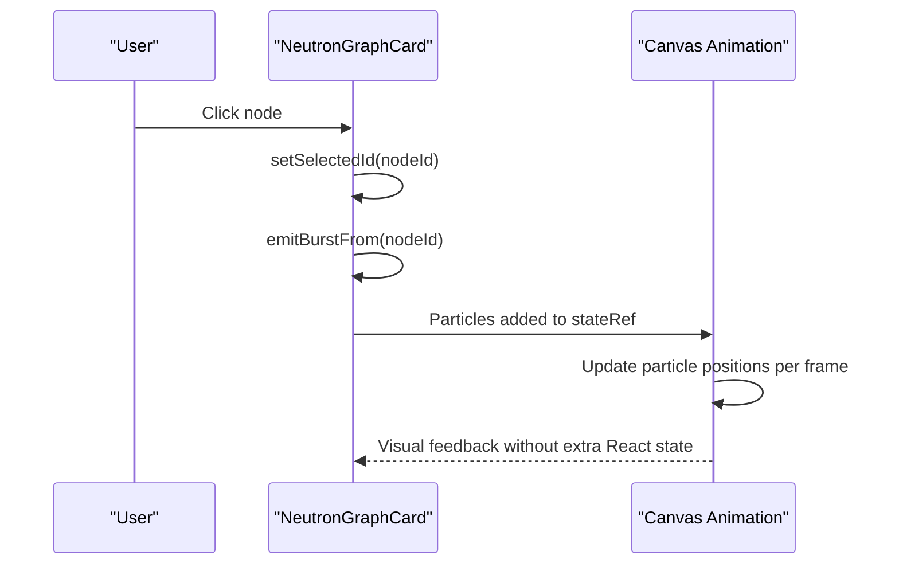
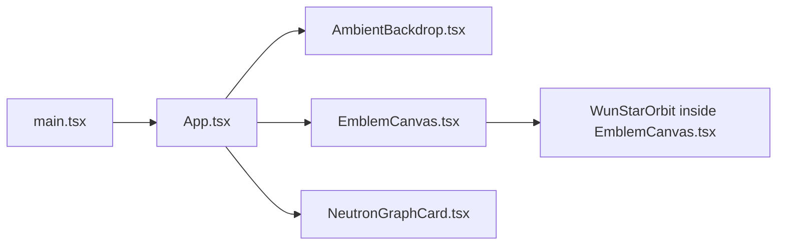

# Component Hierarchy & State Management

<cite>
**Referenced Files in This Document**
- [main.tsx](file://src/main.tsx)
- [App.tsx](file://src/App.tsx)
- [AmbientBackdrop.tsx](file://src/AmbientBackdrop.tsx)
- [EmblemCanvas.tsx](file://src/EmblemCanvas.tsx)
- [NeutronGraphCard.tsx](file://src/NeutronGraphCard.tsx)
</cite>

## Table of Contents
1. [Introduction](#introduction)
2. [Project Structure](#project-structure)
3. [Core Components](#core-components)
4. [Architecture Overview](#architecture-overview)
5. [Detailed Component Analysis](#detailed-component-analysis)
6. [Dependency Analysis](#dependency-analysis)
7. [Performance Considerations](#performance-considerations)
8. [Troubleshooting Guide](#troubleshooting-guide)
9. [Conclusion](#conclusion)

## Introduction
This document explains the WUN Gazette component hierarchy and state management architecture with a focus on how the App component orchestrates global UI state, how child components receive props, and how animation-heavy components keep their internal state separate from React UI state.

The key ideas are:
- App is the root orchestrator for signal selection, friend quests, callsign customization, module interactions, and FAQ toggles.
- AmbientBackdrop, EmblemCanvas, and NeutronGraphCard are presentation-focused components that manage their own animation state.
- Shared data such as activeSignal and triggeredModules lives in App and is passed down through props or computed locally.
- useState hooks are used for declarative UI state, while refs and requestAnimationFrame loops handle animation performance.

## Project Structure
At runtime, the application mounts into the DOM through the entry file, which renders the App component inside React Strict Mode. App then composes the visual sections and delegates animation work to specialized components.

**Diagram sources**
- [main.tsx:6-9](file://src/main.tsx#L6-L9)
- [App.tsx:149-178](file://src/App.tsx#L149-L178)
- [AmbientBackdrop.tsx:13-100](file://src/AmbientBackdrop.tsx#L13-L100)
- [EmblemCanvas.tsx:333-377](file://src/EmblemCanvas.tsx#L333-L377)
- [NeutronGraphCard.tsx:87-396](file://src/NeutronGraphCard.tsx#L87-L396)

**Section sources**
- [main.tsx:1-11](file://src/main.tsx#L1-L11)
- [App.tsx:149-178](file://src/App.tsx#L149-L178)

## Core Components
The core components form a small but expressive hierarchy:

- App: Root orchestrator. Holds global UI state and composes sections.
- AmbientBackdrop: Background starfield and aurora effect. Owns its animation loop.
- EmblemCanvas: Static illustration wrapper around WunStarOrbit. Mostly presentational.
- NeutronGraphCard: Interactive canvas-based graph with local animation state.

**Diagram sources**
- [App.tsx:149-178](file://src/App.tsx#L149-L178)
- [AmbientBackdrop.tsx:13-100](file://src/AmbientBackdrop.tsx#L13-L100)
- [EmblemCanvas.tsx:123-327](file://src/EmblemCanvas.tsx#L123-L327)
- [EmblemCanvas.tsx:333-377](file://src/EmblemCanvas.tsx#L333-L377)
- [NeutronGraphCard.tsx:87-396](file://src/NeutronGraphCard.tsx#L87-L396)

**Section sources**
- [App.tsx:149-178](file://src/App.tsx#L149-L178)
- [AmbientBackdrop.tsx:13-100](file://src/AmbientBackdrop.tsx#L13-L100)
- [EmblemCanvas.tsx:123-327](file://src/EmblemCanvas.tsx#L123-L327)
- [NeutronGraphCard.tsx:87-396](file://src/NeutronGraphCard.tsx#L87-L396)

## Architecture Overview
App manages several independent concerns:

| Concern | State Location | How It Is Used |
|---|---|---|
| Signal selection | `signalIdx` in App | Computes `activeSignal`, drives hero spotlighter and emblem room label |
| Friend quests | `checkedQuests` in App | Calculates `friendshipScore`, `friendTier`, and unlocks perks |
| Callsign customization | `callsign` in App | Displays user-selected name on the passport preview |
| Passport tilt animation | `passTilt` in App | Controls CSS transform based on pointer movement |
| Module interactions | `triggeredModules` in App | Tracks which module cards have been fired |
| FAQ toggles | `openFaq` in App | Controls single-open accordion behavior |

**Diagram sources**
- [App.tsx:149-178](file://src/App.tsx#L149-L178)
- [App.tsx:246-288](file://src/App.tsx#L246-L288)
- [App.tsx:310-437](file://src/App.tsx#L310-L437)
- [App.tsx:440-487](file://src/App.tsx#L440-L487)
- [App.tsx:489-519](file://src/App.tsx#L489-L519)

## Detailed Component Analysis

### App: Root Orchestrator and Global UI State
App owns the primary UI state for the page. It does not perform heavy animation itself; instead, it computes derived values and passes minimal props to child components.

Key responsibilities:
- Signal tuner: `signalIdx` controls which signal is active. The current signal object is computed as `activeSignal`.
- Friend bonuses: `checkedQuests` tracks completed actions. `friendshipScore` and `friendTier` are derived from quest points.
- Callsign input: `callsign` is bound to an input field and displayed in the passport preview.
- Passport tilt: `passTilt` stores rotation angles updated by pointer events.
- Module deck: `triggeredModules` records which modules have been simulated.
- FAQ accordion: `openFaq` holds the index of the currently open question.

State lifting pattern examples:
- Active signal: App computes `activeSignal` from `HERO_SIGNALS[signalIdx]` and passes `activeRoomName` to EmblemCanvas.
- Triggered modules: Each module card reads `fired = !!triggeredModules[m.id]` and updates the shared record through `setTriggeredModules`.

useState usage patterns:
- Numeric index state for tabs and accordions.
- Record state for boolean flags keyed by stable identifiers.
- Object state for lightweight transforms like `{ rx, ry }`.
- Derived values computed during render rather than stored in additional state.

**Diagram sources**
- [App.tsx:246-288](file://src/App.tsx#L246-L288)
- [App.tsx:440-487](file://src/App.tsx#L440-L487)
- [NeutronGraphCard.tsx:87-126](file://src/NeutronGraphCard.tsx#L87-L126)
- [NeutronGraphCard.tsx:346-391](file://src/NeutronGraphCard.tsx#L346-L391)

**Section sources**
- [App.tsx:149-178](file://src/App.tsx#L149-L178)
- [App.tsx:246-288](file://src/App.tsx#L246-L288)
- [App.tsx:310-437](file://src/App.tsx#L310-L437)
- [App.tsx:440-487](file://src/App.tsx#L440-L487)
- [App.tsx:489-519](file://src/App.tsx#L489-L519)

### AmbientBackdrop: Independent Animation Component
AmbientBackdrop is self-contained. It creates a canvas, initializes stars, runs a `requestAnimationFrame` loop, handles resize events, and cleans up on unmount. It has no dependency on App’s state.

Design characteristics:
- Uses `useRef` for the canvas element.
- Uses `useEffect` for lifecycle setup and cleanup.
- Stores animation variables in local scope so they do not cause re-renders.
- Renders decorative SVG/CSS orbs plus the animated starfield canvas.

**Diagram sources**
- [AmbientBackdrop.tsx:16-91](file://src/AmbientBackdrop.tsx#L16-L91)

**Section sources**
- [AmbientBackdrop.tsx:1-102](file://src/AmbientBackdrop.tsx#L1-L102)

### EmblemCanvas and WunStarOrbit: Presentational Illustration Layer
EmblemCanvas is a presentational wrapper that displays the WUN brand mark and wordmark. It receives `activeRoomName` from App but does not mutate it. The actual animated illustration is implemented by `WunStarOrbit`.

Important behaviors:
- `WunStarOrbit` uses a custom hook to detect reduced motion preferences.
- It generates unique IDs for SVG gradients, clips, and filters.
- It renders orbit paths, planet layers, star geometry, and animated gradients.
- It respects accessibility and prefers-reduced-motion settings.

**Diagram sources**
- [EmblemCanvas.tsx:329-377](file://src/EmblemCanvas.tsx#L329-L377)
- [EmblemCanvas.tsx:109-121](file://src/EmblemCanvas.tsx#L109-L121)
- [EmblemCanvas.tsx:123-327](file://src/EmblemCanvas.tsx#L123-L327)

**Section sources**
- [EmblemCanvas.tsx:109-121](file://src/EmblemCanvas.tsx#L109-L121)
- [EmblemCanvas.tsx:123-327](file://src/EmblemCanvas.tsx#L123-L327)
- [EmblemCanvas.tsx:329-377](file://src/EmblemCanvas.tsx#L329-L377)

### NeutronGraphCard: Local Animation State and Interaction
NeutronGraphCard demonstrates a clean separation between React UI state and animation state:

- React state: `selectedId`, `filterKind`, `pulseCount`.
- Animation state: nodes, particles, dimensions, timing, and drawing logic kept in `stateRef`.
- Effects: sync selected ID and filter kind into the ref; initialize canvas, resize observer, and animation loop.
- Interactions: click-to-select nodes, filter pills, and impulse button.

**Diagram sources**
- [NeutronGraphCard.tsx:87-126](file://src/NeutronGraphCard.tsx#L87-L126)
- [NeutronGraphCard.tsx:128-310](file://src/NeutronGraphCard.tsx#L128-L310)
- [NeutronGraphCard.tsx:357-391](file://src/NeutronGraphCard.tsx#L357-L391)

**Section sources**
- [NeutronGraphCard.tsx:1-397](file://src/NeutronGraphCard.tsx#L1-L397)

## Dependency Analysis
The dependency relationships are intentionally shallow:

- main.tsx depends only on App and styles.
- App imports three components and icon libraries.
- EmblemCanvas exports both a reusable orbit symbol and a splash wrapper.
- AmbientBackdrop and NeutronGraphCard are independent of App’s state.

**Diagram sources**
- [main.tsx:1-11](file://src/main.tsx#L1-L11)
- [App.tsx:1-17](file://src/App.tsx#L1-L17)
- [EmblemCanvas.tsx:123-327](file://src/EmblemCanvas.tsx#L123-L327)

**Section sources**
- [main.tsx:1-11](file://src/main.tsx#L1-L11)
- [App.tsx:1-17](file://src/App.tsx#L1-L17)

## Performance Considerations
- Prefer refs for frequently updated animation data. NeutronGraphCard stores mutable simulation state in `stateRef` to avoid unnecessary React re-renders.
- Keep animation loops in effects and cancel them on cleanup. Both AmbientBackdrop and NeutronGraphCard cancel `requestAnimationFrame` and observers.
- Use derived values during render instead of duplicating state. App computes `activeSignal`, `friendshipScore`, and `friendTier` directly from source state.
- Respect reduced motion. EmblemCanvas disables animations when the user prefers reduced motion.
- Avoid expensive computations inside tight loops. Icon paths are cached in `Path2D` where available.

[No sources needed since this section provides general guidance]

## Troubleshooting Guide
Common issues and where to look:

| Symptom | Likely Cause | Where to Inspect |
|---|---|---|
| Background stars stop animating after navigation or mount/unmount | Missing cleanup of animation frame or event listener | AmbientBackdrop effect cleanup |
| Graph particles disappear or never appear | Particle list not seeded or filtered incorrectly | NeutronGraphCard initialization and filtering logic |
| Selected node does not highlight | `selectedId` not synced into animation ref | NeutronGraphCard effect syncing selected state |
| Emblem animations feel janky on low-power devices | Animations not respecting reduced motion preference | EmblemCanvas reduced motion hook |
| Passport tilt resets unexpectedly | Pointer event handlers clearing tilt on leave | App passport tilt handlers |

**Section sources**
- [AmbientBackdrop.tsx:87-91](file://src/AmbientBackdrop.tsx#L87-L91)
- [NeutronGraphCard.tsx:128-310](file://src/NeutronGraphCard.tsx#L128-L310)
- [EmblemCanvas.tsx:109-121](file://src/EmblemCanvas.tsx#L109-L121)
- [App.tsx:365-378](file://src/App.tsx#L365-L378)

## Conclusion
The WUN Gazette architecture follows a clear separation of concerns:
- App is the single source of truth for UI state and composes the page.
- Child components are focused on rendering and animation.
- Animation-heavy components keep mutable simulation state out of React state.
- Props flow downward, while user interactions update state at the appropriate level.

This design keeps the codebase readable, testable, and performant while supporting interactive storytelling features like signal tuning, friend bonus simulation, module demos, and live network visualization.

[No sources needed since this section summarizes without analyzing specific files]