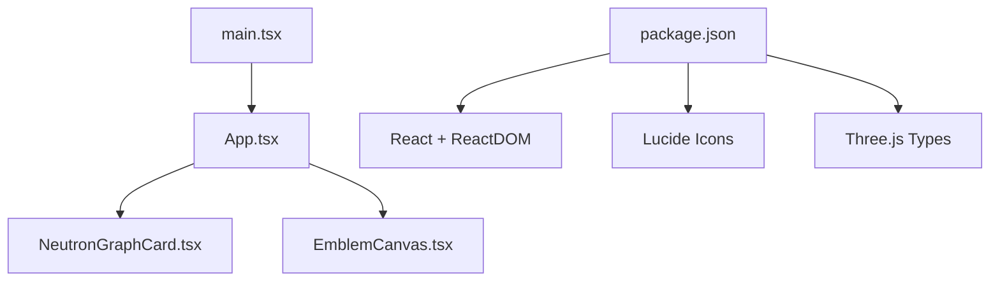
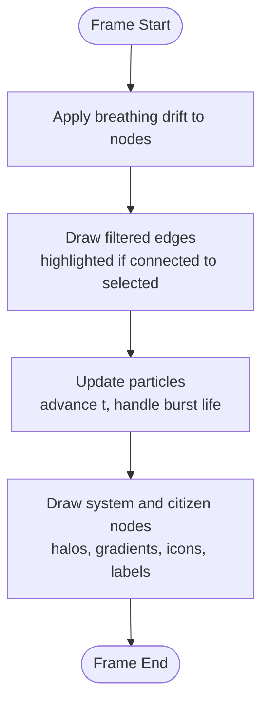
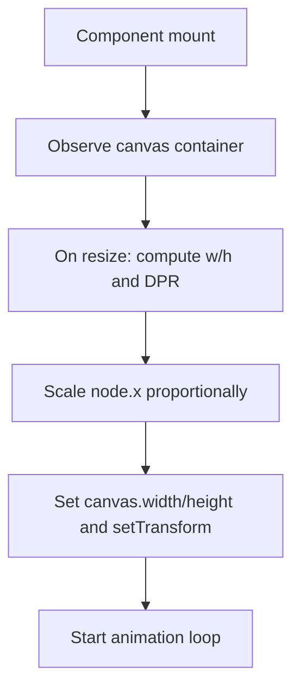
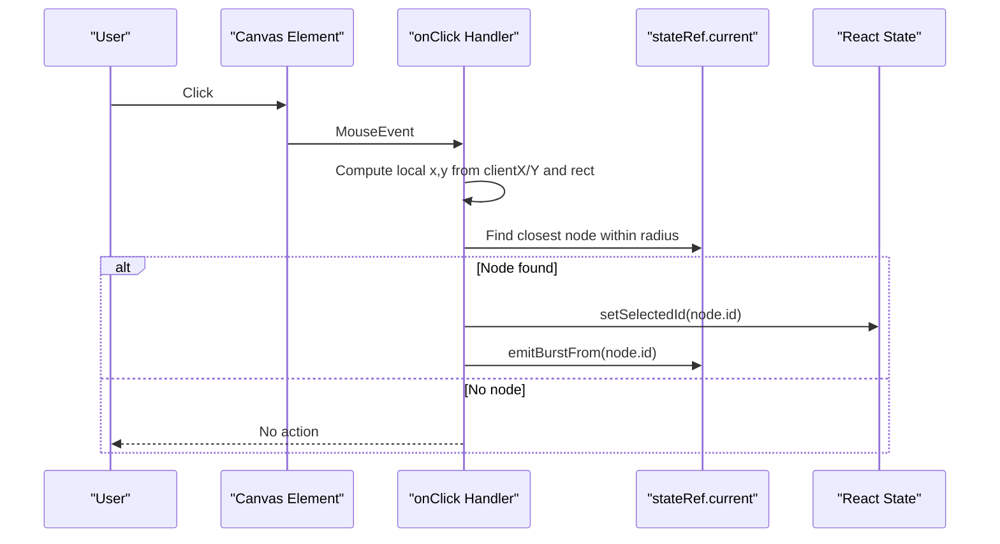
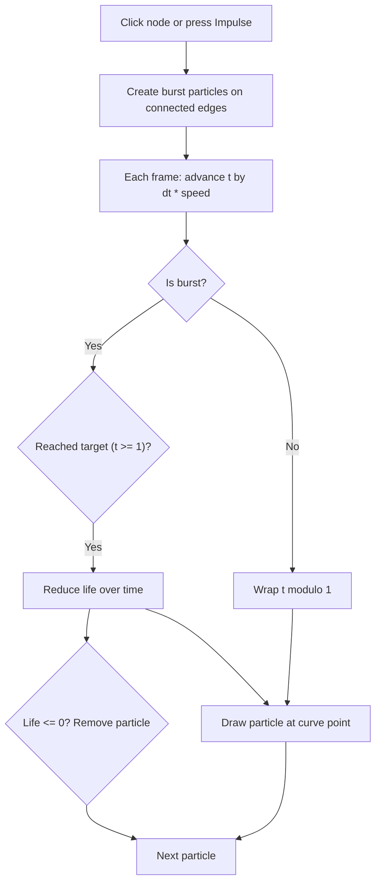
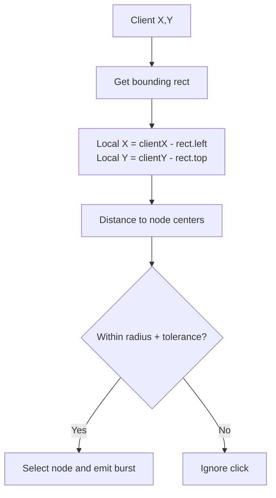
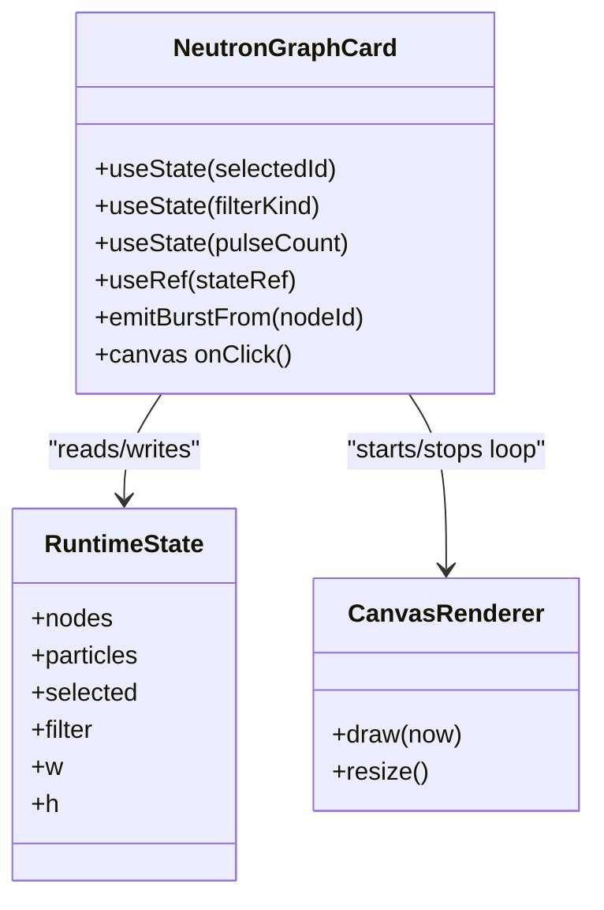
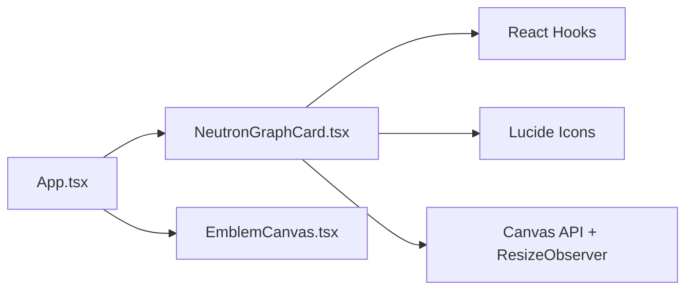

# Interactive Visualizations & User Input

<cite>
**Referenced Files in This Document**   
- [NeutronGraphCard.tsx](file://src/NeutronGraphCard.tsx)
- [App.tsx](file://src/App.tsx)
- [EmblemCanvas.tsx](file://src/EmblemCanvas.tsx)
- [main.tsx](file://src/main.tsx)
- [package.json](file://package.json)
</cite>

## Table of Contents
1. [Introduction](#introduction)
2. [Project Structure](#project-structure)
3. [Core Components](#core-components)
4. [Architecture Overview](#architecture-overview)
5. [Detailed Component Analysis](#detailed-component-analysis)
6. [Dependency Analysis](#dependency-analysis)
7. [Performance Considerations](#performance-considerations)
8. [Troubleshooting Guide](#troubleshooting-guide)
9. [Conclusion](#conclusion)

## Introduction
This document explains the interactive visualization components with a focus on the Neutron Graph Card. It covers canvas-based network graph rendering, node interaction handling, pulse animation effects, event delegation for mouse and touch input, coordinate transformation calculations, real-time updates, state synchronization between visual elements and application logic, performance considerations for interactive graphics, and responsive design patterns for visualization components.

The project is a React-based site that renders an animated emblem, a live network graph card, and several interactive UI sections. The Neutron Graph Card is implemented as a self-contained React component that owns its own canvas, animation loop, and user interaction handlers.

## Project Structure
At a high level:
- `main.tsx` mounts the React application.
- `App.tsx` composes the page layout and includes the Neutron Graph Card and other interactive sections.
- `NeutronGraphCard.tsx` implements the canvas-based network graph with animations and interactions.
- `EmblemCanvas.tsx` provides SVG-based animated branding visuals.
- `package.json` declares dependencies such as React, ReactDOM, Three.js types, and Lucide icons.



**Diagram sources**
- [main.tsx:1-11](file://src/main.tsx#L1-L11)
- [App.tsx:1-20](file://src/App.tsx#L1-L20)
- [NeutronGraphCard.tsx:1-10](file://src/NeutronGraphCard.tsx#L1-L10)
- [EmblemCanvas.tsx:1-10](file://src/EmblemCanvas.tsx#L1-L10)
- [package.json:11-17](file://package.json#L11-L17)

**Section sources**
- [main.tsx:1-11](file://src/main.tsx#L1-L11)
- [App.tsx:1-20](file://src/App.tsx#L1-L20)
- [package.json:1-26](file://package.json#L1-L26)

## Core Components
- **NeutronGraphCard**: A React component that renders a canvas-based network graph. It manages:
  - Node and edge data structures.
  - Continuous ambient particles flowing along edges.
  - Pulse bursts triggered by user actions.
  - Selection state for nodes.
  - Filter controls for stream kinds.
  - Canvas resizing and device pixel ratio handling.
  - An animation loop using `requestAnimationFrame`.

- **App**: The top-level page component that:
  - Renders the Neutron Graph Card inside a section.
  - Provides navigation and contextual copy describing how to interact with the graph.
  - Composes other interactive sections like the emblem and module demos.

- **EmblemCanvas**: An SVG-based animated emblem used in the hero area. It demonstrates motion-aware animations and reduced-motion support.

**Section sources**
- [NeutronGraphCard.tsx:1-120](file://src/NeutronGraphCard.tsx#L1-L120)
- [App.tsx:292-308](file://src/App.tsx#L292-L308)
- [EmblemCanvas.tsx:109-121](file://src/EmblemCanvas.tsx#L109-L121)

## Architecture Overview
The Neutron Graph Card follows a clear separation between:
- Declarative React state (`selectedId`, `filterKind`, `pulseCount`) for UI controls.
- A mutable runtime state object (`stateRef.current`) holding nodes, particles, selection, filter, and canvas dimensions.
- A persistent animation loop that reads from the runtime state and draws to the canvas.
- Event handlers that update both React state (for UI) and runtime state (for rendering).

```mermaid
sequenceDiagram
participant User as "User"
participant UI as "React Controls"
participant State as "stateRef.current"
participant Canvas as "Canvas Renderer"
participant Loop as "Animation Loop"
User->>UI : Click node or filter pill
UI->>State : Update selected/filter/particles
UI-->>User : Re-render control highlights
Loop->>Canvas : Clear rect
Loop->>Canvas : Draw edges (filtered, highlighted)
Loop->>Canvas : Update and draw particles
Loop->>Canvas : Draw nodes and labels
Note over Canvas,Loop : Runs every frame via requestAnimationFrame
```

**Diagram sources**
- [NeutronGraphCard.tsx:181-302](file://src/NeutronGraphCard.tsx#L181-L302)
- [NeutronGraphCard.tsx:312-396](file://src/NeutronGraphCard.tsx#L312-L396)

## Detailed Component Analysis

### Neutron Graph Card: Data Model and Rendering Pipeline
The component defines typed data models for nodes, edges, and pulse particles. Nodes carry position, velocity, radius, icon, label, and system flag. Edges connect node indices and include weight and kind. Particles track their edge index, progress along the curve, speed, and optional burst lifecycle.

Rendering pipeline:
- Initialize ambient particles seeded across all edges.
- On each frame:
  - Apply gentle breathing drift to node positions.
  - Draw curved edges based on filter and selection.
  - Update particle positions along quadratic curves; handle burst fade-out.
  - Draw system nodes with gradient fills and icons, and citizen nodes with simple circles.
  - Draw labels below nodes.



**Diagram sources**
- [NeutronGraphCard.tsx:181-302](file://src/NeutronGraphCard.tsx#L181-L302)

**Section sources**
- [NeutronGraphCard.tsx:6-31](file://src/NeutronGraphCard.tsx#L6-L31)
- [NeutronGraphCard.tsx:41-73](file://src/NeutronGraphCard.tsx#L41-L73)
- [NeutronGraphCard.tsx:181-302](file://src/NeutronGraphCard.tsx#L181-L302)

### Canvas Setup, Resize Handling, and Device Pixel Ratio
The component sets up the canvas context once and resizes it when the container changes:
- Uses `ResizeObserver` to detect size changes.
- Computes device pixel ratio and scales the canvas accordingly.
- Scales node x-coordinates proportionally when width changes.
- Applies a transform to the 2D context to account for DPR.



**Diagram sources**
- [NeutronGraphCard.tsx:155-172](file://src/NeutronGraphCard.tsx#L155-L172)

**Section sources**
- [NeutronGraphCard.tsx:155-172](file://src/NeutronGraphCard.tsx#L155-L172)

### Interaction Handling and Event Delegation
Interaction occurs through two primary mechanisms:
- Canvas click handler:
  - Calculates client coordinates relative to the canvas bounding rectangle.
  - Finds the nearest node within a hit radius.
  - Updates selected node and emits a pulse burst from that node.
- Control buttons:
  - Filter pills update the active filter kind.
  - Impulse button emits a burst from the currently selected node.

Coordinate transformation:
- Client coordinates are converted to canvas-local coordinates by subtracting the bounding rectangle’s left/top offsets.
- Hit testing uses Euclidean distance against node radius plus a tolerance.



**Diagram sources**
- [NeutronGraphCard.tsx:361-372](file://src/NeutronGraphCard.tsx#L361-L372)
- [NeutronGraphCard.tsx:110-126](file://src/NeutronGraphCard.tsx#L110-L126)

**Section sources**
- [NeutronGraphCard.tsx:361-372](file://src/NeutronGraphCard.tsx#L361-L372)
- [NeutronGraphCard.tsx:325-354](file://src/NeutronGraphCard.tsx#L325-L354)

### Pulse Animation Effects and Particle Lifecycle
Pulse bursts are created when a node is clicked or the impulse button is pressed:
- For each edge connected to the source node, a particle is added with initial progress `t = 0`, random speed, and burst flag.
- During animation:
  - Ambient particles continuously advance along edges.
  - Burst particles transition from traveling to fading out after reaching the target.
  - Each frame updates particle position along the quadratic curve and adjusts alpha for burst glow.



**Diagram sources**
- [NeutronGraphCard.tsx:110-126](file://src/NeutronGraphCard.tsx#L110-L126)
- [NeutronGraphCard.tsx:218-252](file://src/NeutronGraphCard.tsx#L218-L252)

**Section sources**
- [NeutronGraphCard.tsx:110-126](file://src/NeutronGraphCard.tsx#L110-L126)
- [NeutronGraphCard.tsx:218-252](file://src/NeutronGraphCard.tsx#L218-L252)

### Coordinate Transformation Calculations
Key transformations:
- Local coordinate calculation:
  - Subtract canvas bounding rectangle offsets from client coordinates to get local x/y.
- Curve sampling:
  - Quadratic Bezier points computed from node endpoints and a perpendicular offset controlled by a bend factor.
  - Used for drawing edges and positioning particles along edges.
- DPR scaling:
  - Canvas width/height multiplied by DPR; context transformed to ensure drawing commands use CSS pixels.



**Diagram sources**
- [NeutronGraphCard.tsx:361-372](file://src/NeutronGraphCard.tsx#L361-L372)
- [NeutronGraphCard.tsx:75-85](file://src/NeutronGraphCard.tsx#L75-L85)
- [NeutronGraphCard.tsx:155-172](file://src/NeutronGraphCard.tsx#L155-L172)

**Section sources**
- [NeutronGraphCard.tsx:75-85](file://src/NeutronGraphCard.tsx#L75-L85)
- [NeutronGraphCard.tsx:155-172](file://src/NeutronGraphCard.tsx#L155-L172)
- [NeutronGraphCard.tsx:361-372](file://src/NeutronGraphCard.tsx#L361-L372)

### Real-Time Updates and State Synchronization
Synchronization strategy:
- React state drives UI controls and highlights.
- A ref-backed runtime state holds mutable simulation data (nodes, particles, selection, filter, dimensions).
- Effects sync React state into the runtime state so the animation loop always reads current values.
- Drawing functions read directly from runtime state without causing re-renders.



**Diagram sources**
- [NeutronGraphCard.tsx:87-108](file://src/NeutronGraphCard.tsx#L87-L108)
- [NeutronGraphCard.tsx:181-302](file://src/NeutronGraphCard.tsx#L181-L302)

**Section sources**
- [NeutronGraphCard.tsx:87-108](file://src/NeutronGraphCard.tsx#L87-L108)
- [NeutronGraphCard.tsx:181-302](file://src/NeutronGraphCard.tsx#L181-L302)

### Touch Device Compatibility and Responsive Design
Touch compatibility:
- The canvas click handler uses standard pointer events which work for both mouse and touch inputs.
- Hit testing uses a generous radius tolerance to accommodate less precise touch targets.

Responsive behavior:
- `ResizeObserver` adapts the canvas to container width changes.
- Node positions scale proportionally when width changes.
- DPR-aware canvas sizing ensures crisp rendering on high-density displays.

Accessibility and reduced motion:
- While the graph does not explicitly check reduced motion, the broader application includes a reduced-motion hook in the emblem component, demonstrating best practices for motion-sensitive users.

**Section sources**
- [NeutronGraphCard.tsx:155-172](file://src/NeutronGraphCard.tsx#L155-L172)
- [NeutronGraphCard.tsx:361-372](file://src/NeutronGraphCard.tsx#L361-L372)
- [EmblemCanvas.tsx:109-121](file://src/EmblemCanvas.tsx#L109-L121)

## Dependency Analysis
The Neutron Graph Card depends on:
- React hooks for state and refs.
- Lucide icons for UI badges and buttons.
- Browser APIs: `requestAnimationFrame`, `ResizeObserver`, `Path2D`, `getBoundingClientRect`.

The App component imports and renders the Neutron Graph Card alongside other components.



**Diagram sources**
- [App.tsx:15-17](file://src/App.tsx#L15-L17)
- [NeutronGraphCard.tsx:1-3](file://src/NeutronGraphCard.tsx#L1-L3)

**Section sources**
- [App.tsx:15-17](file://src/App.tsx#L15-L17)
- [NeutronGraphCard.tsx:1-3](file://src/NeutronGraphCard.tsx#L1-L3)

## Performance Considerations
- Animation loop:
  - Uses `requestAnimationFrame` with delta time capped to avoid large jumps.
  - Avoids React state updates inside the loop; only reads from runtime state.
- Drawing optimizations:
  - Clears canvas each frame.
  - Filters edges before drawing based on active filter.
  - Caches icon paths in a `Map` to avoid recreating `Path2D` objects.
- Memory management:
  - Removes expired burst particles.
  - Cancels animation frame and disconnects `ResizeObserver` on cleanup.
- Responsiveness:
  - Scales node positions on resize to maintain layout integrity.
  - DPR-aware canvas sizing prevents blurry rendering on high-DPI screens.

Recommendations:
- Consider throttling heavy operations during rapid resize events.
- Batch particle creation to reduce per-frame allocations.
- Use spatial partitioning for hit testing if node count grows significantly.

[No sources needed since this section provides general guidance]

## Troubleshooting Guide
Common issues and resolutions:
- Canvas appears blurry:
  - Ensure DPR scaling is applied via `setTransform` and canvas width/height are set correctly.
- Interactions do not register:
  - Verify that the click handler computes local coordinates correctly and that hit radius accounts for touch precision.
- Particles disappear unexpectedly:
  - Check burst lifecycle logic and ensure life decay is appropriate for desired duration.
- Layout shifts on resize:
  - Confirm that node x-coordinates are scaled proportionally and that the animation loop reads updated dimensions.

**Section sources**
- [NeutronGraphCard.tsx:155-172](file://src/NeutronGraphCard.tsx#L155-L172)
- [NeutronGraphCard.tsx:361-372](file://src/NeutronGraphCard.tsx#L361-L372)
- [NeutronGraphCard.tsx:218-252](file://src/NeutronGraphCard.tsx#L218-L252)

## Conclusion
The Neutron Graph Card demonstrates a robust pattern for interactive canvas-based visualizations in React:
- Separate declarative UI state from mutable simulation state.
- Drive rendering through a dedicated animation loop that reads from runtime state.
- Handle user input with precise coordinate transformations and generous hit tolerances.
- Implement efficient particle systems with clear lifecycle management.
- Support responsive layouts and high-DPI displays.

These patterns provide a solid foundation for building performant, accessible, and interactive graphics in web applications.