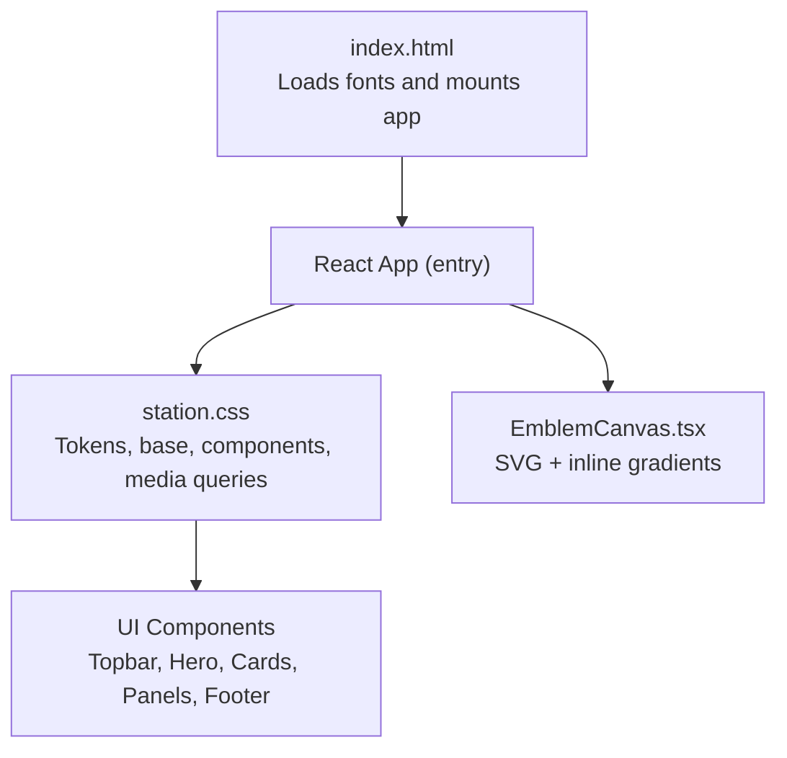
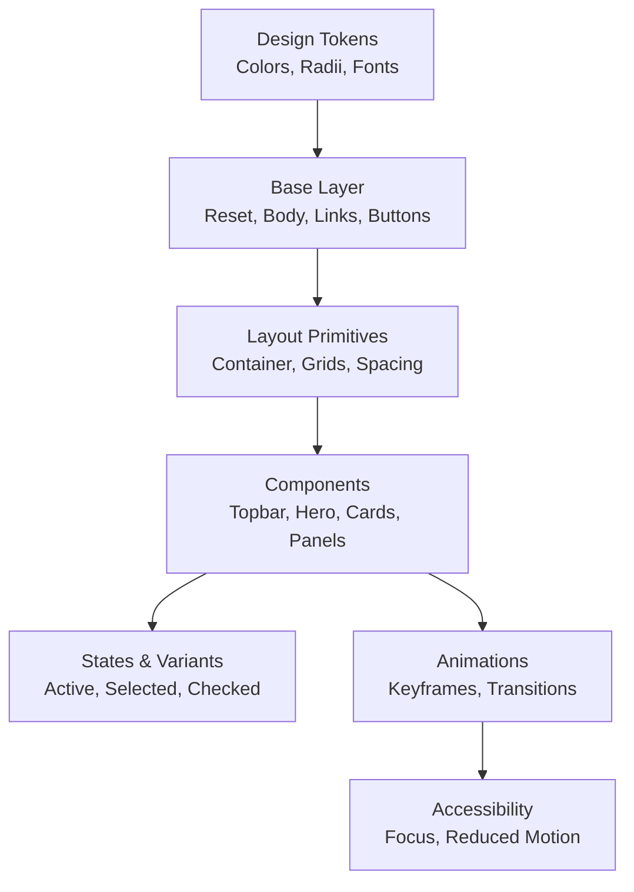
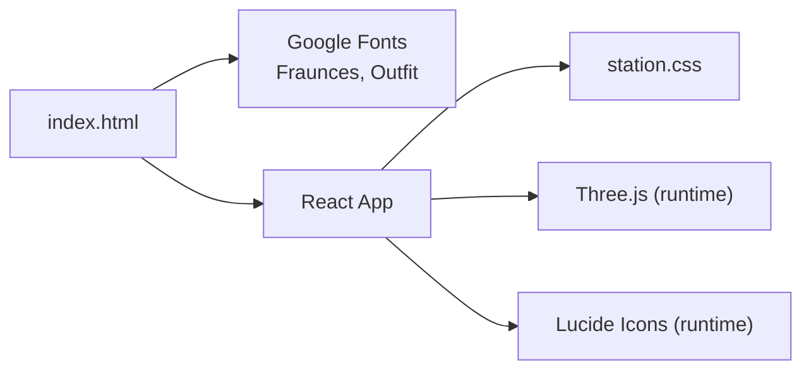

# Styling Architecture & Design System

<cite>
**Referenced Files in This Document**   
- [station.css](file://src/station.css)
- [index.html](file://index.html)
- [package.json](file://package.json)
- [EmblemCanvas.tsx](file://src/EmblemCanvas.tsx)
</cite>

## Table of Contents
1. [Introduction](#introduction)
2. [Project Structure](#project-structure)
3. [Core Components](#core-components)
4. [Architecture Overview](#architecture-overview)
5. [Detailed Component Analysis](#detailed-component-analysis)
6. [Dependency Analysis](#dependency-analysis)
7. [Performance Considerations](#performance-considerations)
8. [Troubleshooting Guide](#troubleshooting-guide)
9. [Conclusion](#conclusion)
10. [Appendices](#appendices)

## Introduction
This document explains the WUN Gazette styling architecture and design system. It covers CSS organization, custom properties, component-specific styles, responsive strategy, animations, color and typography systems, spacing conventions, naming patterns, accessibility considerations, and how inline styles relate to CSS classes for dynamic scenarios. The goal is to make the visual system understandable for both developers and non-technical readers.

## Project Structure
The styling system lives primarily in a single global stylesheet that defines tokens, base resets, layout utilities, and component styles. Fonts are loaded via the HTML entry point, and React components compose these styles through class names.

**Diagram sources**
- [index.html:1-24](file://index.html#L1-L24)
- [station.css:1-2252](file://src/station.css#L1-L2252)
- [EmblemCanvas.tsx:180-206](file://src/EmblemCanvas.tsx#L180-L206)

**Section sources**
- [index.html:1-24](file://index.html#L1-L24)
- [package.json:1-26](file://package.json#L1-L26)

## Core Components
The stylesheet organizes styles into clear layers:

- Design tokens and base layer
  - Custom properties for colors, radii, fonts, and color scheme
  - Global reset and base typography
  - Focus-visible outline for keyboard navigation
- Layout primitives
  - Container width and centering
  - Grid-based sections and card shells
- UI components
  - Topbar, buttons, hero section, emblem stage, bento grid, mini panels (wallet, ballot, chat, market, orbita), neutron graph card, quest checklist, allies section, pioneer pass, path steps, FAQ, final CTA, footer
- Responsive breakpoints
  - Tablet breakpoint at 1024px
  - Mobile breakpoint at 480px
- Accessibility and motion preferences
  - Reduced-motion overrides for key animated elements

Key token categories:
- Backgrounds: dark palette with layered surfaces and borders
- Text: primary, secondary, muted
- Accents: violet, gold, cyan
- Radii: small, medium, large
- Typography: display serif and sans stack

Component families:
- Buttons: primary sizes, secondary, ghost
- Cards: copy-card shell used across many components
- Panels: glassmorphic containers with backdrop blur
- Interactive states: active, selected, checked, fired, on variants using modifier classes

**Section sources**
- [station.css:1-56](file://src/station.css#L1-L56)
- [station.css:132-147](file://src/station.css#L132-L147)
- [station.css:149-288](file://src/station.css#L149-L288)
- [station.css:290-539](file://src/station.css#L290-L539)
- [station.css:1047-1169](file://src/station.css#L1047-L1169)
- [station.css:2166-2251](file://src/station.css#L2166-L2251)

## Architecture Overview
The styling architecture follows a token-driven, component-first approach:

- Tokens define the visual language once and are reused everywhere
- Base styles normalize defaults and establish consistent behavior
- Components encapsulate appearance and interaction states
- Media queries adjust layout and density without duplicating logic
- Animations are scoped to specific components and respect reduced-motion preferences

[No sources needed since this diagram shows conceptual workflow, not actual code structure]

## Detailed Component Analysis

### Design Tokens and Base Layer
- Custom properties define:
  - Backgrounds: deep dark tones and translucent surfaces
  - Borders: subtle white and accent-tinted borders
  - Text: primary, secondary, muted levels
  - Accent colors: violet, gold, cyan
  - Border radii: small, medium, large
  - Font stacks: display serif and sans-serif
  - Color scheme set to dark
- Base rules:
  - Box-sizing normalization
  - Smooth scrolling and horizontal overflow control
  - Body background, text color, font family, size, line height
  - Inherited link and button styles
  - Focus-visible outline using an accent color

Practical implications:
- Consistent contrast and readability across the site
- Centralized theme values reduce duplication and risk
- Dark mode is explicit and enforced at the root level

**Section sources**
- [station.css:1-21](file://src/station.css#L1-L21)
- [station.css:23-56](file://src/station.css#L23-L56)

### Typography System
- Display typeface for headings and brand elements
- Sans-serif typeface for body and interface text
- Fluid sizing via clamp() for hero titles and section headers
- Controlled letter-spacing and line-height for legibility
- Gradient text utility for decorative emphasis

Usage patterns:
- Section titles use display font with tight tracking
- Kicker labels use uppercase, wide letter-spacing, and accent color
- Body copy uses neutral text-secondary for supporting content

**Section sources**
- [station.css:18-19](file://src/station.css#L18-L19)
- [station.css:32-41](file://src/station.css#L32-L41)
- [station.css:322-333](file://src/station.css#L322-L333)
- [station.css:389-398](file://src/station.css#L389-L398)
- [station.css:541-545](file://src/station.css#L541-L545)

### Color Scheme and Surface Hierarchy
- Backgrounds range from solid dark to translucent surfaces
- Borders provide subtle separation; strong borders highlight interactive or important edges
- Accent colors guide attention:
  - Gold for highlights and success-like states
  - Violet for focus and selection emphasis
  - Cyan for informational accents
- Glassmorphism achieved with backdrop-filter blur and semi-transparent backgrounds

Examples:
- Copy-card shell provides reusable glass effect
- Panels like spotlighter, pass preview, and FAQ items reuse similar surface treatments

**Section sources**
- [station.css:1-21](file://src/station.css#L1-L21)
- [station.css:140-147](file://src/station.css#L140-L147)
- [station.css:555-563](file://src/station.css#L555-L563)
- [station.css:1805-1820](file://src/station.css#L1805-L1820)
- [station.css:2031-2037](file://src/station.css#L2031-L2037)

### Spacing Conventions
- Horizontal container width adapts between viewport and fixed maximum
- Padding and gaps are consistent across components:
  - Small gaps for compact controls
  - Medium gaps for card interiors
  - Large gaps for section spacing
- Vertical rhythm established by margins and padding on headings, paragraphs, and lists

Guidelines:
- Prefer gap over margin for flex/grid layouts
- Use clamp() for fluid padding where appropriate
- Keep internal card padding consistent for visual balance

**Section sources**
- [station.css:132-138](file://src/station.css#L132-L138)
- [station.css:160-166](file://src/station.css#L160-L166)
- [station.css:1088-1093](file://src/station.css#L1088-L1093)
- [station.css:1095-1108](file://src/station.css#L1095-L1108)

### Button System
- Primary buttons come in three sizes with shared gradient and hover lift
- Secondary button uses border and subtle background with hover state
- Ghost button is minimal and text-focused
- All buttons inherit font settings and use consistent radii

State handling:
- Hover transitions for transform and box-shadow
- Focus-visible outlines ensure keyboard accessibility

Naming pattern:
- Modifier suffixes indicate size: sm, md, lg
- Semantic prefixes: btn-primary, btn-secondary, btn-ghost

**Section sources**
- [station.css:215-288](file://src/station.css#L215-L288)
- [station.css:53-56](file://src/station.css#L53-L56)

### Hero Section
- Two-column grid layout with copy and visual stage
- Eyebrow pill, kicker, title lines, support text, rule line
- Animated light beam and signal pulse
- Word reveal animation with staggered delays and shimmer
- Reduced-motion override disables animations and restores readable text

Responsive behavior:
- Stacks columns below tablet breakpoint
- Adjusts padding and font sizes on mobile

**Section sources**
- [station.css:290-539](file://src/station.css#L290-L539)
- [station.css:2166-2182](file://src/station.css#L2166-L2182)
- [station.css:2184-2251](file://src/station.css#L2184-L2251)

### Emblem Stage and Canvas
- SVG-based emblem with orbit lines, rings, stars, and shapes
- Animation keyframes for drawing, shimmer, fade-in, drift, and pulse
- Telemetry header and preset switcher for customization
- Canvas wrapper manages cursor states and aspect ratio

Accessibility:
- SVG is marked aria-hidden when decorative
- Gradients defined inline within SVG defs

**Section sources**
- [station.css:923-1045](file://src/station.css#L923-L1045)
- [station.css:803-921](file://src/station.css#L803-L921)
- [EmblemCanvas.tsx:180-206](file://src/EmblemCanvas.tsx#L180-L206)

### Bento Grid and Cards
- 12-column grid with span utilities for flexible layouts
- Card shell with glass effect and hover border transition
- Badge, heading, copy, and mini UI slots inside cards

Use cases:
- Feature showcases
- Data panels
- Interactive previews

**Section sources**
- [station.css:1088-1169](file://src/station.css#L1088-L1169)

### Mini Panels (Wallet, Ballot, Chat, Market, Orbita)
- Reusable panel patterns:
  - Header rows with metadata
  - Status pills and chips
  - Progress bars and stats
  - Tab switches and message grids
  - Market rows with price badges
  - Sector selectors and endorsement buttons

State modifiers:
- is-active, is-selected, is-on, is-checked, is-fired
- Consistent border and background changes per state

**Section sources**
- [station.css:1172-1229](file://src/station.css#L1172-L1229)
- [station.css:1236-1290](file://src/station.css#L1236-L1290)
- [station.css:1292-1337](file://src/station.css#L1292-L1337)
- [station.css:1339-1375](file://src/station.css#L1339-L1375)
- [station.css:1377-1439](file://src/station.css#L1377-L1439)

### Neutron Graph Card
- Header with title and controls
- Filter pills and pulse buttons
- Canvas shell with rounded borders and background
- Footer bar with node pills indicating active states

Interactions:
- Hover lift and background transitions
- Active pill highlighting

**Section sources**
- [station.css:1441-1555](file://src/station.css#L1441-L1555)

### Quest Checklist and Friendship Meter
- Checklist items with checkbox visuals and points
- Checked state modifies border and background
- Friendship meter progress bar with gradient fill

**Section sources**
- [station.css:1557-1638](file://src/station.css#L1557-L1638)

### Allies Section and Pioneer Pass
- Two-column layout with perks grid and pass customizer
- Role pills and input fields with focus ring
- Preview card with avatar, role tag, holder name, perk boxes, and bottom metadata

**Section sources**
- [station.css:1698-1912](file://src/station.css#L1698-L1912)

### Path Steps and Preview
- Step buttons with numbered indicators and descriptions
- Active step highlights with gold border and background
- Preview card with specs list and footer actions

**Section sources**
- [station.css:1914-2019](file://src/station.css#L1914-L2019)

### FAQ and Final CTA
- Accordion-style FAQ items with open state
- Final call-to-action card with centered layout and gradient background
- Footer with brand, links, company info, and copyright

**Section sources**
- [station.css:2021-2155](file://src/station.css#L2021-L2155)

### Responsive Strategy and Breakpoints
- Tablet breakpoint at 1024px:
  - Single-column grids for hero, allies, and path layouts
  - Span utilities collapse to full width
  - Desktop navigation hidden on smaller screens
- Mobile breakpoint at 480px:
  - Tighter container width
  - Compact topbar spacing and truncated brand wordmark
  - Full-width primary and secondary buttons
  - Adjusted hero padding and title sizing

Mobile-first approach:
- Base styles target default mobile experience
- Larger screens enhance layout with additional columns and spacing

**Section sources**
- [station.css:2166-2251](file://src/station.css#L2166-L2251)

### Animation Keyframes and Motion Preferences
- Aurora drift for ambient orbs
- Hero light beam sweep and signal ripple
- Word reveal and shimmer for hero title
- Splash screen draw, shimmer, fade-in, letter float, star pulse, shape drift
- Reduced-motion media query disables or simplifies animations for users who prefer less motion

Best practices:
- Use will-change sparingly for performance-critical transforms
- Respect prefers-reduced-motion to avoid overwhelming sensitive users

**Section sources**
- [station.css:120-130](file://src/station.css#L120-L130)
- [station.css:335-374](file://src/station.css#L335-L374)
- [station.css:477-519](file://src/station.css#L477-L519)
- [station.css:521-539](file://src/station.css#L521-L539)
- [station.css:831-921](file://src/station.css#L831-L921)
- [station.css:847-851](file://src/station.css#L847-L851)

### Naming Patterns and BEM Usage
- Predominantly flat class names with semantic prefixes:
  - .topbar, .hero-section, .bento-grid, .neutron-card
- Modifier classes for states:
  - .is-active, .is-selected, .is-checked, .is-on, .is-fired
- BEM-style nesting appears in splash/emblem components:
  - .wun-splash__stack, .wun-splash__mark, .wun-splash__wordmark
  - .wun-orbit__line, .wun-orbit__rings, .wun-orbit__planet, .wun-orbit__star
- Utility-like classes:
  - .copy-card, .text-gradient

Composition techniques:
- Combine base shells with contextual modifiers
- Use grid spans for layout composition
- Apply backdrop-filter and gradients for glass effects

**Section sources**
- [station.css:149-213](file://src/station.css#L149-L213)
- [station.css:657-791](file://src/station.css#L657-L791)
- [station.css:803-829](file://src/station.css#L803-L829)
- [station.css:1172-1229](file://src/station.css#L1172-L1229)

### Accessibility Considerations
- Focus management:
  - :focus-visible provides a visible outline for keyboard users
  - Inputs have explicit focus styles with accent-colored borders
- Screen reader support:
  - Decorative SVGs are marked aria-hidden
  - Meaningful text content remains accessible through semantic HTML
- Motion preferences:
  - prefers-reduced-motion disables animations for sensitive users
- Contrast and readability:
  - Dark color scheme with carefully chosen text and accent colors
  - Clear hierarchy between primary, secondary, and muted text

Recommendations:
- Ensure all interactive elements are reachable via keyboard
- Provide sufficient color contrast for text and icons
- Test with screen readers to verify meaningful announcements

**Section sources**
- [station.css:53-56](file://src/station.css#L53-L56)
- [station.css:1772-1775](file://src/station.css#L1772-L1775)
- [EmblemCanvas.tsx:180-182](file://src/EmblemCanvas.tsx#L180-L182)
- [station.css:521-539](file://src/station.css#L521-L539)

### Inline Styles vs CSS Classes for Dynamic Scenarios
- CSS classes handle static presentation and state:
  - State modifiers (.is-active, .is-selected) toggle visual feedback
  - Component shells provide consistent look and feel
- Inline styles are used for dynamic values:
  - SVG gradients and patterns defined inline within component markup
  - Dynamic widths or positions can be applied via inline styles when driven by runtime data
- Composition strategy:
  - Prefer classes for theming and layout
  - Use inline styles only for values that change frequently or depend on component state
  - Avoid overriding critical styles with inline declarations; instead, update class names or CSS variables

Example references:
- SVG defs and gradients defined inline in the emblem component
- Class-driven states for panels and buttons

**Section sources**
- [EmblemCanvas.tsx:180-206](file://src/EmblemCanvas.tsx#L180-L206)
- [station.css:1172-1229](file://src/station.css#L1172-L1229)
- [station.css:1236-1290](file://src/station.css#L1236-L1290)

## Dependency Analysis
The styling system has minimal external dependencies:

- Fonts loaded via Google Fonts in the HTML head
- React and Three.js are runtime dependencies for interactivity and graphics
- Vite is the build toolchain

**Diagram sources**
- [index.html:12-17](file://index.html#L12-L17)
- [package.json:11-24](file://package.json#L11-L24)

**Section sources**
- [index.html:12-17](file://index.html#L12-L17)
- [package.json:11-24](file://package.json#L11-L24)

## Performance Considerations
- Use backdrop-filter judiciously; it can be expensive on lower-end devices
- Limit the number of simultaneous animations; prefer transforms and opacity
- Leverage will-change only for elements actively animating
- Prefer CSS variables for theme updates to avoid reflows
- Keep media queries simple and targeted to minimize cascade complexity

[No sources needed since this section provides general guidance]

## Troubleshooting Guide
Common issues and resolutions:

- Animations not respecting reduced-motion:
  - Verify that prefers-reduced-motion blocks target the correct selectors
  - Ensure animations are explicitly disabled or simplified
- Focus visibility missing:
  - Confirm :focus-visible rules are present and not overridden
  - Check that interactive elements are focusable
- Contrast problems:
  - Validate text against background using contrast tools
  - Prefer --text-primary for main content and --text-secondary for supporting text
- Layout breaks on small screens:
  - Inspect container width calculations and grid spans
  - Ensure span utilities collapse correctly at breakpoints
- Glassmorphism performance:
  - Reduce blur radius or disable on low-power devices if necessary

**Section sources**
- [station.css:521-539](file://src/station.css#L521-L539)
- [station.css:53-56](file://src/station.css#L53-L56)
- [station.css:2166-2251](file://src/station.css#L2166-L2251)

## Conclusion
The WUN Gazette styling system is a cohesive, token-driven architecture that emphasizes consistency, accessibility, and performance. By centralizing design tokens, organizing components clearly, and applying responsive strategies thoughtfully, the system scales well across devices and use cases. The combination of CSS classes for presentation and inline styles for dynamic values enables flexible composition while maintaining a clean separation of concerns.

[No sources needed since this section summarizes without analyzing specific files]

## Appendices

### CSS Class Naming Patterns Summary
- Component classes: descriptive, lowercase with hyphens
- State modifiers: .is-* for active, selected, checked, on, fired
- BEM-style nested classes: .block__element for structured components
- Utilities: .copy-card, .text-gradient for reusable effects

**Section sources**
- [station.css:140-147](file://src/station.css#L140-L147)
- [station.css:657-791](file://src/station.css#L657-L791)
- [station.css:1172-1229](file://src/station.css#L1172-L1229)