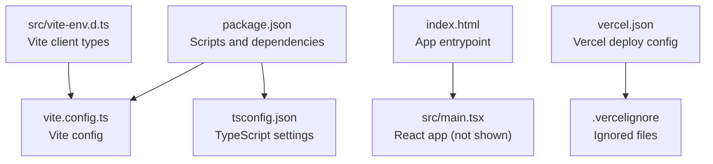
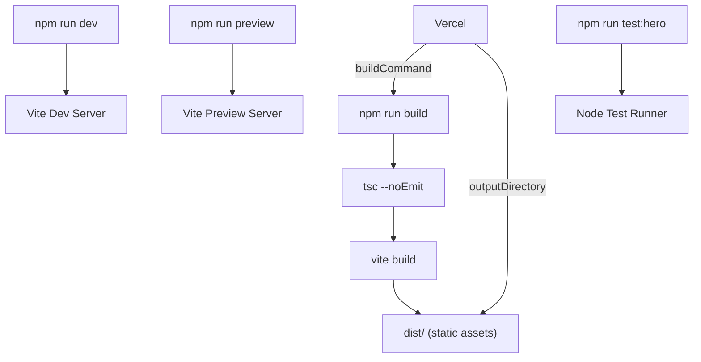
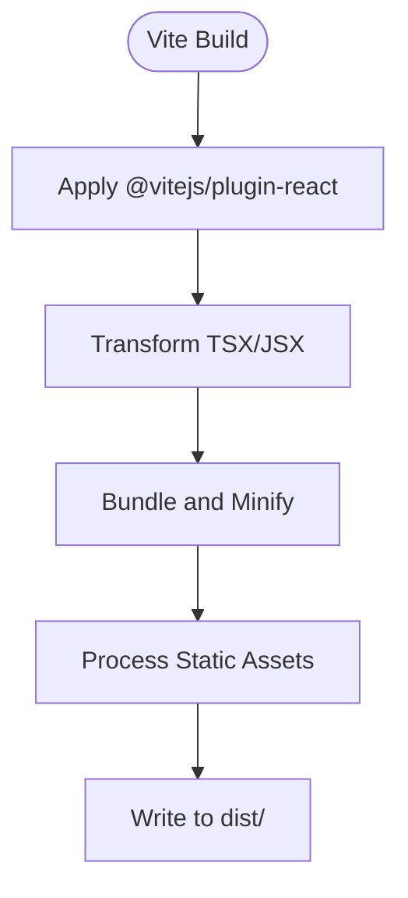
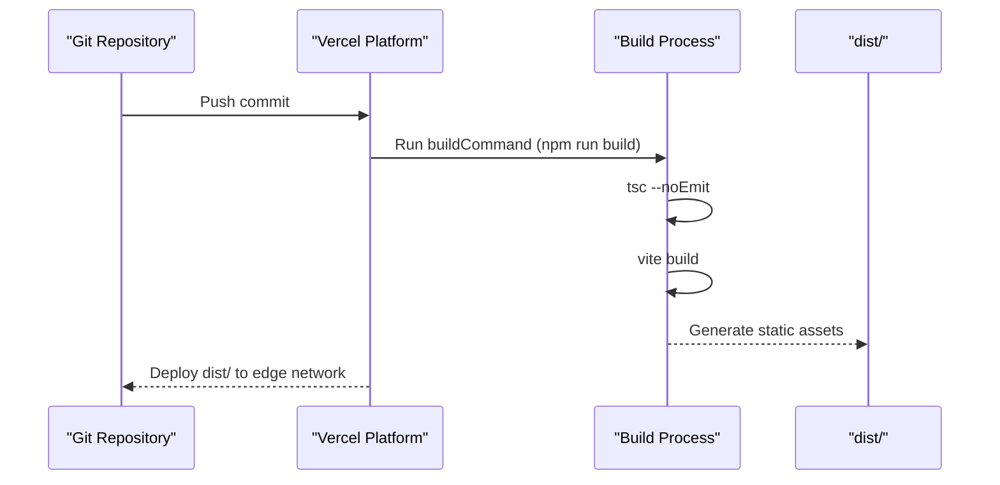
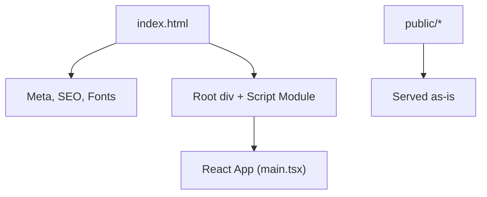
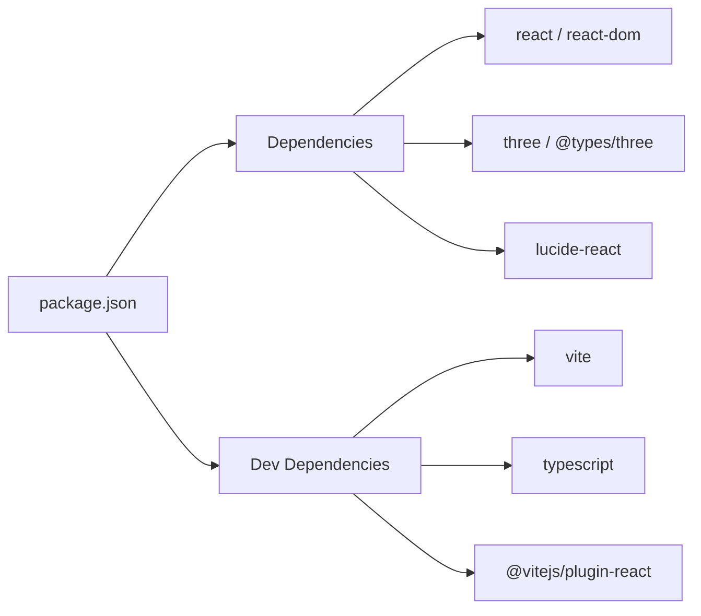

# Configuration & Deployment

<cite>
**Referenced Files in This Document**
- [package.json](file://package.json)
- [vite.config.ts](file://vite.config.ts)
- [tsconfig.json](file://tsconfig.json)
- [vercel.json](file://vercel.json)
- [.vercelignore](file://.vercelignore)
- [index.html](file://index.html)
- [src/vite-env.d.ts](file://src/vite-env.d.ts)
</cite>

## Table of Contents
1. [Introduction](#introduction)
2. [Project Structure](#project-structure)
3. [Core Components](#core-components)
4. [Architecture Overview](#architecture-overview)
5. [Detailed Component Analysis](#detailed-component-analysis)
6. [Dependency Analysis](#dependency-analysis)
7. [Performance Considerations](#performance-considerations)
8. [Troubleshooting Guide](#troubleshooting-guide)
9. [Conclusion](#conclusion)
10. [Appendices](#appendices)

## Introduction
This document explains how the WUN Gazette project is configured and deployed. It covers Vite build configuration, TypeScript settings, Vercel deployment setup, environment configuration, asset handling, and production optimization. It also provides guidance for customizing build outputs, setting up CI/CD pipelines, and managing environment variables for static site hosting.

## Project Structure
The project is a React + TypeScript application built with Vite and deployed to Vercel as a static site. Key files:
- Build tooling: Vite and React plugin
- Type checking: TypeScript compiler options
- Entry point: HTML template that mounts the app
- Deployment: Vercel framework and output directory
- Environment types: Vite client type references

**Diagram sources**
- [package.json:1-26](file://package.json#L1-L26)
- [vite.config.ts:1-7](file://vite.config.ts#L1-L7)
- [tsconfig.json:1-18](file://tsconfig.json#L1-L18)
- [index.html:1-24](file://index.html#L1-L24)
- [vercel.json:1-6](file://vercel.json#L1-L6)
- [.vercelignore:1-5](file://.vercelignore#L1-L5)
- [src/vite-env.d.ts:1-2](file://src/vite-env.d.ts#L1-L2)

**Section sources**
- [package.json:1-26](file://package.json#L1-L26)
- [vite.config.ts:1-7](file://vite.config.ts#L1-L7)
- [tsconfig.json:1-18](file://tsconfig.json#L1-L18)
- [index.html:1-24](file://index.html#L1-L24)
- [vercel.json:1-6](file://vercel.json#L1-L6)
- [.vercelignore:1-5](file://.vercelignore#L1-L5)
- [src/vite-env.d.ts:1-2](file://src/vite-env.d.ts#L1-L2)

## Core Components
- Build scripts: Development server, type-checked build, preview, and test runner are defined in package scripts.
- Vite configuration: Minimal setup enabling React JSX transformation via the official plugin.
- TypeScript configuration: Strict mode, modern target/module, bundler module resolution, and no emit since Vite handles compilation.
- Vercel configuration: Declares Vite as the framework, uses npm run build, and publishes the dist folder.
- HTML entrypoint: Defines meta tags, fonts preconnect, and loads the React app module.
- Environment types: References Vite client types for IDE support.

**Section sources**
- [package.json:5-10](file://package.json#L5-L10)
- [vite.config.ts:1-7](file://vite.config.ts#L1-L7)
- [tsconfig.json:1-18](file://tsconfig.json#L1-L18)
- [vercel.json:1-6](file://vercel.json#L1-L6)
- [index.html:1-24](file://index.html#L1-L24)
- [src/vite-env.d.ts:1-2](file://src/vite-env.d.ts#L1-L2)

## Architecture Overview
The build and deployment pipeline connects scripts, Vite, TypeScript, and Vercel into a cohesive flow.

**Diagram sources**
- [package.json:5-10](file://package.json#L5-L10)
- [vercel.json:1-6](file://vercel.json#L1-L6)

## Detailed Component Analysis

### Vite Build Configuration
- Plugin: The React plugin is enabled to transform JSX/TSX.
- Output: Default Vite behavior produces an optimized production bundle under dist/.
- Customization points:
  - Base path and public directory can be adjusted if deploying under a subpath or using a CDN.
  - Build options such as minification, sourcemaps, chunk splitting, and rollup plugins can be added to optimize performance.
  - Environment variables are exposed to the client when prefixed with VITE_ and imported at build time.

**Diagram sources**
- [vite.config.ts:1-7](file://vite.config.ts#L1-L7)

**Section sources**
- [vite.config.ts:1-7](file://vite.config.ts#L1-L7)

### TypeScript Settings
- Target and libraries: Targets ES2022 runtime features and includes DOM APIs.
- Module system: Uses ESNext modules with bundler-aware resolution.
- Strictness: Enables strict mode and unused variable checks for safer code.
- No emit: Delegates emission to Vite; TypeScript only performs type-checking.
- Include paths: Compiles src and the Vite config file.

Recommendations:
- Keep isolatedModules true for faster builds.
- Maintain strict mode to catch issues early.
- Add baseUrl/path mappings if the project grows.

**Section sources**
- [tsconfig.json:1-18](file://tsconfig.json#L1-L18)

### Vercel Deployment Setup
- Framework detection: Declares vite so Vercel applies optimal defaults.
- Build command: Executes npm run build, which runs type checking then Vite build.
- Output directory: Publishes the dist folder as the static site root.
- Ignored files: Excludes .env*, .vercel, .gitignore, and node_modules from the repository upload.

CI/CD integration:
- Connect your repository to Vercel.
- Configure environment variables in the Vercel dashboard for production and preview environments.
- Use branch deployments for previews and automatic deploys on main.

**Diagram sources**
- [vercel.json:1-6](file://vercel.json#L1-L6)
- [package.json:5-10](file://package.json#L5-L10)

**Section sources**
- [vercel.json:1-6](file://vercel.json#L1-L6)
- [.vercelignore:1-5](file://.vercelignore#L1-L5)
- [package.json:5-10](file://package.json#L5-L10)

### Environment Configuration
- Client-side env vars: Prefix variables with VITE_ and import them in source files at build time.
- Types: The Vite client types reference enables IDE support for process.env.VITE_*.
- Security: Never commit secrets. Use Vercel’s environment variables UI or CI/CD secret management.
- Local development: Create .env.local for local-only variables; it is ignored by default.

Best practices:
- Define clear prefixes for different environments (e.g., API endpoints).
- Validate required variables at startup in development to fail fast.
- Rotate secrets regularly and avoid logging sensitive values.

**Section sources**
- [src/vite-env.d.ts:1-2](file://src/vite-env.d.ts#L1-L2)
- [.vercelignore:1-5](file://.vercelignore#L1-L5)

### Asset Handling
- Fonts: Preconnect hints and stylesheet links are declared in the HTML head for performance.
- Root container: The app mounts to a root div element.
- Static assets: Place files under the public directory to serve them without processing.
- Optimization: Prefer lazy loading for heavy assets and use appropriate formats (WebP/AVIF) where possible.

**Diagram sources**
- [index.html:1-24](file://index.html#L1-L24)

**Section sources**
- [index.html:1-24](file://index.html#L1-L24)

## Dependency Analysis
The project depends on React, Three.js, and related types, with Vite and the React plugin driving the build.

**Diagram sources**
- [package.json:11-24](file://package.json#L11-L24)

**Section sources**
- [package.json:11-24](file://package.json#L11-L24)

## Performance Considerations
- Build optimizations:
  - Enable code splitting and dynamic imports for large components.
  - Tune minification and sourcemap generation based on debugging needs.
  - Leverage Vite’s Rollup-based output for efficient tree-shaking.
- Runtime optimizations:
  - Lazy-load heavy 3D scenes and offscreen rendering.
  - Use font-display strategies and preload critical resources.
  - Implement caching headers via hosting provider (Vercel supports cache control rules).
- Asset strategy:
  - Serve images in modern formats and sizes.
  - Use CDN-friendly paths and versioned filenames.
- Monitoring:
  - Track bundle size over time and set budgets to prevent regressions.

[No sources needed since this section provides general guidance]

## Troubleshooting Guide
Common issues and resolutions:
- Build fails due to type errors:
  - Ensure TypeScript strictness aligns with your codebase.
  - Fix unused variables and parameters flagged by tsconfig.
- Missing environment variables:
  - Verify VITE_ prefix for client-side variables.
  - Confirm variables are set in Vercel’s environment settings.
- Assets not found:
  - Check that static assets are placed under public and referenced correctly.
  - Ensure base path matches deployment subpath if applicable.
- Preview differs from production:
  - Run npm run preview locally to validate production-like behavior.

**Section sources**
- [tsconfig.json:1-18](file://tsconfig.json#L1-L18)
- [vercel.json:1-6](file://vercel.json#L1-L6)
- [index.html:1-24](file://index.html#L1-L24)

## Conclusion
WUN Gazette uses a minimal, modern stack: Vite for building, TypeScript for type safety, and Vercel for deployment. The configuration is intentionally simple, making it easy to extend with additional build optimizations, environment variables, and CI/CD automation. Follow the recommendations above to customize outputs, secure secrets, and optimize performance for production.

[No sources needed since this section summarizes without analyzing specific files]

## Appendices

### Build Scripts Reference
- Development: Starts the Vite dev server with hot reload.
- Build: Runs type checking then Vite build to produce dist/.
- Preview: Serves the built output locally for validation.
- Test: Executes a Node-based test file.

**Section sources**
- [package.json:5-10](file://package.json#L5-L10)

### Vercel Configuration Reference
- Framework: vite
- Build command: npm run build
- Output directory: dist

**Section sources**
- [vercel.json:1-6](file://vercel.json#L1-L6)