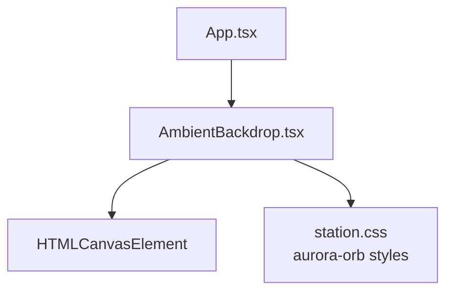
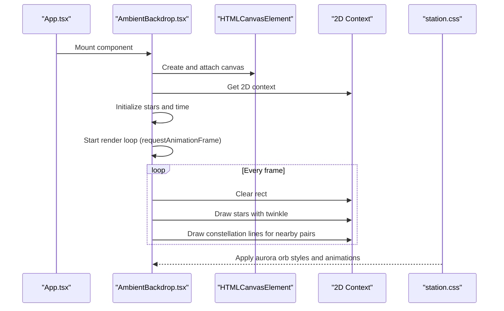
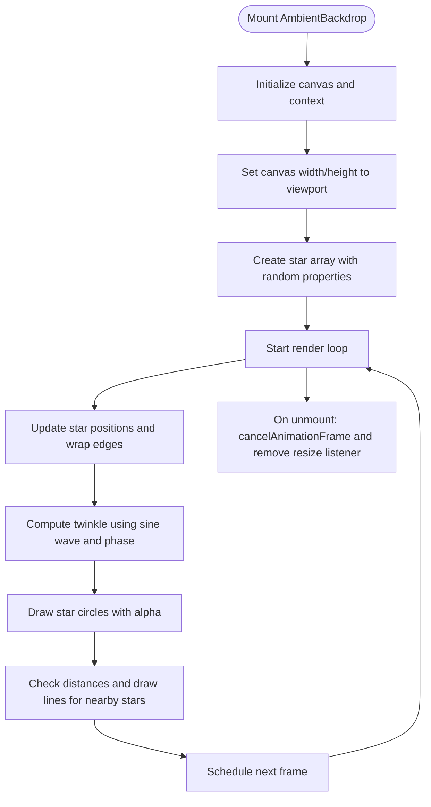
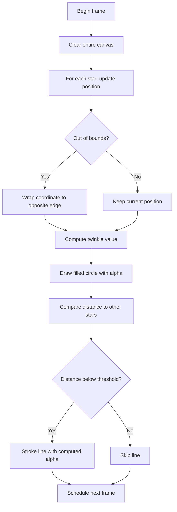
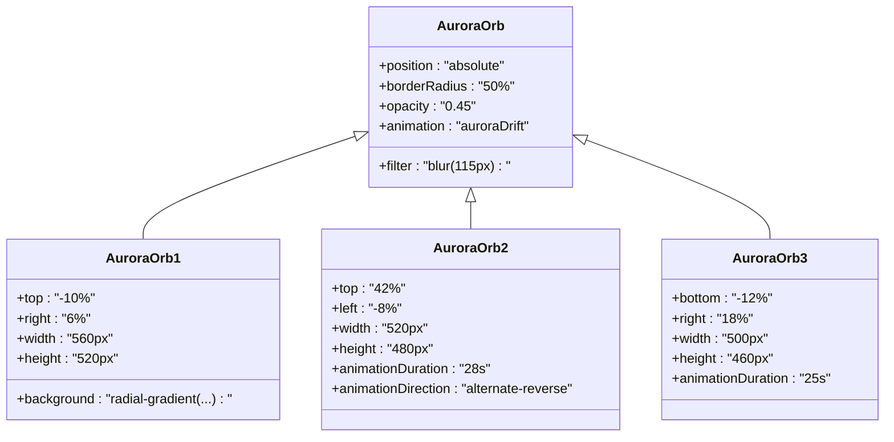
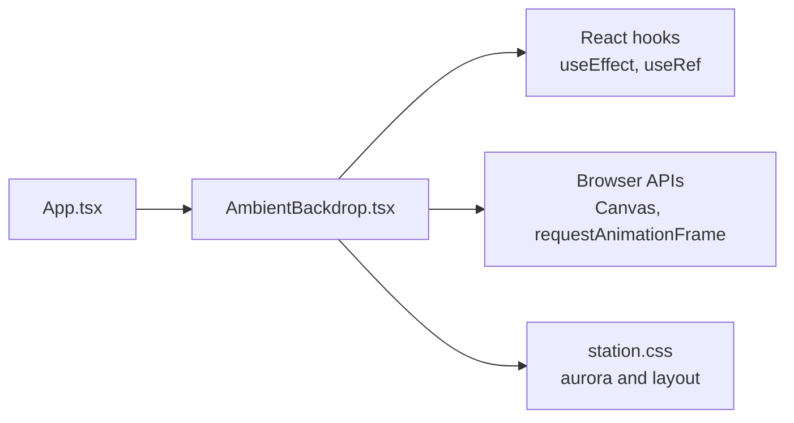

# AmbientBackdrop Component

<cite>
**Referenced Files in This Document**
- [AmbientBackdrop.tsx](file://src/AmbientBackdrop.tsx)
- [App.tsx](file://src/App.tsx)
- [station.css](file://src/station.css)
- [package.json](file://package.json)
</cite>

## Table of Contents
1. [Introduction](#introduction)
2. [Project Structure](#project-structure)
3. [Core Components](#core-components)
4. [Architecture Overview](#architecture-overview)
5. [Detailed Component Analysis](#detailed-component-analysis)
6. [Dependency Analysis](#dependency-analysis)
7. [Performance Considerations](#performance-considerations)
8. [Troubleshooting Guide](#troubleshooting-guide)
9. [Conclusion](#conclusion)
10. [Appendices](#appendices)

## Introduction
The AmbientBackdrop component provides a full-screen animated starfield background with subtle constellation lines and CSS-driven aurora orbs. It is rendered as a React component that owns a canvas element, initializes a 2D drawing context, creates a small set of stars, and runs an animation loop using requestAnimationFrame. The component integrates into the application through App.tsx and uses CSS classes defined in station.css for layout, aurora effects, and responsive behavior.

This documentation explains:
- How the Canvas API draws and animates stars
- Star dot properties and their roles in movement, size, brightness, and phase
- The animation loop lifecycle and cleanup
- Responsive handling for window resize events
- Mathematical calculations for twinkling and constellation line connections
- CSS integration for aurora orb elements
- Customization guidance for star density, colors, speed, and connection thresholds
- Accessibility considerations and performance best practices

## Project Structure
The AmbientBackdrop component lives under src and is imported by the root application component. Its visual styling is provided by a shared stylesheet.

**Diagram sources**
- [App.tsx:15-15](file://src/App.tsx#L15-L15)
- [AmbientBackdrop.tsx:13-100](file://src/AmbientBackdrop.tsx#L13-L100)
- [station.css:69-130](file://src/station.css#L69-L130)

**Section sources**
- [AmbientBackdrop.tsx:1-100](file://src/AmbientBackdrop.tsx#L1-L100)
- [App.tsx:15-15](file://src/App.tsx#L15-L15)
- [station.css:69-130](file://src/station.css#L69-L130)

## Core Components
- AmbientBackdrop: A React functional component that renders a fixed backdrop container, three aurora orb divs, and a canvas element. It sets up the canvas, initializes stars, starts the animation loop, and cleans up on unmount.
- StarDot: An internal data structure describing each star’s position, radius, velocity, base alpha, and phase offset.
- Auroras: Three absolutely positioned divs styled with CSS gradients, blur, and keyframe animations to create soft ambient color fields behind the starfield.

Key responsibilities:
- Canvas initialization and sizing
- Star creation and per-frame updates
- Constellation line rendering between nearby stars
- Animation scheduling via requestAnimationFrame
- Event listener management for window resize
- Accessibility attribute assignment

**Section sources**
- [AmbientBackdrop.tsx:3-11](file://src/AmbientBackdrop.tsx#L3-L11)
- [AmbientBackdrop.tsx:13-100](file://src/AmbientBackdrop.tsx#L13-L100)
- [station.css:85-130](file://src/station.css#L85-L130)

## Architecture Overview
At runtime, App.tsx mounts AmbientBackdrop at the top of the page. AmbientBackdrop attaches a canvas to the viewport, fills it with moving stars, and draws faint lines between stars that are close enough. Aurora orbs sit behind the canvas and drift slowly using CSS animations.

**Diagram sources**
- [App.tsx:176-178](file://src/App.tsx#L176-L178)
- [AmbientBackdrop.tsx:16-90](file://src/AmbientBackdrop.tsx#L16-L90)
- [station.css:69-130](file://src/station.css#L69-L130)

## Detailed Component Analysis

### AmbientBackdrop Component
AmbientBackdrop is a self-contained effect that:
- Uses a ref to access the canvas element
- Initializes width and height from the viewport
- Adds a passive resize listener to keep the canvas sized correctly
- Creates a fixed number of stars with randomized properties
- Runs a render function that updates positions, wraps edges, computes twinkle, draws circles, and draws lines between nearby stars
- Schedules the next frame with requestAnimationFrame
- Cleans up the animation frame and resize listener on unmount

**Diagram sources**
- [AmbientBackdrop.tsx:16-90](file://src/AmbientBackdrop.tsx#L16-L90)

#### Star Dot Properties
Each star has:
- x, y: Current screen coordinates
- r: Radius controlling visual size
- vx, vy: Velocity vectors for slow drift
- alpha: Base opacity used to compute twinkle
- phase: Phase offset for independent twinkle timing

These properties enable:
- Smooth motion across the viewport
- Edge wrapping so stars re-enter from opposite sides
- Per-star twinkle variation without global flicker

**Section sources**
- [AmbientBackdrop.tsx:3-11](file://src/AmbientBackdrop.tsx#L3-L11)
- [AmbientBackdrop.tsx:31-40](file://src/AmbientBackdrop.tsx#L31-L40)

#### Animation Loop and Timing
- Time variable increments each frame by a small constant to drive oscillation
- requestAnimationFrame schedules the next frame
- Each frame clears the canvas before redrawing
- Cleanup cancels the animation frame and removes the resize listener

**Diagram sources**
- [AmbientBackdrop.tsx:45-85](file://src/AmbientBackdrop.tsx#L45-L85)

**Section sources**
- [AmbientBackdrop.tsx:42-90](file://src/AmbientBackdrop.tsx#L42-L90)

#### Twinkling Math
Twinkle is calculated as:
- A base alpha multiplied by a sine-based factor
- The sine argument combines a global time multiplier and a per-star phase offset
- This produces smooth, asynchronous brightness oscillations across stars

Resulting alpha is formatted to a fixed precision when applied to the fill style.

**Section sources**
- [AmbientBackdrop.tsx:58-62](file://src/AmbientBackdrop.tsx#L58-L62)

#### Constellation Line Connections
For every pair of stars where j > i:
- Distance is computed using the hypotenuse formula
- If distance is below a fixed threshold, a line is drawn
- Line alpha decreases linearly as distance approaches the threshold
- Lines use a distinct color and thin stroke width

This creates a subtle network effect among nearby stars.

**Section sources**
- [AmbientBackdrop.tsx:64-79](file://src/AmbientBackdrop.tsx#L64-L79)

#### Responsive Resize Handling
- On mount, canvas dimensions are set to window.innerWidth and window.innerHeight
- A passive resize listener updates both width and height
- Cleanup removes the listener on unmount

Best practice note: In high-frequency resize scenarios, consider debouncing or throttling to reduce layout thrashing.

**Section sources**
- [AmbientBackdrop.tsx:22-29](file://src/AmbientBackdrop.tsx#L22-L29)
- [AmbientBackdrop.tsx:87-90](file://src/AmbientBackdrop.tsx#L87-L90)

#### Rendering Pipeline
Per frame:
- Increment time
- Clear canvas
- For each star:
  - Update position by velocity
  - Wrap coordinates if out of bounds
  - Compute twinkle
  - Draw circle
  - Compare with subsequent stars to draw lines if close enough
- Schedule next frame

Complexity:
- Star updates: O(n)
- Pairwise distance checks: O(n^2)
- With n = 46, this is manageable but grows quickly with higher densities

**Section sources**
- [AmbientBackdrop.tsx:45-85](file://src/AmbientBackdrop.tsx#L45-L85)

#### Accessibility
- The backdrop container has aria-hidden="true" because it is decorative
- This prevents assistive technologies from announcing non-interactive background visuals

**Section sources**
- [AmbientBackdrop.tsx:93-99](file://src/AmbientBackdrop.tsx#L93-L99)

#### CSS Integration for Aurora Orbs
Three aurora orbs are rendered as divs with shared and variant classes:
- Shared class applies absolute positioning, rounded corners, blur, base opacity, and a drifting animation
- Variant classes define position, size, gradient colors, animation duration, and direction
- Keyframes animate transform and scale to create gentle movement

**Diagram sources**
- [station.css:85-130](file://src/station.css#L85-L130)

**Section sources**
- [station.css:69-130](file://src/station.css#L69-L130)

### Integration with App.tsx
App.tsx imports and mounts AmbientBackdrop near the top of the page content. This ensures the backdrop sits behind other UI layers while remaining interactive-free due to pointer-events being disabled in CSS.

**Section sources**
- [App.tsx:15-15](file://src/App.tsx#L15-L15)
- [App.tsx:176-178](file://src/App.tsx#L176-L178)

## Dependency Analysis
AmbientBackdrop depends on:
- React hooks: useEffect, useRef
- Browser APIs: HTMLCanvasElement, CanvasRenderingContext2D, window.addEventListener, requestAnimationFrame, cancelAnimationFrame
- CSS classes defined in station.css
- App.tsx for mounting

There are no external library dependencies for the starfield logic itself.

**Diagram sources**
- [AmbientBackdrop.tsx:1-1](file://src/AmbientBackdrop.tsx#L1-L1)
- [AmbientBackdrop.tsx:16-90](file://src/AmbientBackdrop.tsx#L16-L90)
- [station.css:69-130](file://src/station.css#L69-L130)
- [App.tsx:15-15](file://src/App.tsx#L15-L15)

**Section sources**
- [AmbientBackdrop.tsx:1-1](file://src/AmbientBackdrop.tsx#L1-L1)
- [App.tsx:15-15](file://src/App.tsx#L15-L15)
- [station.css:69-130](file://src/station.css#L69-L130)

## Performance Considerations
- Canvas clearing: The entire canvas is cleared each frame; ensure the clear region matches the viewport to avoid overdraw.
- Star count: The default star count is small (46), keeping pairwise comparisons cheap. Increasing density significantly increases O(n^2) work.
- Throttling resize: Debounce or throttle the resize handler to prevent excessive recalculations during rapid window resizing.
- Passive listeners: The resize listener is passive, which avoids blocking scroll performance.
- Alpha formatting: Using fixed-precision alpha values reduces string churn slightly.
- Avoid heavy operations inside the loop: Keep math minimal and reuse computed values where possible.
- Visibility detection: Optionally pause the animation loop when the tab is hidden or the component is not visible to save CPU/GPU resources.

[No sources needed since this section provides general guidance]

## Troubleshooting Guide
Common issues and resolutions:
- Canvas appears blank:
  - Verify the canvas ref is attached and getContext returns a valid 2D context.
  - Ensure the canvas width and height are set to the viewport dimensions.
- Stars do not move:
  - Confirm the render loop is started and requestAnimationFrame is called recursively.
  - Check that time increments and velocities are non-zero.
- Constellation lines not visible:
  - Adjust the distance threshold and line alpha scaling factors.
  - Increase line width or alpha for visibility.
- High CPU usage:
  - Reduce star count.
  - Debounce resize events.
  - Pause animation when the tab is inactive.
- Aurora orbs not showing:
  - Verify CSS classes are present and station.css is loaded.
  - Check that the backdrop container has pointer-events disabled so it does not block interactions.

**Section sources**
- [AmbientBackdrop.tsx:16-90](file://src/AmbientBackdrop.tsx#L16-L90)
- [station.css:69-130](file://src/station.css#L69-L130)

## Conclusion
AmbientBackdrop delivers a lightweight, visually rich starfield background using the Canvas API and CSS animations. Its design balances simplicity and performance by keeping star counts low, using efficient math for twinkling and line connections, and leveraging passive event listeners. The component integrates cleanly into the app, remains accessible by marking itself as decorative, and can be customized for density, colors, speed, and connection thresholds.

[No sources needed since this section summarizes without analyzing specific files]

## Appendices

### Customization Guide
- Star density:
  - Change the star count constant to increase or decrease the number of stars.
  - Note that increasing density raises O(n^2) pairwise checks.
- Star colors:
  - Modify the fill style color for stars.
  - Modify the stroke style color for constellation lines.
- Animation speed:
  - Adjust the time increment per frame to make movement and twinkle faster or slower.
- Constellation connection threshold:
  - Change the distance threshold used to decide whether to draw a line between two stars.
  - Adjust the line alpha scaling factor to make connections more or less visible.
- Aurora customization:
  - Edit aurora orb sizes, positions, gradients, and animation durations in the stylesheet.

**Section sources**
- [AmbientBackdrop.tsx:31-40](file://src/AmbientBackdrop.tsx#L31-L40)
- [AmbientBackdrop.tsx:58-79](file://src/AmbientBackdrop.tsx#L58-L79)
- [station.css:85-130](file://src/station.css#L85-L130)

### Environment and Dependencies
- The project uses Vite for development and build scripts.
- React and ReactDOM are core dependencies.
- No additional libraries are required for the AmbientBackdrop implementation.

**Section sources**
- [package.json:1-26](file://package.json#L1-L26)