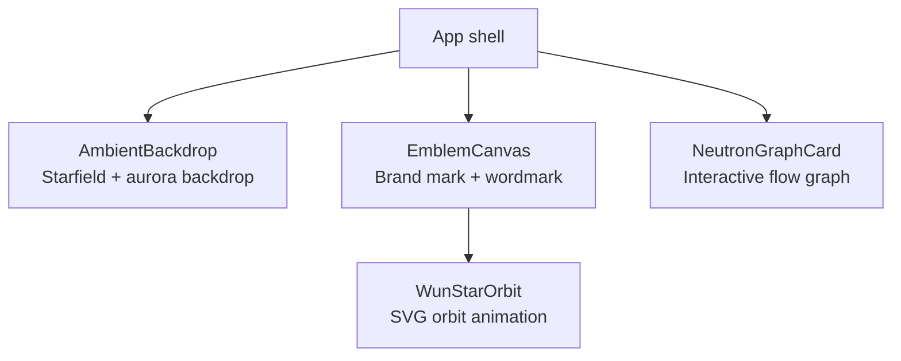
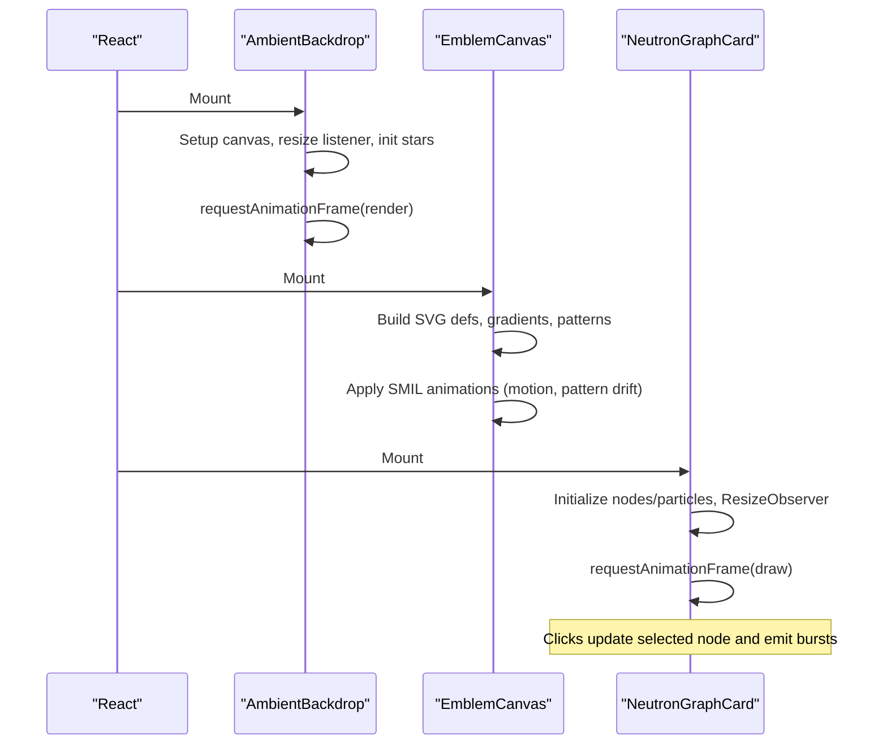
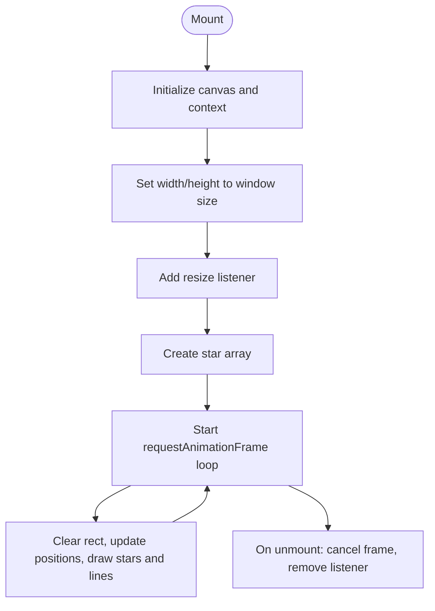
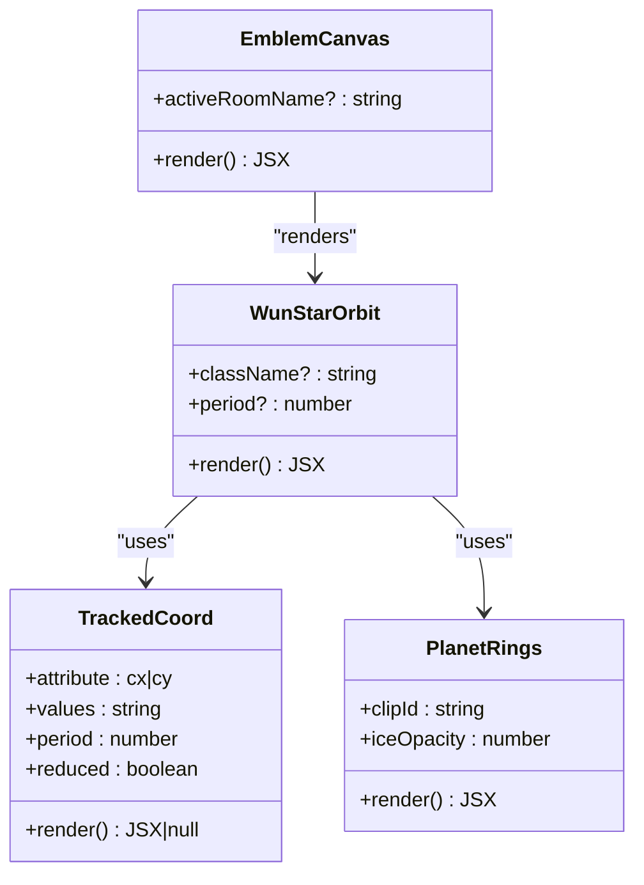
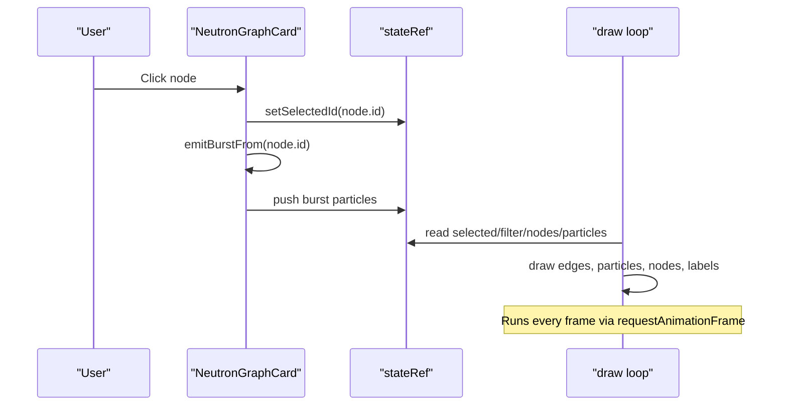
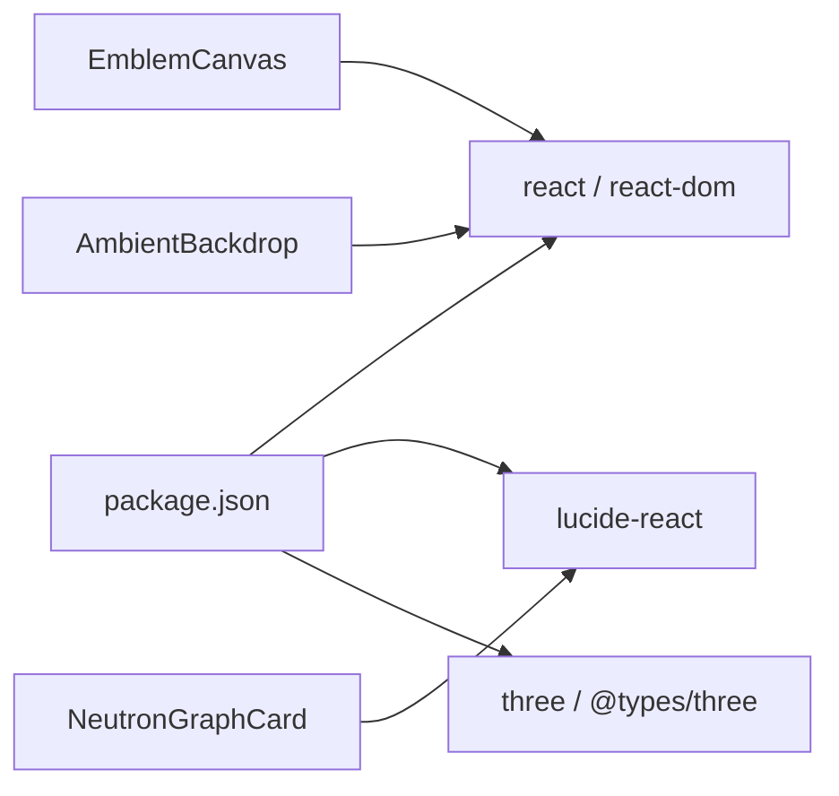

# Core Components

<cite>
**Referenced Files in This Document**
- [AmbientBackdrop.tsx](file://src/AmbientBackdrop.tsx)
- [EmblemCanvas.tsx](file://src/EmblemCanvas.tsx)
- [NeutronGraphCard.tsx](file://src/NeutronGraphCard.tsx)
- [package.json](file://package.json)
</cite>

## Table of Contents
1. [Introduction](#introduction)
2. [Project Structure](#project-structure)
3. [Core Components](#core-components)
4. [Architecture Overview](#architecture-overview)
5. [Detailed Component Analysis](#detailed-component-analysis)
6. [Dependency Analysis](#dependency-analysis)
7. [Performance Considerations](#performance-considerations)
8. [Troubleshooting Guide](#troubleshooting-guide)
9. [Conclusion](#conclusion)

## Introduction
This document explains the core React components that power the WUN Gazette visual experience:
- AmbientBackdrop: a starfield and aurora backdrop rendered with Canvas 2D.
- EmblemCanvas: a brand mark visualization built from SVG, gradients, patterns, and animations.
- NeutronGraphCard: an interactive network graph with animated particles, selection, and filtering.

These components are designed for performance, accessibility, and customization while keeping implementation details contained inside each component.

## Project Structure
The three components live directly under `src`. They are self-contained and do not import shared UI libraries beyond what is declared in the project dependencies.

**Diagram sources**
- [AmbientBackdrop.tsx:13-101](file://src/AmbientBackdrop.tsx#L13-L101)
- [EmblemCanvas.tsx:123-327](file://src/EmblemCanvas.tsx#L123-L327)
- [EmblemCanvas.tsx:333-377](file://src/EmblemCanvas.tsx#L333-L377)
- [NeutronGraphCard.tsx:87-396](file://src/NeutronGraphCard.tsx#L87-L396)

**Section sources**
- [AmbientBackdrop.tsx:1-102](file://src/AmbientBackdrop.tsx#L1-L102)
- [EmblemCanvas.tsx:1-378](file://src/EmblemCanvas.tsx#L1-L378)
- [NeutronGraphCard.tsx:1-397](file://src/NeutronGraphCard.tsx#L1-L397)
- [package.json:1-26](file://package.json#L1-L26)

## Core Components
- AmbientBackdrop renders a full-screen canvas with drifting stars, subtle constellation lines, and CSS aurora orbs behind it. It uses requestAnimationFrame and cleans up listeners and animation frames on unmount.
- EmblemCanvas composes a stylized SVG scene with a rotating planet-like object, orbital rings, atmospheric gradients, and a wordmark. It respects reduced motion preferences and generates unique IDs per instance.
- NeutronGraphCard renders a Canvas-based network graph with curved edges, flowing particles, node selection, edge filtering, and click-to-burst interactions.

**Section sources**
- [AmbientBackdrop.tsx:13-101](file://src/AmbientBackdrop.tsx#L13-L101)
- [EmblemCanvas.tsx:123-377](file://src/EmblemCanvas.tsx#L123-L377)
- [NeutronGraphCard.tsx:87-396](file://src/NeutronGraphCard.tsx#L87-L396)

## Architecture Overview
Each component encapsulates its own rendering loop or animation strategy:
- AmbientBackdrop and NeutronGraphCard use imperative Canvas 2D loops driven by requestAnimationFrame.
- EmblemCanvas uses declarative SVG with SMIL animations and CSS transforms, plus a small hook to respect user motion preferences.

**Diagram sources**
- [AmbientBackdrop.tsx:16-91](file://src/AmbientBackdrop.tsx#L16-L91)
- [EmblemCanvas.tsx:109-121](file://src/EmblemCanvas.tsx#L109-L121)
- [EmblemCanvas.tsx:180-326](file://src/EmblemCanvas.tsx#L180-L326)
- [NeutronGraphCard.tsx:102-310](file://src/NeutronGraphCard.tsx#L102-L310)

## Detailed Component Analysis

### AmbientBackdrop
Purpose
- Provides a subtle animated starfield background with faint constellation lines and CSS aurora orbs.

Props
- None. The component renders a fixed visual effect.

State and Lifecycle
- Uses a ref for the canvas element.
- On mount, initializes canvas dimensions based on window size, creates a set of star objects with position, velocity, radius, alpha, and phase.
- Sets up a resize listener to keep the canvas sized to the viewport.
- Starts a render loop using requestAnimationFrame; clears and redraws each frame.
- Cleans up the animation frame and resize listener on unmount.

Animation Techniques
- Stars move slowly and wrap around screen edges.
- Twinkle effect via sine-modulated alpha.
- Constellation lines drawn between nearby stars with distance-based opacity.
- Aurora orbs are styled via CSS classes and layered behind the canvas.

Performance Considerations
- Star count is fixed at a small number to keep per-frame work low.
- Resize handling uses passive event listeners.
- Animation frame is canceled on cleanup to avoid leaks.

Integration Patterns
- Renders as a background layer; other content should overlay it.
- Accessible markup sets aria-hidden on the container since it is decorative.

Customization Options
- Visual style can be adjusted through CSS classes applied to the container and aurora orbs.
- Star density and movement parameters are defined inline and could be extracted into props if needed.

Common Pitfalls
- If the component is mounted offscreen or within a hidden tab, the canvas may still consume resources; consider pausing the loop when visibility changes.
- Ensure parent containers do not clip the canvas unexpectedly.

**Diagram sources**
- [AmbientBackdrop.tsx:16-91](file://src/AmbientBackdrop.tsx#L16-L91)

**Section sources**
- [AmbientBackdrop.tsx:1-102](file://src/AmbientBackdrop.tsx#L1-L102)

### EmblemCanvas
Purpose
- Displays the WUN brand mark with an animated orbital ring, atmospheric gradients, and a letter-by-letter wordmark reveal.

Props
- activeRoomName?: string — currently unused by the component but available for future integration.

Internal Subcomponents
- WunStarOrbit: renders the main SVG scene including:
  - Orbital paths and glowing line.
  - Planet layers with rings, atmosphere, cloud pattern, and starlight gradient.
  - SMIL animations for motion along the orbit path and pattern drift.
  - Unique IDs generated per instance to avoid collisions.

State and Accessibility
- Uses a custom hook to detect prefers-reduced-motion and disables certain animations when enabled.
- Uses useId to generate stable, unique identifiers for gradients, filters, and clip paths.
- The outer container has role="img" and an accessible label.

Animation Techniques
- SMIL animateMotion moves the planet along an elliptical orbit.
- SMIL animateTransform animates the cloud pattern translation.
- Radial gradients simulate star-facing lighting and sheen.
- CSS classes control additional visual effects like glow and layout.

Performance Considerations
- Animations are handled by the browser’s SVG engine where possible.
- Reduced motion support avoids unnecessary animation overhead.
- Unique IDs prevent global namespace conflicts when multiple instances exist.

Integration Patterns
- Can be used as a standalone splash card or embedded within larger layouts.
- The className prop allows external styling and compact variants.

Customization Options
- className prop for styling and variant detection (e.g., mini).
- period prop controls the orbit animation duration.
- Colors and geometry are defined locally; extendable by overriding styles or forking the component.

Accessibility Notes
- Decorative elements are marked aria-hidden.
- The overall image has a descriptive label.

**Diagram sources**
- [EmblemCanvas.tsx:52-74](file://src/EmblemCanvas.tsx#L52-L74)
- [EmblemCanvas.tsx:76-107](file://src/EmblemCanvas.tsx#L76-L107)
- [EmblemCanvas.tsx:123-327](file://src/EmblemCanvas.tsx#L123-L327)
- [EmblemCanvas.tsx:333-377](file://src/EmblemCanvas.tsx#L333-L377)

**Section sources**
- [EmblemCanvas.tsx:1-378](file://src/EmblemCanvas.tsx#L1-L378)

### NeutronGraphCard
Purpose
- Renders an interactive, animated network graph showing system nodes and citizen connections with flowing particles and selectable highlights.

Props
- None. All configuration is internal.

State Management
- React state:
  - selectedId: currently selected node.
  - filterKind: current edge filter (all, reward, sync, trade).
  - pulseCount: number of impulses sent.
- Mutable runtime state stored in a ref:
  - nodes: positions, velocities, radii, labels, icons.
  - particles: flowing and burst particles along edges.
  - selected and filter mirrors React state for the render loop.
  - w/h canvas dimensions.

Data Model
- Nodes include id, label, system flag, icon type, position, velocity, and radius.
- Edges define source/target indices, weight, and kind.
- Particles track edge index, progress t, speed, and optional burst/life properties.

Interaction Flow
- Clicking a node selects it and emits a burst of particles along connected edges.
- Filter pills toggle which edge kinds are visible.
- Bottom node pills select system nodes and trigger bursts.

Rendering Pipeline
- ResizeObserver keeps the canvas sized to its container and scales node positions proportionally.
- Each frame:
  - Clears the canvas.
  - Applies gentle breathing drift to nodes.
  - Draws curved edges with color/width based on selection and kind.
  - Updates and draws particles along edges, with burst fade-out.
  - Draws system nodes with radial gradients and icons, and citizen nodes with simple circles.
  - Draws labels beneath nodes.

Performance Considerations
- Canvas drawing is efficient for many moving parts.
- Icon paths are cached in a Map to avoid recreating Path2D objects.
- DPR-aware canvas sizing prevents blurriness without excessive pixel counts.
- Particle arrays are filtered every frame to remove expired bursts.

Accessibility
- Controls have roles and labels appropriate for their purpose.
- Buttons are keyboard-accessible and visually indicate active states.

Customization Options
- Edge kinds and colors are defined internally; extendable by modifying constants.
- Node data and edges can be parameterized if you need dynamic graphs.

**Diagram sources**
- [NeutronGraphCard.tsx:110-126](file://src/NeutronGraphCard.tsx#L110-L126)
- [NeutronGraphCard.tsx:128-310](file://src/NeutronGraphCard.tsx#L128-L310)
- [NeutronGraphCard.tsx:357-373](file://src/NeutronGraphCard.tsx#L357-L373)

**Section sources**
- [NeutronGraphCard.tsx:1-397](file://src/NeutronGraphCard.tsx#L1-L397)

## Dependency Analysis
External Dependencies
- lucide-react: used for small icons in the graph card header and footer.
- react/react-dom: framework foundation.
- three/@types/three: present in dependencies but not used by these three components.

Component Coupling
- EmblemCanvas contains WunStarOrbit and helper components; no external UI library usage.
- AmbientBackdrop and NeutronGraphCard are self-contained and rely only on browser APIs (Canvas 2D, requestAnimationFrame, ResizeObserver).

**Diagram sources**
- [package.json:11-16](file://package.json#L11-L16)
- [NeutronGraphCard.tsx:2](file://src/NeutronGraphCard.tsx#L2)

**Section sources**
- [package.json:1-26](file://package.json#L1-L26)
- [NeutronGraphCard.tsx:1-3](file://src/NeutronGraphCard.tsx#L1-L3)

## Performance Considerations
- Prefer Canvas 2D for high-frequency animation with many moving parts (AmbientBackdrop, NeutronGraphCard).
- Use SMIL/SVG for static or moderately animated vector graphics (EmblemCanvas).
- Respect prefers-reduced-motion to reduce CPU/GPU load for sensitive users.
- Avoid frequent DOM updates inside animation loops; mutate refs and draw to canvas instead.
- Debounce or throttle expensive operations like reflows; here, ResizeObserver is used efficiently.
- Cache heavy objects (e.g., Path2D icons) to minimize per-frame allocations.

[No sources needed since this section provides general guidance]

## Troubleshooting Guide
AmbientBackdrop
- Canvas appears blank:
  - Verify the component mounts in the visible DOM and that the parent does not constrain height to zero.
  - Check that the canvas ref is attached and getContext returns a valid context.
- Animation jank:
  - Reduce star count or simplify constellation line calculations if needed.
  - Ensure no heavy synchronous work runs inside the render loop.

EmblemCanvas
- Animations not playing:
  - Confirm the browser supports SMIL animations.
  - Check prefers-reduced-motion settings; some animations are disabled when reduced motion is preferred.
- Multiple instances overlap or conflict:
  - Ensure each instance generates unique IDs; the component already uses useId for this purpose.

NeutronGraphCard
- Graph not resizing:
  - Verify the canvas is placed in a container with a measurable width.
  - Confirm ResizeObserver is supported in the target environment.
- Clicks not selecting nodes:
  - Ensure pointer events reach the canvas and coordinates are calculated relative to the canvas bounding rect.
  - Validate hit-testing radius includes a small margin for usability.
- Blurry rendering:
  - Confirm devicePixelRatio is applied to canvas width/height and context transform.

**Section sources**
- [AmbientBackdrop.tsx:16-91](file://src/AmbientBackdrop.tsx#L16-L91)
- [EmblemCanvas.tsx:109-121](file://src/EmblemCanvas.tsx#L109-L121)
- [NeutronGraphCard.tsx:155-171](file://src/NeutronGraphCard.tsx#L155-L171)
- [NeutronGraphCard.tsx:361-372](file://src/NeutronGraphCard.tsx#L361-L372)

## Conclusion
These three components provide a cohesive visual foundation for the WUN Gazette:
- AmbientBackdrop offers a lightweight, performant starfield backdrop.
- EmblemCanvas delivers a polished, accessible brand mark with graceful animations.
- NeutronGraphCard presents an engaging, interactive network visualization with clear interaction affordances.

By separating concerns—Canvas for heavy animation, SVG for rich vector visuals, and React state for interactivity—the application remains responsive, accessible, and easy to extend.

[No sources needed since this section summarizes without analyzing specific files]