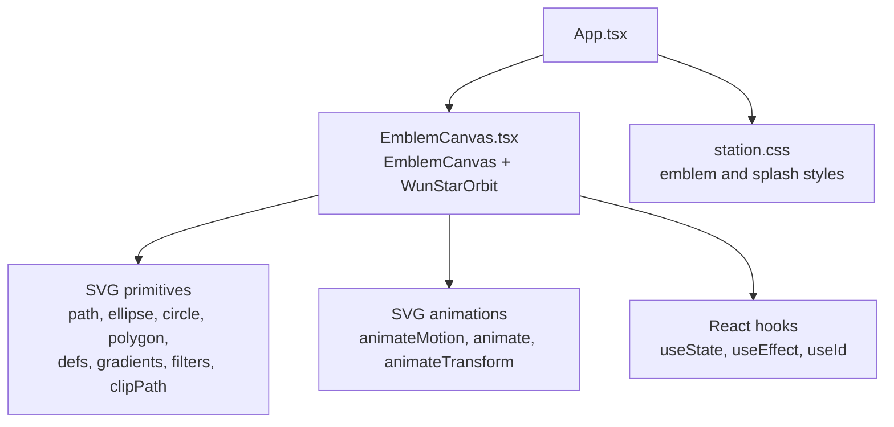
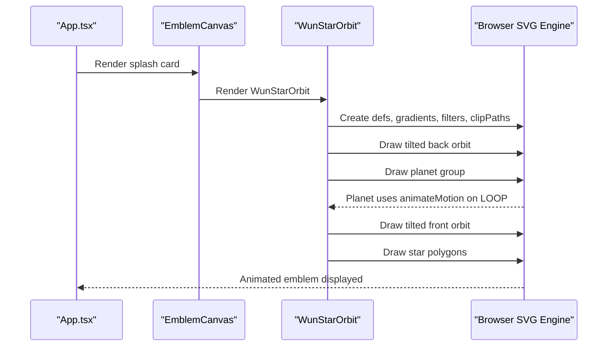
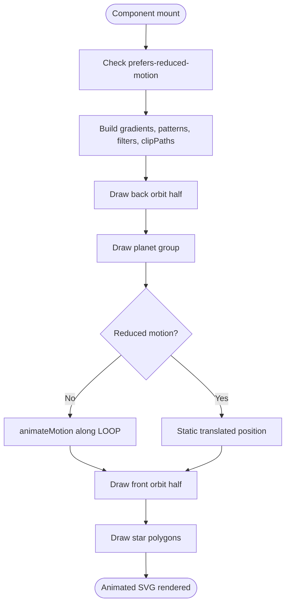
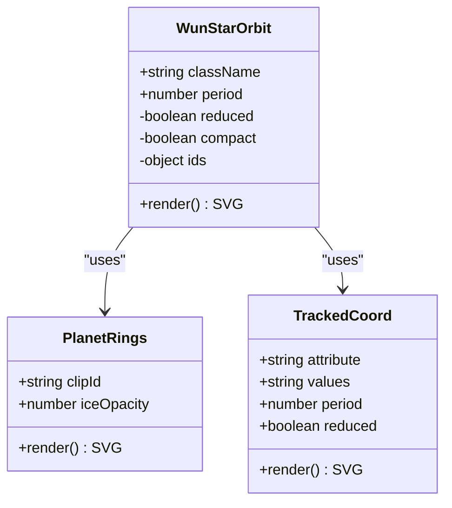
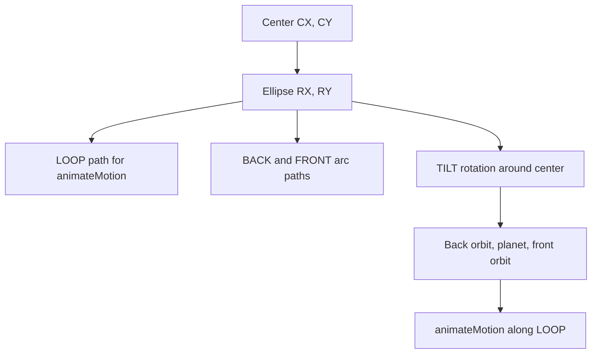
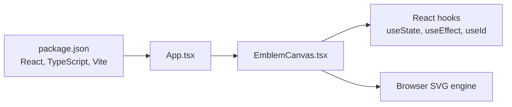

# EmblemCanvas Component

<cite>
**Referenced Files in This Document**
- [EmblemCanvas.tsx](file://src/EmblemCanvas.tsx)
- [App.tsx](file://src/App.tsx)
- [station.css](file://src/station.css)
- [package.json](file://package.json)
</cite>

## Table of Contents
1. [Introduction](#introduction)
2. [Project Structure](#project-structure)
3. [Core Components](#core-components)
4. [Architecture Overview](#architecture-overview)
5. [Detailed Component Analysis](#detailed-component-analysis)
6. [Dependency Analysis](#dependency-analysis)
7. [Performance Considerations](#performance-considerations)
8. [Troubleshooting Guide](#troubleshooting-guide)
9. [Conclusion](#conclusion)

## Introduction
The EmblemCanvas component renders the WUN brand emblem as an animated SVG illustration. It composes a stylized star, an elliptical orbit, and a planet with rings that travel along the orbital path. The animation system is built entirely from declarative SVG elements: `animateMotion` for orbital movement, `animate` and `animateTransform` for gradient and pattern motion, CSS animations for drawing and fading effects, and React hooks for lifecycle and accessibility behavior.

EmblemCanvas also provides the reusable `WunStarOrbit` component, which can be embedded in other parts of the application, such as the topbar and passport preview.

## Project Structure
The emblem logic lives in a single React module. The application shell imports and renders both `EmblemCanvas` and `WunStarOrbit`. Visual styling is defined in a shared stylesheet.

**Diagram sources**
- [App.tsx:15-17](file://src/App.tsx#L15-L17)
- [App.tsx:184-184](file://src/App.tsx#L184-L184)
- [App.tsx:287-287](file://src/App.tsx#L287-L287)
- [EmblemCanvas.tsx:1-1](file://src/EmblemCanvas.tsx#L1-L1)

**Section sources**
- [EmblemCanvas.tsx:1-378](file://src/EmblemCanvas.tsx#L1-L378)
- [App.tsx:15-17](file://src/App.tsx#L15-L17)
- [App.tsx:184-184](file://src/App.tsx#L184-L184)
- [App.tsx:287-287](file://src/App.tsx#L287-L287)
- [station.css:793-829](file://src/station.css#L793-L829)

## Core Components
This section explains the two exported components and their responsibilities.

### EmblemCanvas
- Purpose: Renders the full splash card containing background shapes, the WUN emblem, wordmark text, and a decorative rule.
- Props:
  - `activeRoomName?: string`: Provided by the parent but not consumed inside the component.
- Behavior:
  - Wraps `WunStarOrbit` inside a branded card container.
  - Adds letter-by-letter animation delays to the wordmark text.
  - Uses semantic attributes like `role="img"` and `aria-label` for accessibility.

**Section sources**
- [EmblemCanvas.tsx:329-377](file://src/EmblemCanvas.tsx#L329-L377)

### WunStarOrbit
- Purpose: Renders the core animated emblem: star, orbit lines, and a moving planet with rings.
- Props:
  - `className?: string`: Used to detect compact or mini variants through class name inspection.
  - `period?: number`: Controls the duration of the orbital animation in seconds; defaults to eight seconds.
- Responsibilities:
  - Generates unique IDs for gradients, patterns, filters, and clip paths.
  - Builds SVG definitions including linear gradients, radial gradients, patterns, glow filters, and clip regions.
  - Draws the star using layered polygons.
  - Draws back and front halves of the orbit to create depth.
  - Places the planet between the back and front orbit layers.
  - Applies reduced-motion behavior when requested by the browser.

**Section sources**
- [EmblemCanvas.tsx:109-327](file://src/EmblemCanvas.tsx#L109-L327)

## Architecture Overview
The emblem is composed of three main visual layers:

1. Background orbit half behind the planet.
2. Planet with atmosphere, clouds, sheen, and ring segments.
3. Foreground orbit half in front of the planet.

The entire scene is rotated around the center point to tilt the orbit. The planet follows an elliptical path using `animateMotion`, while gradients and patterns animate independently to simulate lighting and cloud drift.

**Diagram sources**
- [App.tsx:287-287](file://src/App.tsx#L287-L287)
- [EmblemCanvas.tsx:180-325](file://src/EmblemCanvas.tsx#L180-L325)

## Detailed Component Analysis

### SVG-Based Animation System
The animation system combines several techniques:

- Orbital motion: The planet moves along an elliptical loop defined by a path constant. When reduced motion is disabled, `animateMotion` animates the planet along this path for the configured period.
- Gradient tracking: Radial gradients representing starlight and sheen track the planet’s position by animating their `cx` and `cy` values. The tracked coordinates are precomputed so the highlight remains on the star-facing side of the planet.
- Pattern drift: A repeating pattern fills the planet’s cloud layer and translates horizontally over time.
- CSS-driven reveals: Orbit lines draw themselves using CSS stroke-dashoffset animations, and the star fades in with a pulse effect.
- Reduced motion: When the user prefers reduced motion, the component disables continuous animations, freezes the planet at a fixed position, and removes some dynamic effects.

**Diagram sources**
- [EmblemCanvas.tsx:109-121](file://src/EmblemCanvas.tsx#L109-L121)
- [EmblemCanvas.tsx:164-177](file://src/EmblemCanvas.tsx#L164-L177)
- [EmblemCanvas.tsx:287-324](file://src/EmblemCanvas.tsx#L287-L324)

**Section sources**
- [EmblemCanvas.tsx:19-50](file://src/EmblemCanvas.tsx#L19-L50)
- [EmblemCanvas.tsx:52-74](file://src/EmblemCanvas.tsx#L52-L74)
- [EmblemCanvas.tsx:109-121](file://src/EmblemCanvas.tsx#L109-L121)
- [EmblemCanvas.tsx:164-177](file://src/EmblemCanvas.tsx#L164-L177)
- [EmblemCanvas.tsx:204-220](file://src/EmblemCanvas.tsx#L204-L220)
- [EmblemCanvas.tsx:221-265](file://src/EmblemCanvas.tsx#L221-L265)
- [EmblemCanvas.tsx:266-285](file://src/EmblemCanvas.tsx#L266-L285)
- [station.css:793-829](file://src/station.css#L793-L829)

### WunStarOrbit Component Structure
The component organizes its rendering into small helpers and grouped sections:

- Constants define the canvas center, ellipse radii, tilt angle, loop path, and ring configuration.
- `STAR_LIGHT` precomputes coordinate sequences for animated gradient centers.
- `TrackedCoord` renders `<animate>` elements only when reduced motion is off.
- `PlanetRings` draws multiple elliptical ring bands with clipping to separate front and back halves.
- `orbitLine` renders the visible orbit line and optional glow layer.
- `planet` composes the planet’s atmosphere, clouds, lighting, rings, and motion.
- The main render builds `<defs>`, then draws the tilted back orbit and planet, the central star, and finally the tilted front orbit and planet.

**Diagram sources**
- [EmblemCanvas.tsx:76-107](file://src/EmblemCanvas.tsx#L76-L107)
- [EmblemCanvas.tsx:52-74](file://src/EmblemCanvas.tsx#L52-L74)
- [EmblemCanvas.tsx:123-327](file://src/EmblemCanvas.tsx#L123-L327)

**Section sources**
- [EmblemCanvas.tsx:3-17](file://src/EmblemCanvas.tsx#L3-L17)
- [EmblemCanvas.tsx:76-107](file://src/EmblemCanvas.tsx#L76-L107)
- [EmblemCanvas.tsx:123-327](file://src/EmblemCanvas.tsx#L123-L327)

### Orbital Mechanics Implementation
The orbital mechanics are intentionally simple and visually driven rather than physically simulated:

- The orbit is an ellipse centered at a fixed point with horizontal radius `RX` and vertical radius `RY`.
- The path constant defines a closed elliptical loop used by `animateMotion`.
- The planet group is placed inside a clipped region so it appears behind or in front of the orbit depending on the layer.
- The whole scene is rotated by a fixed tilt angle around the center point.
- In reduced-motion mode, the planet is translated to a static position instead of animating along the loop.

**Diagram sources**
- [EmblemCanvas.tsx:3-10](file://src/EmblemCanvas.tsx#L3-L10)
- [EmblemCanvas.tsx:164-177](file://src/EmblemCanvas.tsx#L164-L177)
- [EmblemCanvas.tsx:287-324](file://src/EmblemCanvas.tsx#L287-L324)

**Section sources**
- [EmblemCanvas.tsx:3-10](file://src/EmblemCanvas.tsx#L3-L10)
- [EmblemCanvas.tsx:164-177](file://src/EmblemCanvas.tsx#L164-L177)
- [EmblemCanvas.tsx:287-324](file://src/EmblemCanvas.tsx#L287-L324)

### Visual Styling Approaches
Styling combines inline SVG attributes, CSS classes, and SVG presentation features:

- Gradients: Linear gradients color the star facets and orbit stroke; radial gradients model atmosphere, starlight, and sheen.
- Patterns: A repeating pattern creates the planet’s cloud texture and animates horizontal translation.
- Filters: A Gaussian blur filter adds a soft glow to the orbit line.
- Clip paths: Separate clip regions split the rings into back and front halves and divide the scene vertically for depth.
- CSS animations: Orbit lines draw themselves, the planet fades in, and the star pulses after appearing.

**Section sources**
- [EmblemCanvas.tsx:182-285](file://src/EmblemCanvas.tsx#L182-L285)
- [station.css:793-829](file://src/station.css#L793-L829)

### Props Interface
The public interface is minimal:

- `WunStarOrbitProps`:
  - `className?: string`: Allows embedding the emblem in different contexts. The implementation checks whether the class name contains `mini` to adjust visual density.
  - `period?: number`: Sets the orbital animation duration in seconds. Default is eight seconds.
- `EmblemCanvasProps`:
  - `activeRoomName?: string`: Declared but unused by the component.

**Section sources**
- [EmblemCanvas.tsx:123-126](file://src/EmblemCanvas.tsx#L123-L126)
- [EmblemCanvas.tsx:329-331](file://src/EmblemCanvas.tsx#L329-L331)

### State Management Patterns
State and lifecycle behavior are lightweight:

- `usePrefersReducedMotion`:
  - Initializes state from the browser’s media query.
  - Subscribes to changes in the reduced-motion preference.
  - Returns a boolean that controls whether animations are active.
- `useId`:
  - Generates stable, unique IDs for SVG definitions so multiple instances do not collide.
- No local component state is used for animation timing; durations come from props and declarative SVG/CSS animations.

**Section sources**
- [EmblemCanvas.tsx:109-121](file://src/EmblemCanvas.tsx#L109-L121)
- [EmblemCanvas.tsx:131-147](file://src/EmblemCanvas.tsx#L131-L147)

### Integration with React Lifecycle Methods
The component relies on modern React hooks rather than class-based lifecycle methods:

- `useEffect` sets up and tears down the media query listener for reduced motion.
- `useState` holds the current reduced-motion preference.
- `useId` runs during render to produce unique identifiers.
- Rendering is purely functional: the same inputs produce the same SVG structure.

**Section sources**
- [EmblemCanvas.tsx:1-1](file://src/EmblemCanvas.tsx#L1-L1)
- [EmblemCanvas.tsx:109-121](file://src/EmblemCanvas.tsx#L109-L121)
- [EmblemCanvas.tsx:131-147](file://src/EmblemCanvas.tsx#L131-L147)

### Animation Timing, Rotation Calculations, and Visual Effects
Key timing and calculation behaviors:

- Orbital period: Controlled by the `period` prop and applied to both `animateMotion` and tracked gradient animations.
- Starlight tracking: Precomputed coordinate arrays drive gradient `cx` and `cy` values so the highlight stays aligned with the star-facing side of the planet.
- Sheen wobble: Additional small additive animations shift the sheen gradient slightly for organic movement.
- Cloud drift: The cloud pattern translates horizontally over a fixed duration.
- Orbit drawing: CSS animates `stroke-dashoffset` to reveal the orbit line after a short delay.
- Star entrance: CSS fades the star in and applies a long-running pulse animation.
- Tilt: The orbit groups are rotated around the center point to give a tilted perspective.

**Section sources**
- [EmblemCanvas.tsx:19-50](file://src/EmblemCanvas.tsx#L19-L50)
- [EmblemCanvas.tsx:204-220](file://src/EmblemCanvas.tsx#L204-L220)
- [EmblemCanvas.tsx:221-265](file://src/EmblemCanvas.tsx#L221-L265)
- [EmblemCanvas.tsx:287-324](file://src/EmblemCanvas.tsx#L287-L324)
- [station.css:793-829](file://src/station.css#L793-L829)

### Customization Examples
You can customize the emblem by adjusting props and CSS:

- Change orbital speed:
  - Pass a larger `period` value to slow the orbit, or a smaller value to speed it up.
  - Example usage locations include the topbar and passport preview.
- Use the compact variant:
  - Add a class name containing `mini` to reduce visual density and disable the glow orbit layer.
- Adjust colors:
  - Modify the linear gradients for blue and gold star facets.
  - Modify the ring gradient and stroke colors.
  - Adjust radial gradient stops for atmosphere, starlight, and sheen.
- Adjust opacity and glow:
  - Tune the orbit glow filter’s standard deviation.
  - Adjust CSS stroke opacity for mini emblems.
- Adjust animation timing:
  - Update CSS keyframes referenced by the emblem styles if you need custom fade-in or pulse timings.

**Section sources**
- [App.tsx:184-184](file://src/App.tsx#L184-L184)
- [App.tsx:387-387](file://src/App.tsx#L387-L387)
- [EmblemCanvas.tsx:128-130](file://src/EmblemCanvas.tsx#L128-L130)
- [EmblemCanvas.tsx:183-203](file://src/EmblemCanvas.tsx#L183-L203)
- [EmblemCanvas.tsx:221-268](file://src/EmblemCanvas.tsx#L221-L268)
- [station.css:808-811](file://src/station.css#L808-L811)

## Dependency Analysis
The emblem depends on React hooks and standard SVG capabilities. The application imports both exported components from the emblem module.

**Diagram sources**
- [package.json:11-16](file://package.json#L11-L16)
- [App.tsx:15-17](file://src/App.tsx#L15-L17)
- [EmblemCanvas.tsx:1-1](file://src/EmblemCanvas.tsx#L1-L1)

**Section sources**
- [package.json:11-16](file://package.json#L11-L16)
- [App.tsx:15-17](file://src/App.tsx#L15-L17)
- [EmblemCanvas.tsx:1-1](file://src/EmblemCanvas.tsx#L1-L1)

## Performance Considerations
- Prefer SVG-native animations: The component uses `animateMotion`, `animate`, and `animateTransform`, which are generally efficient because they run on the compositor or native animation pipeline where supported.
- Avoid excessive re-renders: The component does not frequently update state; most animation state is handled by the browser.
- Respect reduced motion: Disabling animations reduces CPU/GPU load and improves accessibility.
- Limit complex filters: The orbit glow uses a Gaussian blur filter; avoid duplicating expensive filters unnecessarily.
- Keep gradient and pattern updates simple: The component precomputes coordinate strings and uses declarative animations rather than JavaScript-driven frame loops.
- Reuse definitions: Unique IDs prevent collisions without rebuilding large shared structures.

[No sources needed since this section provides general guidance]

## Troubleshooting Guide
Common issues and resolutions:

- Planet does not move:
  - Verify that `prefers-reduced-motion` is not enabled.
  - Confirm that `animateMotion` is present and the `LOOP` path is valid.
- Orbit line does not appear:
  - Check CSS animations for `wun-splash-draw`.
  - Ensure the `wun-orbit__line` class is applied and not overridden.
- Glow effect missing:
  - Confirm the glow filter definition exists and the filter URL reference matches the generated ID.
  - Check that the compact variant is not hiding the glow layer.
- Colors look wrong:
  - Verify gradient IDs are unique per instance.
  - Ensure the correct linear or radial gradient is referenced by each shape.
- Planet rings look cut off:
  - Confirm the clip paths for back and front ring halves are correctly applied.
- Animation glitches in older browsers:
  - Some older browsers have limited support for SVG animations or CSS transforms on SVG elements.
  - Test with reduced motion enabled as a fallback.
  - Consider polyfills or feature detection if supporting legacy environments.

**Section sources**
- [EmblemCanvas.tsx:109-121](file://src/EmblemCanvas.tsx#L109-L121)
- [EmblemCanvas.tsx:149-161](file://src/EmblemCanvas.tsx#L149-L161)
- [EmblemCanvas.tsx:164-177](file://src/EmblemCanvas.tsx#L164-L177)
- [EmblemCanvas.tsx:182-285](file://src/EmblemCanvas.tsx#L182-L285)
- [station.css:793-829](file://src/station.css#L793-L829)

## Conclusion
EmblemCanvas delivers a polished, SVG-based brand emblem with layered depth, orbital motion, and accessible design. Its architecture separates concerns cleanly: constants and precomputed data define geometry, helper components build reusable visuals, and React hooks manage lifecycle and accessibility. The animation system favors declarative SVG and CSS techniques, making it performant and easy to customize. By adjusting `period`, class names, gradients, and CSS animations, developers can adapt the emblem for different contexts while maintaining consistent visual quality.

[No sources needed since this section summarizes without analyzing specific files]