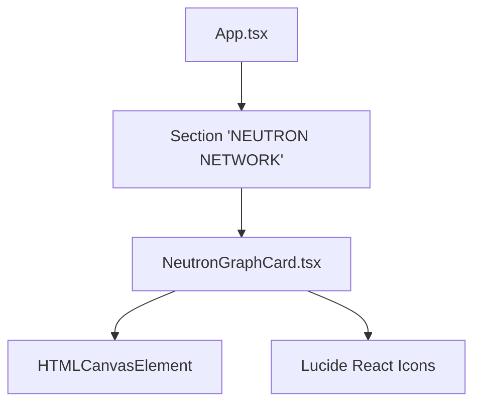
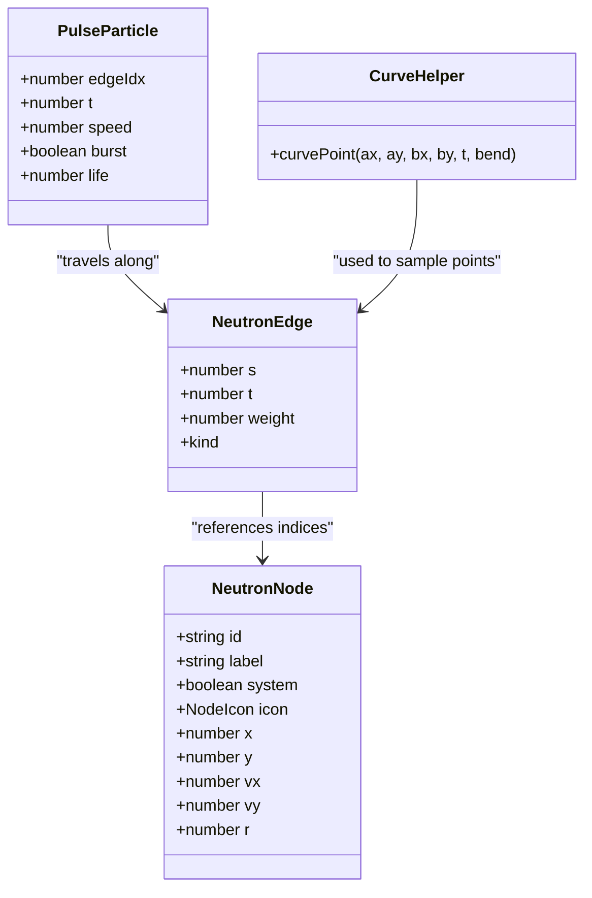
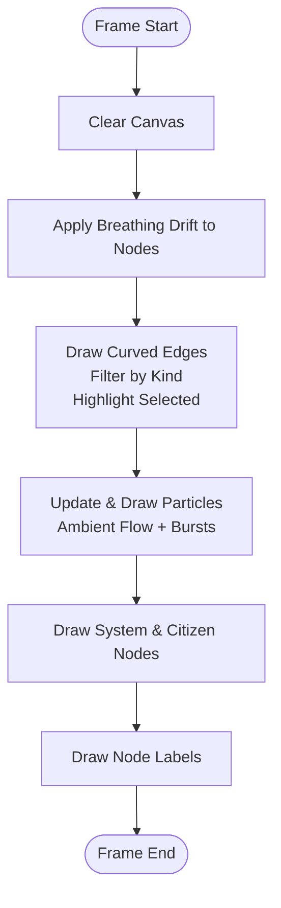
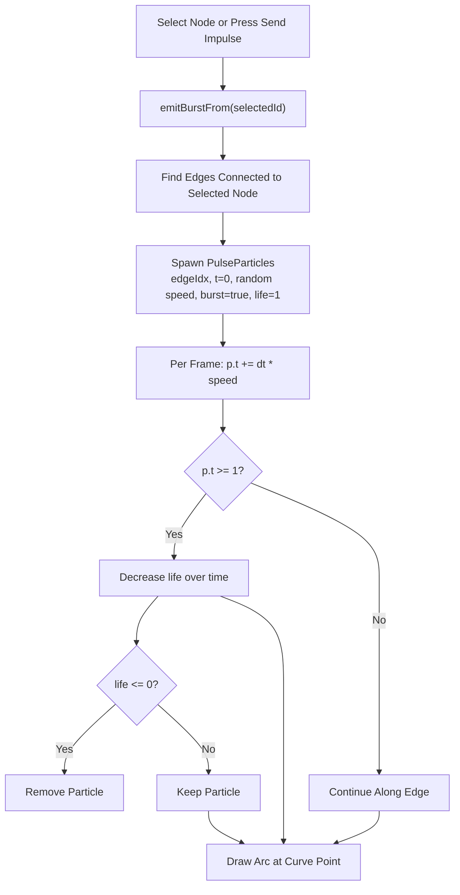
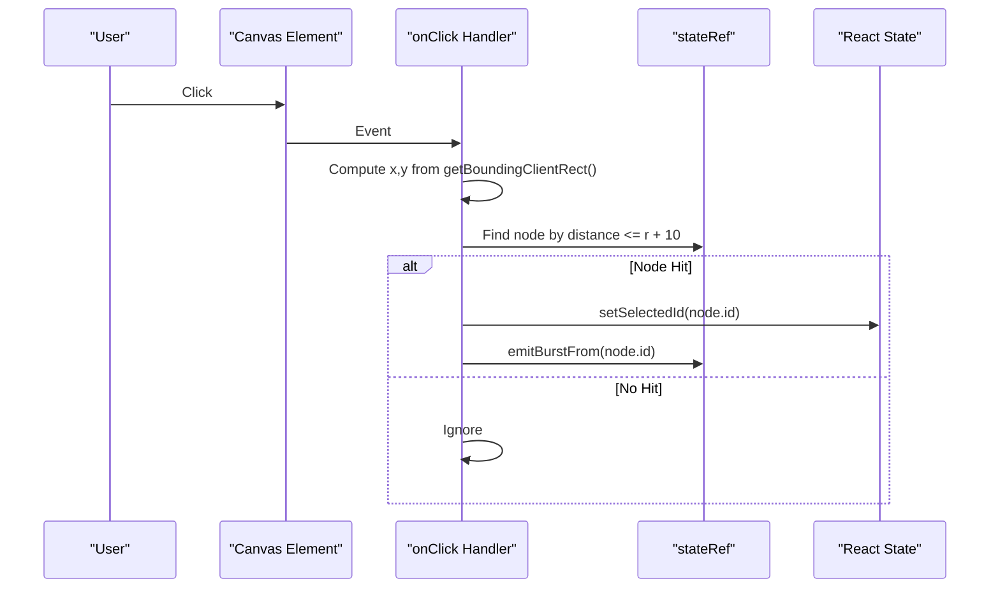
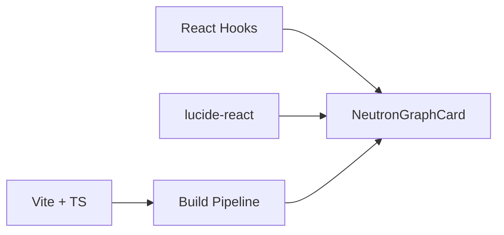

# NeutronGraphCard Component

<cite>
**Referenced Files in This Document**
- [NeutronGraphCard.tsx](file://src/NeutronGraphCard.tsx)
- [App.tsx](file://src/App.tsx)
- [package.json](file://package.json)
</cite>

## Table of Contents
1. [Introduction](#introduction)
2. [Project Structure](#project-structure)
3. [Core Components](#core-components)
4. [Architecture Overview](#architecture-overview)
5. [Detailed Component Analysis](#detailed-component-analysis)
6. [Dependency Analysis](#dependency-analysis)
7. [Performance Considerations](#performance-considerations)
8. [Troubleshooting Guide](#troubleshooting-guide)
9. [Conclusion](#conclusion)

## Introduction
The NeutronGraphCard component renders an interactive, Canvas-based network graph that visualizes a “living” flow of data between system nodes and citizen nodes. It supports:
- Node selection with visual emphasis
- Edge highlighting for selected connections
- Animated particles flowing along edges
- Pulse bursts triggered by user interactions
- Stream filtering by edge kind
- Responsive canvas sizing and high-DPI rendering

This documentation explains the rendering pipeline, interaction model, animation system, data structures, customization options, performance strategies, and troubleshooting guidance.

## Project Structure
The component is implemented as a single React function component in `NeutronGraphCard.tsx`. It is consumed within the application’s main layout in `App.tsx`, where it appears under a dedicated section labeled “Neutron Network.” The project uses Vite, TypeScript, React 19, and Lucide icons.



**Diagram sources**
- [App.tsx:292-308](file://src/App.tsx#L292-L308)
- [NeutronGraphCard.tsx:87-396](file://src/NeutronGraphCard.tsx#L87-L396)

**Section sources**
- [App.tsx:292-308](file://src/App.tsx#L292-L308)
- [package.json:1-26](file://package.json#L1-L26)

## Core Components
- Graph data model:
  - Nodes represent system services or citizen accounts with position, radius, label, icon type, and velocity fields.
  - Edges connect node indices with a weight and a stream kind (sync, reward, trade).
  - Pulse particles travel along edges to visualize flow and burst effects.
- Rendering loop:
  - A `requestAnimationFrame` loop updates positions, draws curved edges, flows particles, and paints nodes and labels.
- Interaction layer:
  - Click detection on the canvas selects a node and triggers a pulse burst.
  - UI controls filter streams and send impulses from the currently selected node.
- State synchronization:
  - React state drives UI; a mutable `stateRef` holds live simulation state for efficient per-frame updates.

**Section sources**
- [NeutronGraphCard.tsx:6-31](file://src/NeutronGraphCard.tsx#L6-L31)
- [NeutronGraphCard.tsx:41-73](file://src/NeutronGraphCard.tsx#L41-L73)
- [NeutronGraphCard.tsx:87-108](file://src/NeutronGraphCard.tsx#L87-L108)
- [NeutronGraphCard.tsx:181-302](file://src/NeutronGraphCard.tsx#L181-L302)
- [NeutronGraphCard.tsx:312-396](file://src/NeutronGraphCard.tsx#L312-L396)

## Architecture Overview
The component follows a clear separation between declarative UI state and imperative simulation state:
- Declarative state: selected node ID, active filter, impulse counter.
- Imperative state: nodes, particles, canvas dimensions, and timing.
- Lifecycle:
  - On mount, initialize ambient particles, set up resize handling, start the render loop.
  - On unmount, cancel animation frames and disconnect observers.

```mermaid
sequenceDiagram
participant UI as "React UI"
participant Ref as "stateRef"
participant Loop as "Render Loop"
participant Ctx as "Canvas 2D Context"
UI->>Ref : Update selectedId / filterKind
Note over Ref : Mutable simulation state updated synchronously
Loop->>Ctx : Clear rect
Loop->>Loop : Apply breathing drift to nodes
Loop->>Ctx : Draw filtered edges with highlight
Loop->>Loop : Update and draw particles
Loop->>Ctx : Draw system/citizen nodes and labels
UI-->>UI : onClick -> select node + emitBurstFrom()
```

**Diagram sources**
- [NeutronGraphCard.tsx:93-108](file://src/NeutronGraphCard.tsx#L93-L108)
- [NeutronGraphCard.tsx:181-302](file://src/NeutronGraphCard.tsx#L181-L302)
- [NeutronGraphCard.tsx:361-372](file://src/NeutronGraphCard.tsx#L361-L372)

## Detailed Component Analysis

### Data Structures and Topology
- Node structure includes identity, label, system flag, icon type, coordinates, velocities, and radius.
- Edge structure references source/target node indices, weight, and kind.
- Pulse particle structure tracks the target edge index, normalized progress along the curve, speed, and optional burst lifecycle.
- Icon paths are predeclared and cached via `Path2D` to avoid repeated parsing.



**Diagram sources**
- [NeutronGraphCard.tsx:6-31](file://src/NeutronGraphCard.tsx#L6-L31)
- [NeutronGraphCard.tsx:75-85](file://src/NeutronGraphCard.tsx#L75-L85)

**Section sources**
- [NeutronGraphCard.tsx:6-31](file://src/NeutronGraphCard.tsx#L6-L31)
- [NeutronGraphCard.tsx:41-73](file://src/NeutronGraphCard.tsx#L41-L73)
- [NeutronGraphCard.tsx:75-85](file://src/NeutronGraphCard.tsx#L75-L85)

### Canvas Rendering System
- High-DPI support:
  - Canvas width/height scaled by device pixel ratio.
  - Context transform applied to map logical pixels to device pixels.
- Resize handling:
  - Uses `ResizeObserver` to adapt to container changes.
  - Scales node X positions proportionally when width changes.
- Drawing order:
  1. Clear canvas.
  2. Apply subtle sinusoidal drift to node positions.
  3. Draw curved edges with conditional styling based on selection and filter.
  4. Update and draw flowing particles along edges.
  5. Draw system nodes with gradient fills, halos, and icon outlines.
  6. Draw citizen nodes with solid fills and strokes.
  7. Render labels beneath each node.



**Diagram sources**
- [NeutronGraphCard.tsx:155-171](file://src/NeutronGraphCard.tsx#L155-L171)
- [NeutronGraphCard.tsx:181-302](file://src/NeutronGraphCard.tsx#L181-L302)

**Section sources**
- [NeutronGraphCard.tsx:155-171](file://src/NeutronGraphCard.tsx#L155-L171)
- [NeutronGraphCard.tsx:181-302](file://src/NeutronGraphCard.tsx#L181-L302)

### Animation System
- Ambient flow:
  - Two particles seeded per edge with staggered phases and speeds.
- Burst pulses:
  - Triggered when a node is selected or when the “Send Impulse” button is pressed.
  - Creates particles on all edges connected to the selected node.
  - Burst particles fade out after reaching the end of their edge.
- Smooth transitions:
  - Particle progress advances by delta time multiplied by speed.
  - Non-burst particles wrap around using modulo arithmetic.
  - Visual opacity adjusts for burst glow and ambient flow.



**Diagram sources**
- [NeutronGraphCard.tsx:110-126](file://src/NeutronGraphCard.tsx#L110-L126)
- [NeutronGraphCard.tsx:128-143](file://src/NeutronGraphCard.tsx#L128-L143)
- [NeutronGraphCard.tsx:218-252](file://src/NeutronGraphCard.tsx#L218-L252)

**Section sources**
- [NeutronGraphCard.tsx:110-126](file://src/NeutronGraphCard.tsx#L110-L126)
- [NeutronGraphCard.tsx:128-143](file://src/NeutronGraphCard.tsx#L128-L143)
- [NeutronGraphCard.tsx:218-252](file://src/NeutronGraphCard.tsx#L218-L252)

### User Interaction Handling
- Mouse click on canvas:
  - Computes click coordinates relative to the canvas bounding box.
  - Performs circular hit testing against nodes with a generous hit radius.
  - Updates selected node and emits a pulse burst from that node.
- Filter pills:
  - Toggle between “All Streams,” “Friend Bonuses,” “Passport Sync,” and “Market Deals.”
  - Filters visible edges and associated particles.
- Footer node pills:
  - Provide quick access to system nodes; selecting one also triggers a pulse burst.



**Diagram sources**
- [NeutronGraphCard.tsx:361-372](file://src/NeutronGraphCard.tsx#L361-L372)
- [NeutronGraphCard.tsx:110-126](file://src/NeutronGraphCard.tsx#L110-L126)

**Section sources**
- [NeutronGraphCard.tsx:361-372](file://src/NeutronGraphCard.tsx#L361-L372)
- [NeutronGraphCard.tsx:325-354](file://src/NeutronGraphCard.tsx#L325-L354)
- [NeutronGraphCard.tsx:376-392](file://src/NeutronGraphCard.tsx#L376-L392)

### Touch Support and Keyboard Navigation
- Touch support:
  - The component does not implement explicit touch event handlers.
  - Browsers may translate some touch gestures into mouse events depending on platform behavior, but this is not guaranteed.
- Keyboard navigation:
  - There is no built-in keyboard focus management or key listeners for the canvas.
  - The footer node pills are regular buttons and can be navigated with standard keyboard focus; however, there is no custom keydown handler to trigger actions.

Recommendation: Add explicit `onPointerDown`/`onPointerMove`/`onPointerUp` handlers for consistent pointer behavior across devices, and add a `keydown` listener to handle Enter/Space for pill buttons and optionally arrow keys for node traversal.

[No sources needed since this section provides general guidance]

### Customization Examples

- Customize node appearances:
  - Modify the drawing logic for system nodes to change halo size, gradient colors, or icon scaling.
  - Adjust citizen node fill/stroke colors and radii.
  - Change label font family, size, and color.

- Customize edge styles:
  - Adjust stroke colors and widths for selected vs. non-selected edges.
  - Modify the curvature factor in the curve helper to alter edge shape.

- Customize animation behaviors:
  - Increase/decrease ambient particle count per edge.
  - Tune particle speeds and burst lifetimes.
  - Adjust the breathing drift amplitude and frequency.

- Customize color schemes:
  - Replace hard-coded colors with theme variables or props passed into the component.
  - Map edge kinds to different palettes.

Note: These customizations should be implemented by extending the drawing and animation sections of the component.

[No sources needed since this section provides general guidance]

## Dependency Analysis
- React hooks:
  - `useEffect` initializes the canvas lifecycle and animation loop.
  - `useRef` holds the canvas element and mutable simulation state.
  - `useState` manages selected node, filter kind, and impulse count.
- External libraries:
  - Lucide React icons are used for UI badges and action buttons.
- Build tooling:
  - Vite and TypeScript are configured for development and build.



**Diagram sources**
- [NeutronGraphCard.tsx:1-2](file://src/NeutronGraphCard.tsx#L1-L2)
- [package.json:11-16](file://package.json#L11-L16)
- [package.json:18-24](file://package.json#L18-L24)

**Section sources**
- [NeutronGraphCard.tsx:1-2](file://src/NeutronGraphCard.tsx#L1-L2)
- [package.json:11-16](file://package.json#L11-L16)
- [package.json:18-24](file://package.json#L18-L24)

## Performance Considerations
- Rendering efficiency:
  - Use `requestAnimationFrame` for smooth frame pacing.
  - Clamp delta time to prevent large jumps when tabs are inactive.
  - Avoid heavy allocations inside the render loop; reuse objects where possible.
- Canvas scaling:
  - Scale canvas dimensions by device pixel ratio for crisp rendering on high-DPI displays.
  - Apply context transform once per resize rather than per frame.
- Memory management:
  - Cancel animation frames and disconnect `ResizeObserver` on cleanup.
  - Limit particle counts; remove expired burst particles promptly.
- Large graphs:
  - Consider spatial partitioning for hit testing if node count grows significantly.
  - Batch edge drawing and minimize state reads/writes per frame.
  - Precompute static geometry (e.g., icon paths) and cache results.
- Responsive design:
  - Use `ResizeObserver` to adapt to container changes.
  - Scale node positions proportionally when width changes.
  - Ensure minimum canvas width to maintain readability.

[No sources needed since this section provides general guidance]

## Troubleshooting Guide

- Canvas scaling problems:
  - Symptom: Blurry or misaligned graphics.
  - Causes: Incorrect device pixel ratio handling or missing context transform.
  - Fixes:
    - Set canvas width/height to logical size times device pixel ratio.
    - Apply `setTransform(dpr, 0, 0, dpr, 0, 0)` on the 2D context.
    - Recalculate sizes on resize and update node positions proportionally.

- Animation performance bottlenecks:
  - Symptom: Janky animations or high CPU usage.
  - Causes: Excessive allocations, too many particles, or expensive operations per frame.
  - Fixes:
    - Reduce ambient particle density.
    - Cap burst particle lifetimes and remove them promptly.
    - Avoid creating new objects inside the render loop; reuse buffers.
    - Ensure delta time is clamped to reasonable bounds.

- Interaction detection failures:
  - Symptom: Clicks do not select nodes.
  - Causes: Coordinate mismatch between event coordinates and canvas coordinate space.
  - Fixes:
    - Subtract the canvas bounding rectangle offsets from client coordinates.
    - Use a generous hit radius (node radius plus padding).
    - Verify that node positions are updated consistently with canvas scaling.

- Filter not updating visuals:
  - Symptom: Edges remain visible despite filter selection.
  - Causes: Filter state not synchronized with simulation state or drawing logic ignores filter.
  - Fixes:
    - Ensure `filterKind` updates `stateRef.current.filter`.
    - Confirm edge drawing and particle filtering check the active filter.

- Missing touch or keyboard support:
  - Symptom: Touch interactions do not work; keyboard navigation unavailable.
  - Causes: No explicit touch or key handlers.
  - Fixes:
    - Add pointer event handlers for consistent cross-device input.
    - Wire keyboard events to pill buttons and optionally to canvas for accessibility.

**Section sources**
- [NeutronGraphCard.tsx:155-171](file://src/NeutronGraphCard.tsx#L155-L171)
- [NeutronGraphCard.tsx:181-302](file://src/NeutronGraphCard.tsx#L181-L302)
- [NeutronGraphCard.tsx:361-372](file://src/NeutronGraphCard.tsx#L361-L372)

## Conclusion
The NeutronGraphCard component delivers a polished, animated network visualization powered by Canvas. Its architecture cleanly separates declarative UI state from imperative simulation state, enabling smooth animations, responsive resizing, and intuitive interactions. By following the customization guidelines and performance recommendations, developers can extend the component to support larger datasets, richer themes, and broader accessibility requirements while maintaining responsiveness and clarity.