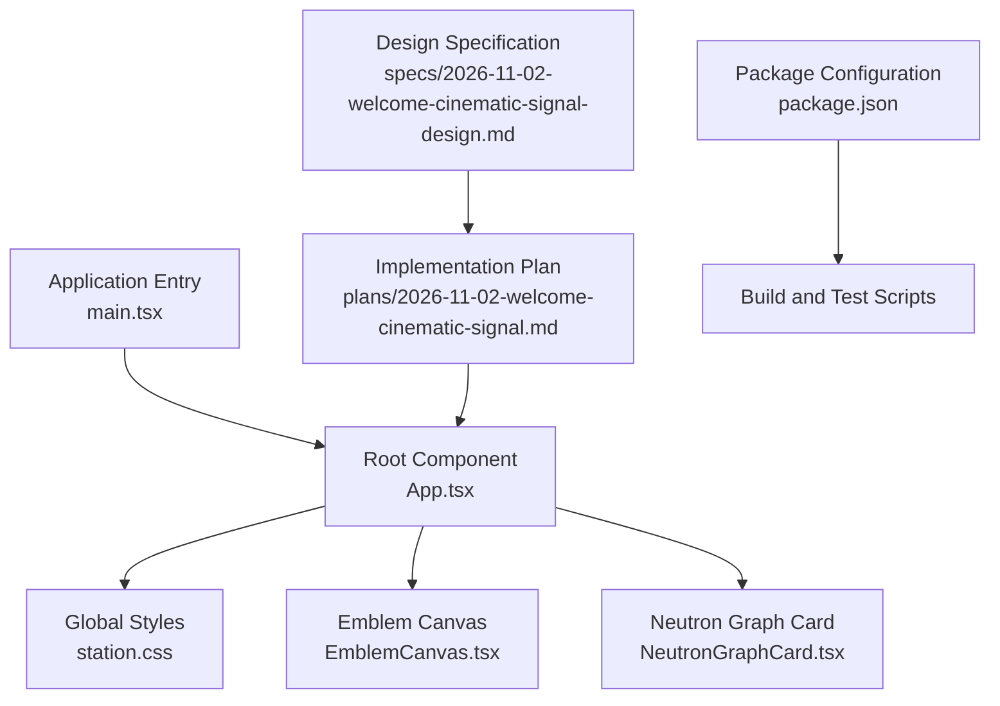
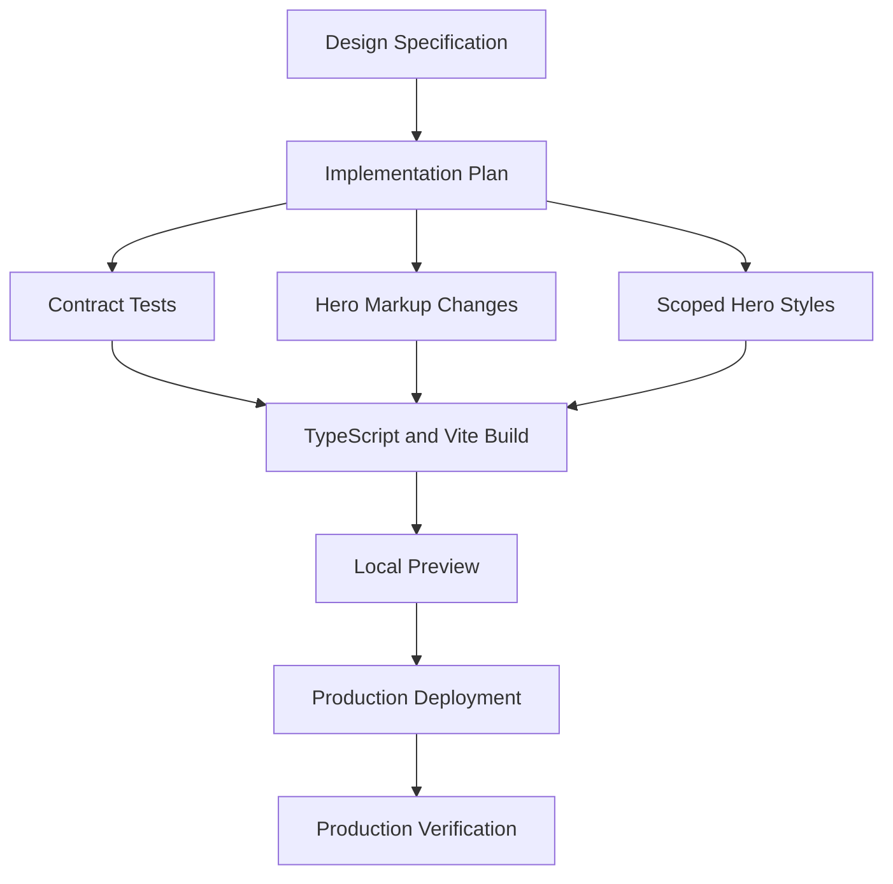
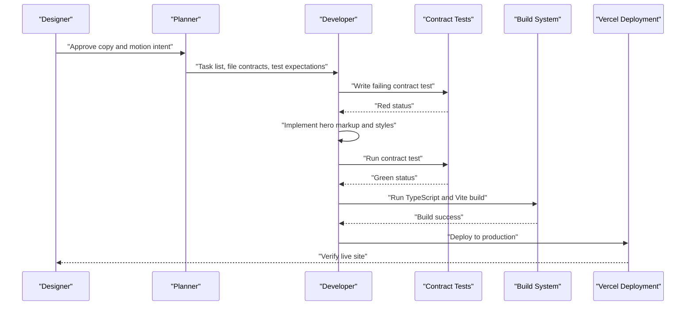
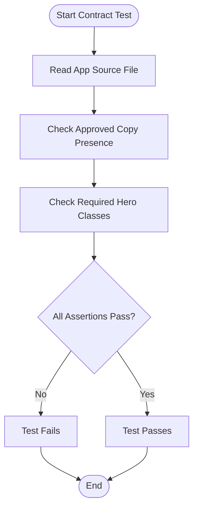
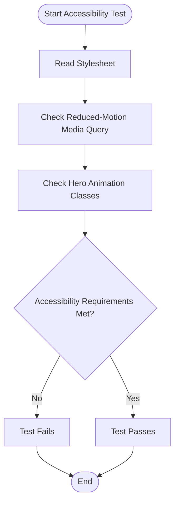
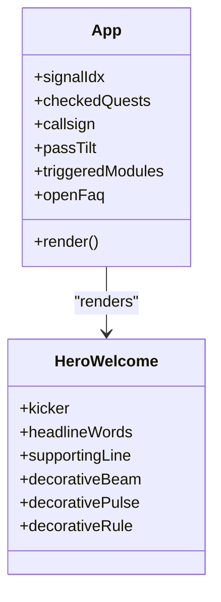
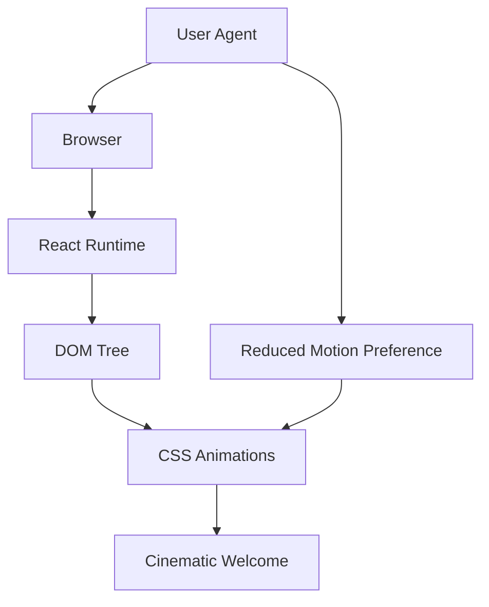
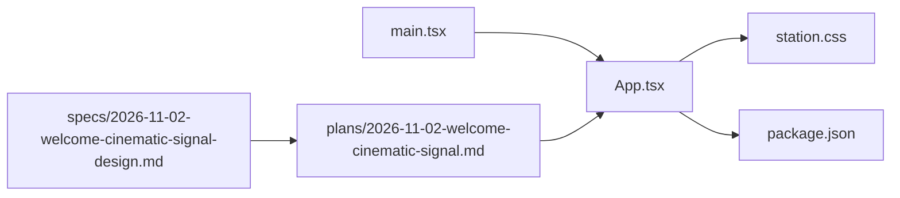
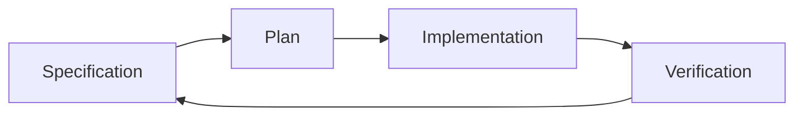

# Development Plans & Specifications

<cite>
**Referenced Files in This Document**
- [2026-11-02-welcome-cinematic-signal.md](file://docs/superpowers/plans/2026-11-02-welcome-cinematic-signal.md)
- [2026-11-02-welcome-cinematic-signal-design.md](file://docs/superpowers/specs/2026-11-02-welcome-cinematic-signal-design.md)
- [package.json](file://package.json)
- [App.tsx](file://src/App.tsx)
- [main.tsx](file://src/main.tsx)
</cite>

## Table of Contents
1. [Introduction](#introduction)
2. [Project Structure](#project-structure)
3. [Core Components](#core-components)
4. [Architecture Overview](#architecture-overview)
5. [Detailed Component Analysis](#detailed-component-analysis)
6. [Dependency Analysis](#dependency-analysis)
7. [Performance Considerations](#performance-considerations)
8. [Troubleshooting Guide](#troubleshooting-guide)
9. [Conclusion](#conclusion)
10. [Appendices](#appendices)

## Introduction
This document explains the development planning and specification process for the WUN Gazette project, using the cinematic signal feature as a concrete example. It describes how plans and specifications relate to each other and to the actual implementation, how the cinematic welcome is designed and planned, and how future features should be documented and tracked.

The cinematic signal feature replaces the generic hero greeting with an approved welcome that combines sequential word reveal, restrained shimmer, a faint light beam, and a small Neutron pulse. The plan defines tasks, interfaces, constraints, tests, build steps, and deployment instructions. The design specification defines goals, approved copy, composition, motion behavior, accessibility requirements, scope, and verification steps.

## Project Structure
The repository contains:
- A React application entry point and main component.
- A CSS stylesheet referenced by the application.
- Documentation under `docs/superpowers/plans` and `docs/superpowers/specs`.
- Package configuration defining scripts, dependencies, and dev dependencies.

**Diagram sources**
- [main.tsx:1-11](file://src/main.tsx#L1-L11)
- [App.tsx:1-571](file://src/App.tsx#L1-L571)
- [2026-11-02-welcome-cinematic-signal.md:1-172](file://docs/superpowers/plans/2026-11-02-welcome-cinematic-signal.md#L1-L172)
- [2026-11-02-welcome-cinematic-signal-design.md:1-62](file://docs/superpowers/specs/2026-11-02-welcome-cinematic-signal-design.md#L1-L62)
- [package.json:1-26](file://package.json#L1-L26)

**Section sources**
- [main.tsx:1-11](file://src/main.tsx#L1-L11)
- [App.tsx:1-571](file://src/App.tsx#L1-L571)
- [package.json:1-26](file://package.json#L1-L26)

## Core Components
The cinematic signal feature spans three primary areas:

- Design specification: Defines the goal, approved copy, composition, motion, accessibility, scope, and verification criteria.
- Implementation plan: Converts the specification into executable tasks, file contracts, test expectations, build commands, and deployment steps.
- Application code: Contains the current hero markup, stateful components, and styles that the plan targets.

Key responsibilities:
- The design specification establishes what must be true before implementation begins.
- The implementation plan defines how to reach that state through ordered tasks and verifiable checks.
- The application code reflects the current state of the feature and serves as the target for changes.

**Section sources**
- [2026-11-02-welcome-cinematic-signal-design.md:1-62](file://docs/superpowers/specs/2026-11-02-welcome-cinematic-signal-design.md#L1-L62)
- [2026-11-02-welcome-cinematic-signal.md:1-172](file://docs/superpowers/plans/2026-11-02-welcome-cinematic-signal.md#L1-L172)
- [App.tsx:1-571](file://src/App.tsx#L1-L571)

## Architecture Overview
The cinematic signal feature follows a layered approach:

- Specification layer: Describes user-facing goals, copy, visual composition, motion intent, accessibility rules, and verification.
- Planning layer: Translates the specification into tasks, files, interfaces, tests, build steps, and deployment actions.
- Implementation layer: Updates React components, CSS, and tests to satisfy the plan.
- Runtime layer: Renders the hero section, applies CSS animations, and respects reduced-motion preferences.

**Diagram sources**
- [2026-11-02-welcome-cinematic-signal-design.md:1-62](file://docs/superpowers/specs/2026-11-02-welcome-cinematic-signal-design.md#L1-L62)
- [2026-11-02-welcome-cinematic-signal.md:1-172](file://docs/superpowers/plans/2026-11-02-welcome-cinematic-signal.md#L1-L172)
- [package.json:1-26](file://package.json#L1-L26)

## Detailed Component Analysis

### Cinematic Signal Feature Lifecycle
The cinematic signal feature moves from design intent to production through a clear lifecycle:

1. Define the design goal and approved copy.
2. Create a task-oriented implementation plan.
3. Write contract tests that assert required markup and accessibility behavior.
4. Implement semantic hero markup and scoped styles.
5. Run tests and build.
6. Verify locally and deploy to production.

**Diagram sources**
- [2026-11-02-welcome-cinematic-signal-design.md:1-62](file://docs/superpowers/specs/2026-11-02-welcome-cinematic-signal-design.md#L1-L62)
- [2026-11-02-welcome-cinematic-signal.md:1-172](file://docs/superpowers/plans/2026-11-02-welcome-cinematic-signal.md#L1-L172)
- [package.json:1-26](file://package.json#L1-L26)

**Section sources**
- [2026-11-02-welcome-cinematic-signal-design.md:1-62](file://docs/superpowers/specs/2026-11-02-welcome-cinematic-signal-design.md#L1-L62)
- [2026-11-02-welcome-cinematic-signal.md:1-172](file://docs/superpowers/plans/2026-11-02-welcome-cinematic-signal.md#L1-L172)

### Hero Welcome Contract
The plan introduces a contract test that asserts the presence of approved copy and required classes. This ensures the implementation cannot drift from the approved messaging or structure.

Key aspects:
- The test reads the source file and checks for approved phrases.
- The test enforces class names used by the cinematic effect.
- The test fails before the approved copy exists, then passes after implementation.

**Diagram sources**
- [2026-11-02-welcome-cinematic-signal.md:21-86](file://docs/superpowers/plans/2026-11-02-welcome-cinematic-signal.md#L21-L86)
- [App.tsx:217-239](file://src/App.tsx#L217-L239)

**Section sources**
- [2026-11-02-welcome-cinematic-signal.md:21-86](file://docs/superpowers/plans/2026-11-02-welcome-cinematic-signal.md#L21-L86)
- [App.tsx:217-239](file://src/App.tsx#L217-L239)

### Motion and Accessibility Contract
The plan extends the contract test to verify that the stylesheet includes a reduced-motion media query and references the relevant hero classes. This protects accessibility during animation updates.

Key aspects:
- The test reads the stylesheet and checks for reduced-motion handling.
- The test confirms the presence of beam, pulse, and headline word classes.
- The plan requires static readable text when reduced motion is requested.

**Diagram sources**
- [2026-11-02-welcome-cinematic-signal.md:89-140](file://docs/superpowers/plans/2026-11-02-welcome-cinematic-signal.md#L89-L140)
- [2026-11-02-welcome-cinematic-signal-design.md:40-48](file://docs/superpowers/specs/2026-11-02-welcome-cinematic-signal-design.md#L40-L48)

**Section sources**
- [2026-11-02-welcome-cinematic-signal.md:89-140](file://docs/superpowers/plans/2026-11-02-welcome-cinematic-signal.md#L89-L140)
- [2026-11-02-welcome-cinematic-signal-design.md:40-48](file://docs/superpowers/specs/2026-11-02-welcome-cinematic-signal-design.md#L40-L48)

### Current Hero Implementation
The current `App.tsx` already contains the cinematic hero structure expected by the plan:
- A translucent card container.
- Decorative beam and pulse elements.
- A kicker line.
- A headline rendered as individual words.
- A supporting paragraph.
- A decorative rule.

This means the implementation has largely reached the state described by the plan’s Task 1 and Task 2, while the plan still documents the intended workflow and verification steps.

**Diagram sources**
- [App.tsx:149-159](file://src/App.tsx#L149-L159)
- [App.tsx:217-239](file://src/App.tsx#L217-L239)

**Section sources**
- [App.tsx:149-159](file://src/App.tsx#L149-L159)
- [App.tsx:217-239](file://src/App.tsx#L217-L239)

### Conceptual Overview
At a high level, the cinematic signal feature is a front-end enhancement focused on the hero section. It does not introduce new backend services, authentication flows, or data pipelines. Its complexity lies in coordinating copy approval, semantic markup, CSS motion, accessibility fallbacks, and deployment verification.

[No sources needed since this diagram shows conceptual workflow, not actual code structure]

## Dependency Analysis
The cinematic signal feature depends on:
- The React application entry point.
- The root `App` component.
- The global stylesheet.
- The package configuration for build and test scripts.

**Diagram sources**
- [main.tsx:1-11](file://src/main.tsx#L1-L11)
- [App.tsx:1-571](file://src/App.tsx#L1-L571)
- [package.json:1-26](file://package.json#L1-L26)
- [2026-11-02-welcome-cinematic-signal.md:1-172](file://docs/superpowers/plans/2026-11-02-welcome-cinematic-signal.md#L1-L172)
- [2026-11-02-welcome-cinematic-signal-design.md:1-62](file://docs/superpowers/specs/2026-11-02-welcome-cinematic-signal-design.md#L1-L62)

**Section sources**
- [main.tsx:1-11](file://src/main.tsx#L1-L11)
- [App.tsx:1-571](file://src/App.tsx#L1-L571)
- [package.json:1-26](file://package.json#L1-L26)

## Performance Considerations
- Keep animations lightweight and scoped to the hero card.
- Avoid layout thrashing by using transform and opacity where possible.
- Respect `prefers-reduced-motion` to prevent unnecessary work for users who prefer reduced motion.
- Use CSS keyframes instead of JavaScript-driven animation loops for simple reveals and pulses.
- Ensure the emblem and Neutron graph remain visually dominant without competing with the welcome animation.
- Validate performance at both desktop and narrow viewport widths.

[No sources needed since this section provides general guidance]

## Troubleshooting Guide
Common issues and resolutions:

- Contract test fails because approved copy is missing:
  - Confirm the hero markup contains the approved kicker, headline, and supporting line.
  - Ensure no unauthorized gold copy is added.
  - Re-run the contract test.

- Contract test fails because required classes are missing:
  - Confirm the hero container and decorative elements use the expected class names.
  - Confirm headline words use the expected per-word classes.
  - Re-run the contract test.

- Reduced-motion fallback not detected:
  - Confirm the stylesheet includes a reduced-motion media query.
  - Confirm the stylesheet references the hero animation classes.
  - Re-run the accessibility test.

- Build fails:
  - Run the TypeScript check and Vite build script.
  - Fix type errors and unresolved imports.
  - Re-run the build.

- Production deployment fails:
  - Confirm the existing Vercel project is targeted.
  - Do not create a new project if prompted.
  - Verify the deployment ID and live URL.

**Section sources**
- [2026-11-02-welcome-cinematic-signal.md:31-86](file://docs/superpowers/plans/2026-11-02-welcome-cinematic-signal.md#L31-L86)
- [2026-11-02-welcome-cinematic-signal.md:99-140](file://docs/superpowers/plans/2026-11-02-welcome-cinematic-signal.md#L99-L140)
- [2026-11-02-welcome-cinematic-signal.md:144-172](file://docs/superpowers/plans/2026-11-02-welcome-cinematic-signal.md#L144-L172)
- [package.json:5-10](file://package.json#L5-L10)

## Conclusion
The WUN Gazette cinematic signal feature demonstrates a disciplined approach to feature development:
- The design specification defines the user-facing goal, approved copy, composition, motion, accessibility, and verification.
- The implementation plan converts those requirements into ordered tasks, file contracts, tests, build steps, and deployment instructions.
- The current application code already reflects much of the intended hero structure, while the plan preserves the verification workflow.

For future features, follow the same pattern: start with a clear specification, translate it into a task-oriented plan, write contract tests early, implement incrementally, verify locally, and deploy only after all checks pass.

[No sources needed since this section summarizes without analyzing specific files]

## Appendices

### Planning Methodology
Use this methodology for new feature plans:
1. Identify the design goal and constraints.
2. List affected files and interfaces.
3. Define contract tests before implementation.
4. Break work into small, verifiable tasks.
5. Include build and test commands.
6. Include local verification and deployment steps.
7. Record scope boundaries to avoid unintended changes.

**Section sources**
- [2026-11-02-welcome-cinematic-signal.md:11-17](file://docs/superpowers/plans/2026-11-02-welcome-cinematic-signal.md#L11-L17)
- [2026-11-02-welcome-cinematic-signal.md:21-172](file://docs/superpowers/plans/2026-11-02-welcome-cinematic-signal.md#L21-L172)

### Specification Format
Use this format for new design specifications:
- Goal: One sentence describing the user-facing outcome.
- Approved Copy: Exact wording for fixed text.
- Composition: Layout and hierarchy description.
- Motion: Animation intent and timing.
- Accessibility: Reduced-motion, readability, contrast, and tree exclusion rules.
- Scope: What changes and what must remain unchanged.
- Verification: Manual and automated checks before deployment.

**Section sources**
- [2026-11-02-welcome-cinematic-signal-design.md:3-62](file://docs/superpowers/specs/2026-11-02-welcome-cinematic-signal-design.md#L3-L62)

### Relationship Between Plans, Specs, and Implementation
- Specification: Defines what must be achieved.
- Plan: Defines how to achieve it, including tests and deployment.
- Implementation: Actual code changes that satisfy the plan and spec.
- Verification: Tests, builds, local preview, and production checks confirm alignment.

[No sources needed since this diagram shows conceptual workflow, not actual code structure]