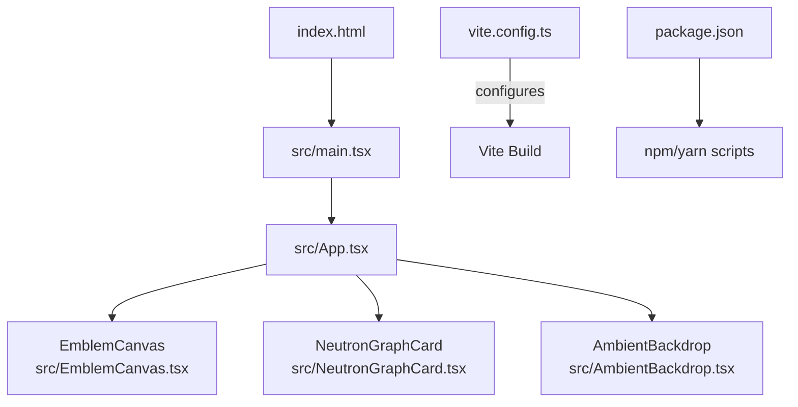
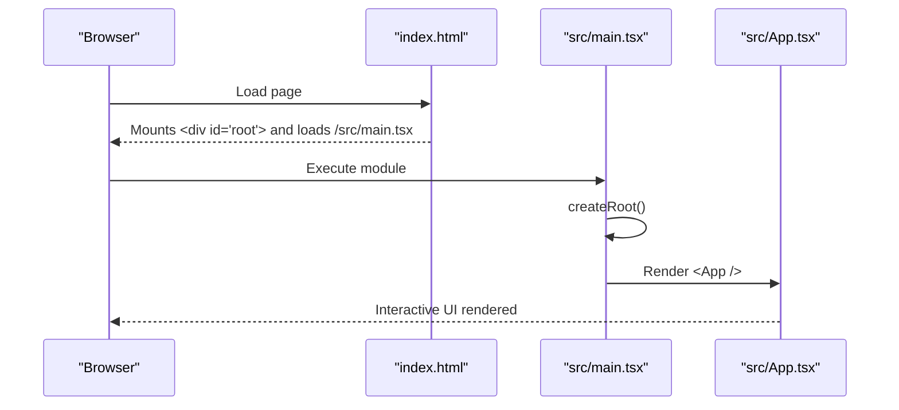
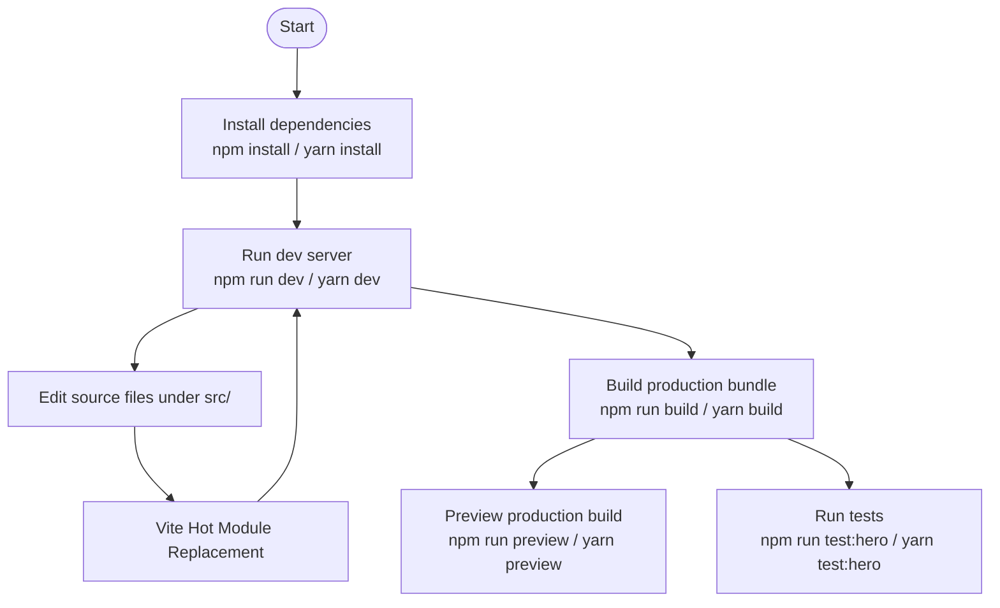
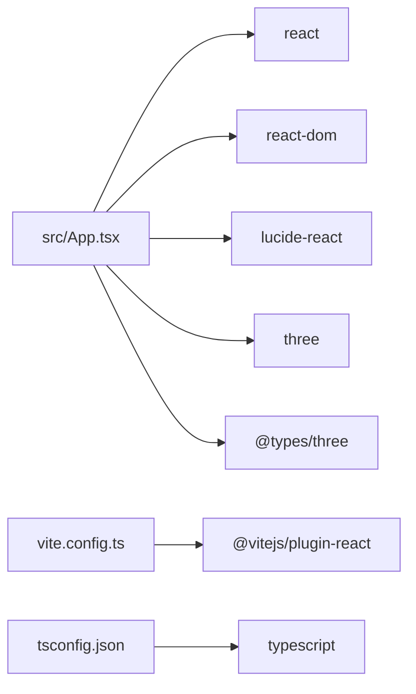

# Getting Started

<cite>
**Referenced Files in This Document**
- [package.json](file://package.json)
- [vite.config.ts](file://vite.config.ts)
- [tsconfig.json](file://tsconfig.json)
- [index.html](file://index.html)
- [src/main.tsx](file://src/main.tsx)
- [src/App.tsx](file://src/App.tsx)
- [src/heroWelcome.test.mjs](file://src/heroWelcome.test.mjs)
</cite>

## Table of Contents
1. [Introduction](#introduction)
2. [Project Structure](#project-structure)
3. [Core Components](#core-components)
4. [Architecture Overview](#architecture-overview)
5. [Detailed Component Analysis](#detailed-component-analysis)
6. [Dependency Analysis](#dependency-analysis)
7. [Performance Considerations](#performance-considerations)
8. [Troubleshooting Guide](#troubleshooting-guide)
9. [Conclusion](#conclusion)

## Introduction
WUN Gazette is a React + TypeScript landing application built with Vite. It renders an interactive showcase for the WUN platform, including animated sections, a 3D emblem canvas, and a Neutron graph visualization. The project uses Node.js native testing for a small content guardrail test and ships a production build through Vite.

This guide helps you install dependencies, run the development server, preview the production build, and understand how the app is structured so you can contribute confidently.

## Project Structure
At a high level:
- `index.html` is the HTML entry point that mounts the React root and loads the module script.
- `src/main.tsx` creates the React root and renders the top-level `App`.
- `src/App.tsx` composes the main UI, including hero, Neutron graph, friend bonuses, modules, FAQ, and footer.
- `vite.config.ts` configures Vite with the React plugin.
- `tsconfig.json` configures TypeScript for strict mode and bundler-style module resolution.
- `package.json` defines scripts, runtime dependencies (React, Three.js, Lucide icons), and dev dependencies (Vite, TypeScript, React types).

**Diagram sources**
- [index.html:19-22](file://index.html#L19-L22)
- [src/main.tsx:1-10](file://src/main.tsx#L1-L10)
- [src/App.tsx:1-18](file://src/App.tsx#L1-L18)
- [vite.config.ts:1-6](file://vite.config.ts#L1-L6)
- [package.json:5-10](file://package.json#L5-L10)

**Section sources**
- [index.html:1-24](file://index.html#L1-L24)
- [src/main.tsx:1-11](file://src/main.tsx#L1-L11)
- [src/App.tsx:1-571](file://src/App.tsx#L1-L571)
- [vite.config.ts:1-7](file://vite.config.ts#L1-L7)
- [package.json:1-26](file://package.json#L1-L26)

## Core Components
- App shell: `src/App.tsx` renders the full page layout, navigation, hero section, Neutron graph card, friend bonus simulator, modules deck, FAQ, and footer.
- Entry point: `src/main.tsx` mounts the React tree into the DOM element defined in `index.html`.
- Configuration: `vite.config.ts` enables the React plugin; `tsconfig.json` enforces strict TypeScript rules and bundler module resolution.

Key responsibilities:
- Rendering the interactive hero with signal tuner tabs and call-to-action links.
- Composing child components for 3D visuals and network graphs.
- Providing state-driven UI interactions such as toggling friend quests and module actions.

**Section sources**
- [src/App.tsx:149-571](file://src/App.tsx#L149-L571)
- [src/main.tsx:1-11](file://src/main.tsx#L1-L11)
- [vite.config.ts:1-7](file://vite.config.ts#L1-L7)
- [tsconfig.json:1-18](file://tsconfig.json#L1-L18)

## Architecture Overview
The application follows a simple client-side architecture:
- Browser loads `index.html`, which includes a `
` and a module script pointing to `src/main.tsx`.
- `main.tsx` initializes React’s root and renders `App`.
- `App` composes UI components and manages local state for interactivity.
- Vite handles development-time hot module replacement and production builds.

**Diagram sources**
- [index.html:19-22](file://index.html#L19-L22)
- [src/main.tsx:1-10](file://src/main.tsx#L1-L10)
- [src/App.tsx:149-176](file://src/App.tsx#L149-L176)

## Detailed Component Analysis

### Installation and Setup
Follow these steps to set up the project locally:

1. Install Node.js (recommended LTS version).
2. Open a terminal in the repository root (``).
3. Install dependencies using your preferred package manager:
   - npm: `npm install`
   - yarn: `yarn install`
4. Start the development server:
   - npm: `npm run dev`
   - yarn: `yarn dev`
5. Open the local URL shown by Vite in your browser.

What happens under the hood:
- `dev` runs Vite in development mode with hot reloading.
- `build` first type-checks with TypeScript (`tsc --noEmit`) and then builds a production bundle via Vite.
- `preview` serves the built output locally for verification.
- `test:hero` runs a Node-based test suite that validates key hero content and reduced-motion CSS behavior.

**Section sources**
- [package.json:5-10](file://package.json#L5-L10)
- [package.json:11-24](file://package.json#L11-L24)

### Running the Development Server
- Run `npm run dev` or `yarn dev`.
- Vite starts a local server and watches for changes.
- Edit files under `src`; the browser updates automatically.

Tip: If you see port conflicts, stop any existing process on the default port or configure Vite to use another port.

**Section sources**
- [package.json:6](file://package.json#L6)
- [vite.config.ts:4-6](file://vite.config.ts#L4-L6)

### Building for Production
- Run `npm run build` or `yarn build`.
- TypeScript type checking runs first; if there are type errors, the build stops.
- Vite then generates optimized static assets.

After building, you can preview the production output locally:
- Run `npm run preview` or `yarn preview`.
- A local preview server will serve the built files.

**Section sources**
- [package.json:7-8](file://package.json#L7-L8)
- [tsconfig.json:1-18](file://tsconfig.json#L1-L18)

### Running Tests
- Run `npm run test:hero` or `yarn test:hero`.
- The test reads `src/App.tsx` and `src/station.css` and asserts:
  - Hero messaging matches approved copy.
  - Reduced-motion CSS exists and disables animations where required.

This test ensures critical marketing copy and accessibility-related motion behavior remain consistent.

**Section sources**
- [package.json:9](file://package.json#L9)
- [src/heroWelcome.test.mjs:1-31](file://src/heroWelcome.test.mjs#L1-L31)

### Understanding the Build Process
- Entry: `index.html` mounts the React root and loads `/src/main.tsx`.
- Runtime bootstrap: `main.tsx` creates the React root and renders `App`.
- UI composition: `App` composes the site’s sections and delegates visuals to child components.
- Tooling:
  - Vite provides fast dev server and optimized production builds.
  - TypeScript performs strict type checks during build.
  - The React plugin enables JSX support.

**Diagram sources**
- [package.json:5-10](file://package.json#L5-L10)
- [index.html:19-22](file://index.html#L19-L22)
- [src/main.tsx:1-10](file://src/main.tsx#L1-L10)

## Dependency Analysis
Runtime and development dependencies:
- Runtime:
  - React and ReactDOM for UI rendering.
  - Three.js and its types for 3D visuals.
  - Lucide React for iconography.
- Development:
  - Vite for bundling and dev server.
  - TypeScript for type safety.
  - React types for TSX support.
  - Vite React plugin for JSX transformation.

**Diagram sources**
- [package.json:11-24](file://package.json#L11-L24)
- [vite.config.ts:1-6](file://vite.config.ts#L1-L6)
- [tsconfig.json:1-18](file://tsconfig.json#L1-L18)

**Section sources**
- [package.json:11-24](file://package.json#L11-L24)

## Performance Considerations
- Keep component trees lean; avoid unnecessary re-renders in `App` by memoizing expensive computations when needed.
- Use lazy loading for heavy 3D scenes if they are not visible initially.
- Prefer code splitting for large visual components to reduce initial bundle size.
- Ensure animations respect `prefers-reduced-motion` for accessibility and performance on low-power devices.

[No sources needed since this section provides general guidance]

## Troubleshooting Guide
Common setup issues and resolutions:

- Node.js version mismatch
  - Symptom: Dependency installation fails or unexpected behavior.
  - Resolution: Use a recent LTS Node.js version compatible with Vite and TypeScript.

- Port already in use
  - Symptom: Dev server cannot start due to port conflict.
  - Resolution: Stop the conflicting process or configure Vite to use another port.

- TypeScript errors blocking the build
  - Symptom: `npm run build` fails at the type-check step.
  - Resolution: Fix reported type errors in `src` files; ensure imports and types match.

- Missing environment or configuration
  - Symptom: Build or dev server behaves unexpectedly.
  - Resolution: Verify `vite.config.ts` and `tsconfig.json` are present and unmodified unless intentionally customized.

- Tests failing
  - Symptom: `npm run test:hero` reports assertion failures.
  - Resolution: Ensure hero copy and reduced-motion CSS remain intact as validated by the test.

**Section sources**
- [package.json:5-10](file://package.json#L5-L10)
- [tsconfig.json:1-18](file://tsconfig.json#L1-L18)
- [src/heroWelcome.test.mjs:1-31](file://src/heroWelcome.test.mjs#L1-L31)

## Conclusion
You now have everything needed to install, run, build, and test WUN Gazette locally. The app is a straightforward React + TypeScript project powered by Vite, with clear entry points and scripts. For contributors, focus on `src/App.tsx` for UI changes, keep hero copy and accessibility behaviors intact, and run the provided scripts to validate your work.

[No sources needed since this section summarizes without analyzing specific files]