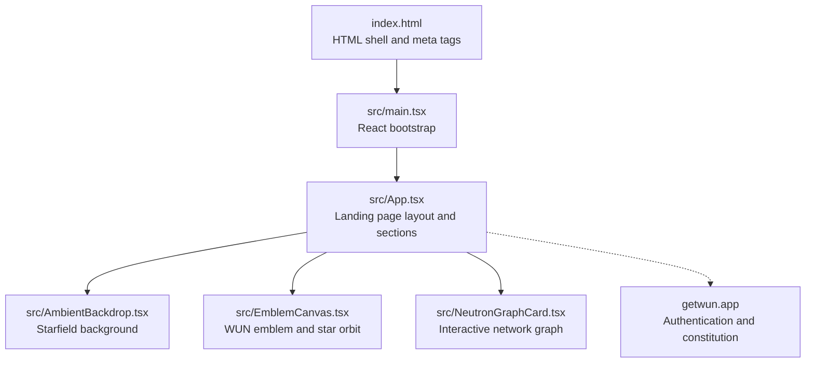
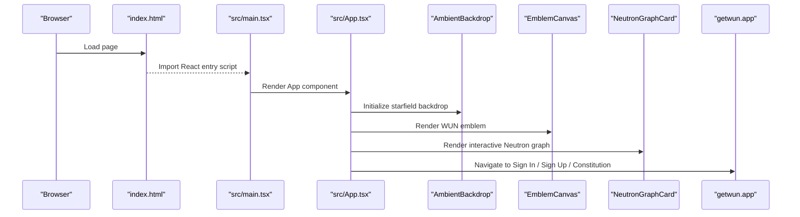
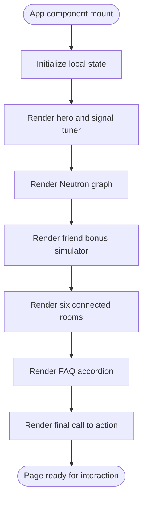
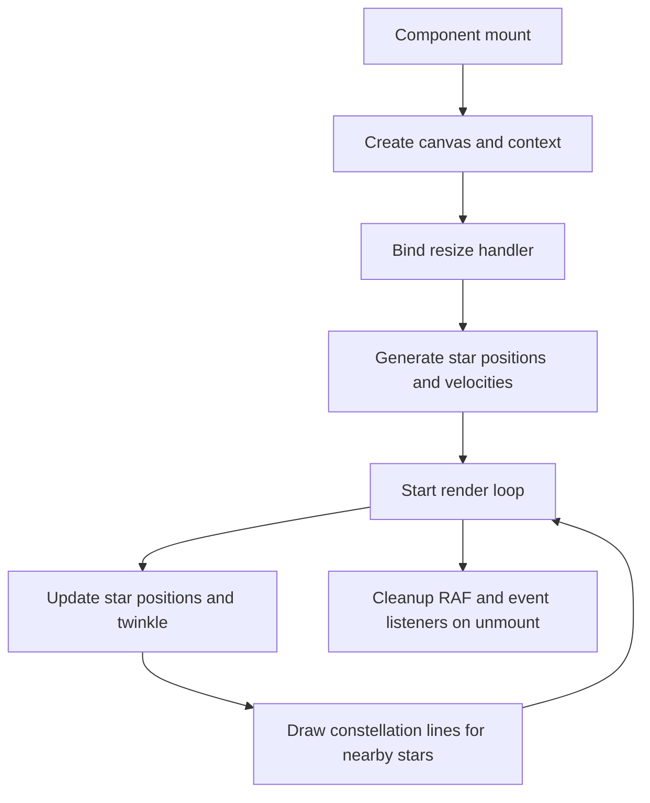
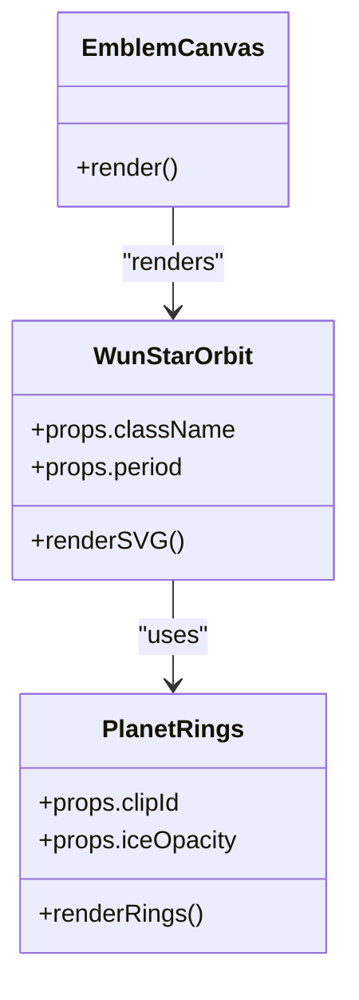
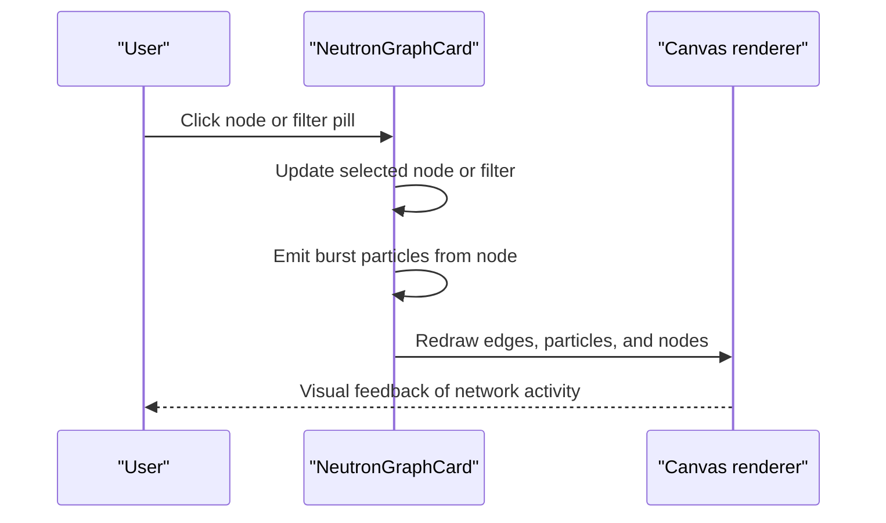
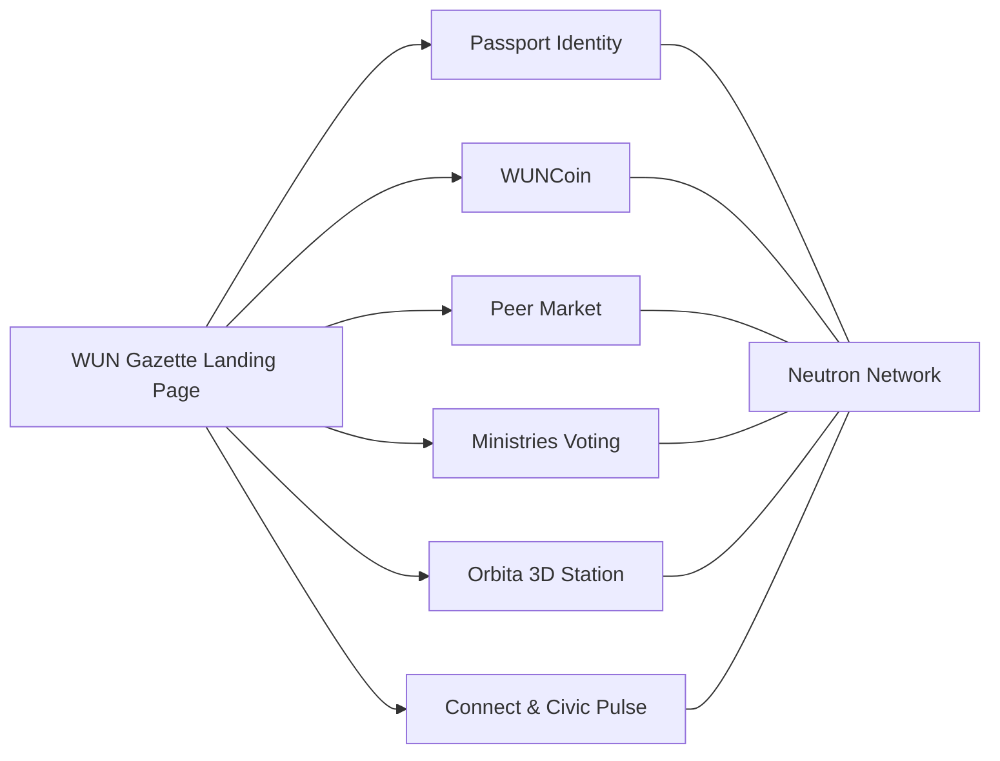
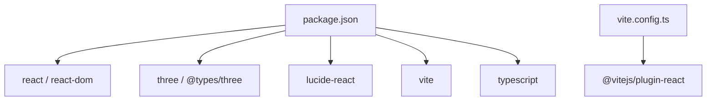

# Project Overview

<cite>
**Referenced Files in This Document**
- [package.json](file://package.json)
- [index.html](file://index.html)
- [vite.config.ts](file://vite.config.ts)
- [src/main.tsx](file://src/main.tsx)
- [src/App.tsx](file://src/App.tsx)
- [src/AmbientBackdrop.tsx](file://src/AmbientBackdrop.tsx)
- [src/EmblemCanvas.tsx](file://src/EmblemCanvas.tsx)
- [src/NeutronGraphCard.tsx](file://src/NeutronGraphCard.tsx)
</cite>

## Table of Contents
1. [Introduction](#introduction)
2. [Project Structure](#project-structure)
3. [Core Components](#core-components)
4. [Architecture Overview](#architecture-overview)
5. [Detailed Component Analysis](#detailed-component-analysis)
6. [Dependency Analysis](#dependency-analysis)
7. [Performance Considerations](#performance-considerations)
8. [Troubleshooting Guide](#troubleshooting-guide)
9. [Conclusion](#conclusion)

## Introduction
WUN Gazette is an interactive marketing landing page for World Union Nation (WUN). It presents WUN as a digital nation where one passport unlocks currency, chats, peer trade, open voting, and a 3D orbital station. The site emphasizes transparency, early participation, and community-driven development.

Key goals:
- Explain WUN’s purpose without financial promises or guarantees.
- Showcase core features through interactive demos rather than static text.
- Provide clear paths to sign up, sign in, and read the constitution.
- Introduce newcomers to WUN’s ecosystem while giving developers a clean React + TypeScript + Vite codebase to extend.

Target audience:
- New citizens exploring WUN.
- Early friends testing rooms and collecting bonuses.
- Contributors building on top of the landing page.
- Partners evaluating WUN’s public-facing platform.

Relationship to the broader WUN ecosystem:
- The site links directly to the WUN authentication flow and constitution.
- It introduces modules such as WUNCoin, Connect, Market, Ministries, Orbita, and Civic Pulse.
- It visualizes how these modules share a common network layer called Neutron.

[No sources needed since this section summarizes project intent without analyzing specific files]

## Project Structure
The repository is a single-page React application built with TypeScript and Vite. The entry point renders the root React component, which composes the full landing experience.

**Diagram sources**
- [index.html:1-24](file://index.html#L1-L24)
- [src/main.tsx:1-11](file://src/main.tsx#L1-L11)
- [src/App.tsx:1-571](file://src/App.tsx#L1-L571)
- [src/AmbientBackdrop.tsx:1-102](file://src/AmbientBackdrop.tsx#L1-L102)
- [src/EmblemCanvas.tsx:1-378](file://src/EmblemCanvas.tsx#L1-L378)
- [src/NeutronGraphCard.tsx:1-397](file://src/NeutronGraphCard.tsx#L1-L397)

High-level structure:
- `index.html` defines the HTML shell, title, description, fonts, and root container.
- `src/main.tsx` mounts the React app into the DOM using React Strict Mode.
- `src/App.tsx` contains the complete landing page UI, including hero, Neutron graph, friend bonuses, module cards, FAQ, and footer.
- Visual components include `AmbientBackdrop`, `EmblemCanvas`, and `NeutronGraphCard`.
- Build and scripts are configured in `package.json` and `vite.config.ts`.

**Section sources**
- [index.html:1-24](file://index.html#L1-L24)
- [src/main.tsx:1-11](file://src/main.tsx#L1-L11)
- [package.json:1-26](file://package.json#L1-L26)
- [vite.config.ts:1-7](file://vite.config.ts#L1-L7)

## Core Components
This section summarizes the main user-facing features exposed by the landing page.

- Hero section:
  - Presents WUN’s positioning as a living digital world.
  - Includes a “Live Signal Tuner” that cycles through featured signals such as WUNCoin, Neutron Graph, Friend Bonuses, and Orbita 3D.
  - Provides primary calls to action for signing up and exploring the Neutron graph.

- Neutron Graph:
  - Interactive canvas visualization showing system nodes and citizen nodes.
  - Supports filtering by stream type and clicking nodes to emit pulses.
  - Demonstrates how passports, deals, and friend bonuses move through one shared network.

- Friend Bonuses:
  - Checklist-style simulator where users toggle actions to see perks unlock.
  - Displays a dynamic citizenship card with tilt interaction, tier label, and unlocked rewards.

- Six Connected Rooms:
  - Module cards for WUNCoin, Connect, Market, Ministries, Orbita, and Civic Pulse.
  - Each card includes a simulated action button and result message.

- FAQ and Footer:
  - Short answers about WUN, friend bonuses, WUNCoin, and joining speed.
  - Footer identifies WUN LLC and links to privacy, terms, and contact email.

**Section sources**
- [src/App.tsx:23-147](file://src/App.tsx#L23-L147)
- [src/App.tsx:149-571](file://src/App.tsx#L149-L571)

## Architecture Overview
At runtime, the browser loads the HTML shell, which imports the React entry script. React mounts the `App` component, which orchestrates all landing page sections. Visual effects are implemented with lightweight Canvas animations and SVG graphics. External navigation points link to the WUN authentication portal and constitution.

**Diagram sources**
- [index.html:19-22](file://index.html#L19-L22)
- [src/main.tsx:1-11](file://src/main.tsx#L1-L11)
- [src/App.tsx:149-571](file://src/App.tsx#L149-L571)
- [src/AmbientBackdrop.tsx:1-102](file://src/AmbientBackdrop.tsx#L1-L102)
- [src/EmblemCanvas.tsx:1-378](file://src/EmblemCanvas.tsx#L1-L378)
- [src/NeutronGraphCard.tsx:1-397](file://src/NeutronGraphCard.tsx#L1-L397)

## Detailed Component Analysis

### Landing Page Root: App Component
Responsibilities:
- Manage local state for signal selection, friend quest toggles, callsign input, passport tilt, triggered module actions, and FAQ expansion.
- Compose the hero, Neutron graph, friend bonuses, module deck, FAQ, and final call-to-action sections.
- Link to external WUN services for authentication and governance.

User interactions:
- Switching signals updates the hero spotlight content and emblem context.
- Toggling friend quests updates the friendship score and tier.
- Clicking module buttons simulates room actions and shows results.
- Expanding FAQ items toggles visibility of answers.

**Diagram sources**
- [src/App.tsx:149-571](file://src/App.tsx#L149-L571)

**Section sources**
- [src/App.tsx:149-571](file://src/App.tsx#L149-L571)

### Ambient Background: AmbientBackdrop
Responsibilities:
- Draw a starfield using Canvas.
- Animate stars with gentle movement and twinkling.
- Draw subtle constellation lines between nearby stars.
- Handle window resize and cleanup animation frames.

Design notes:
- Uses a fixed number of stars for predictable performance.
- Constellation line drawing is distance-based and limited to nearby pairs.
- Animation loop uses `requestAnimationFrame`.

**Diagram sources**
- [src/AmbientBackdrop.tsx:1-102](file://src/AmbientBackdrop.tsx#L1-L102)

**Section sources**
- [src/AmbientBackdrop.tsx:1-102](file://src/AmbientBackdrop.tsx#L1-L102)

### Brand Emblem: EmblemCanvas and WunStarOrbit
Responsibilities:
- Render the WUN brand mark as SVG.
- Animate a planet along an elliptical orbit.
- Apply lighting, sheen, rings, and atmospheric gradients.
- Respect reduced motion preferences.

Key behaviors:
- `WunStarOrbit` computes animated light positions along the orbit path.
- Planet rings are layered with clip paths to simulate depth.
- Motion animations can be disabled when the user prefers reduced motion.

**Diagram sources**
- [src/EmblemCanvas.tsx:123-327](file://src/EmblemCanvas.tsx#L123-L327)
- [src/EmblemCanvas.tsx:76-107](file://src/EmblemCanvas.tsx#L76-L107)
- [src/EmblemCanvas.tsx:333-377](file://src/EmblemCanvas.tsx#L333-L377)

**Section sources**
- [src/EmblemCanvas.tsx:1-378](file://src/EmblemCanvas.tsx#L1-L378)

### Network Visualization: NeutronGraphCard
Responsibilities:
- Display a live-feeling graph of system nodes and citizen nodes.
- Support filtering edges by kind: reward, sync, or trade.
- Emit pulse particles from selected nodes.
- Respond to canvas clicks to select nodes and trigger bursts.

Data model:
- Nodes represent systems like Passport ID, Friend Drops, Orbita Ring, Peer Escrow, and sample citizens.
- Edges connect nodes with weights and kinds.
- Particles travel along curved edges with different speeds and lifetimes.

Interaction flow:
- User selects a node or filter.
- Clicking a node emits burst particles along connected edges.
- Continuous ambient particles animate across visible edges.

**Diagram sources**
- [src/NeutronGraphCard.tsx:87-397](file://src/NeutronGraphCard.tsx#L87-L397)

Complexity considerations:
- Node drift and particle updates run every frame.
- Edge drawing and particle lifecycle management are optimized within the render loop.
- Icon paths are cached to avoid repeated geometry construction.

**Section sources**
- [src/NeutronGraphCard.tsx:1-397](file://src/NeutronGraphCard.tsx#L1-L397)

### Conceptual Overview
Conceptually, WUN Gazette acts as a guided introduction to the WUN ecosystem:
- It explains WUNCoin as a digital unit intended for use within the WUN ecosystem, with legal and technical frameworks developed separately.
- It visualizes the Neutron network as the shared ledger connecting passports, trades, and friend bonuses.
- It encourages early participation through friend bonuses and community engagement tools.
- It provides direct access to the WUN authentication flow and constitution.

[No sources needed since this diagram shows conceptual relationships, not actual code structure]

## Dependency Analysis
External dependencies:
- React and ReactDOM provide the component framework and DOM rendering.
- Three.js and its types are declared but not used in the current landing page; they may support future 3D features.
- Lucide React supplies icons used throughout the UI.
- Vite and the React plugin handle development server, build, and bundling.
- TypeScript ensures type safety during development.

Build configuration:
- Vite is configured with the React plugin.
- Scripts expose development, build, preview, and a small test command for the hero welcome behavior.

**Diagram sources**
- [package.json:1-26](file://package.json#L1-L26)
- [vite.config.ts:1-7](file://vite.config.ts#L1-L7)

**Section sources**
- [package.json:1-26](file://package.json#L1-L26)
- [vite.config.ts:1-7](file://vite.config.ts#L1-L7)

## Performance Considerations
- Canvas-based animations should remain lightweight. Avoid creating new objects inside the render loop.
- Starfield and Neutron graph both use `requestAnimationFrame`; ensure cleanup occurs on unmount.
- Prefer CSS transforms and opacity changes over layout-triggering properties for smooth animations.
- Reduce motion should be respected where possible, as already implemented in the emblem component.
- Keep external links to WUN services fast and reliable; consider adding loading states if future integrations become asynchronous.

[No sources needed since this section provides general guidance]

## Troubleshooting Guide
Common issues and resolutions:
- React app does not mount:
  - Verify that the HTML file contains the root element and imports the entry script.
  - Ensure no console errors prevent React from mounting.

- Animations appear janky:
  - Check for heavy work inside animation loops.
  - Confirm that resize handlers do not cause expensive reflows.

- Reduced motion not respected:
  - Ensure components check `prefers-reduced-motion` and disable animations accordingly.

- External links broken:
  - Verify URLs for sign-in, sign-up, and constitution routes.
  - Confirm that `getwun.app` is reachable from deployment environments.

**Section sources**
- [index.html:19-22](file://index.html#L19-L22)
- [src/EmblemCanvas.tsx:109-121](file://src/EmblemCanvas.tsx#L109-L121)
- [src/App.tsx:19-22](file://src/App.tsx#L19-L22)

## Conclusion
WUN Gazette is a focused, interactive marketing landing page that introduces World Union Nation through clear messaging, practical demonstrations, and accessible visuals. It balances newcomer-friendly explanations with developer-friendly architecture. The site showcases WUNCoin, the Neutron network, friend bonuses, and six connected rooms, while linking directly to WUN’s authentication and governance resources. For contributors, the codebase offers a straightforward React + TypeScript + Vite foundation with modular components for further expansion.

[No sources needed since this section summarizes without analyzing specific files]