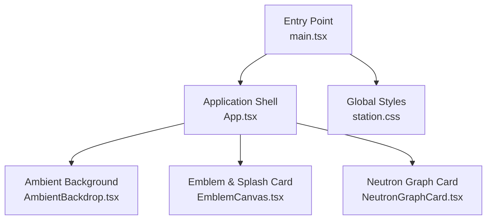
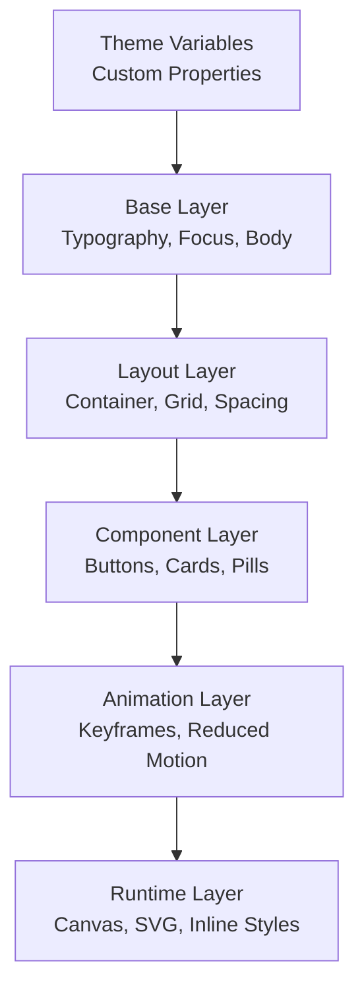
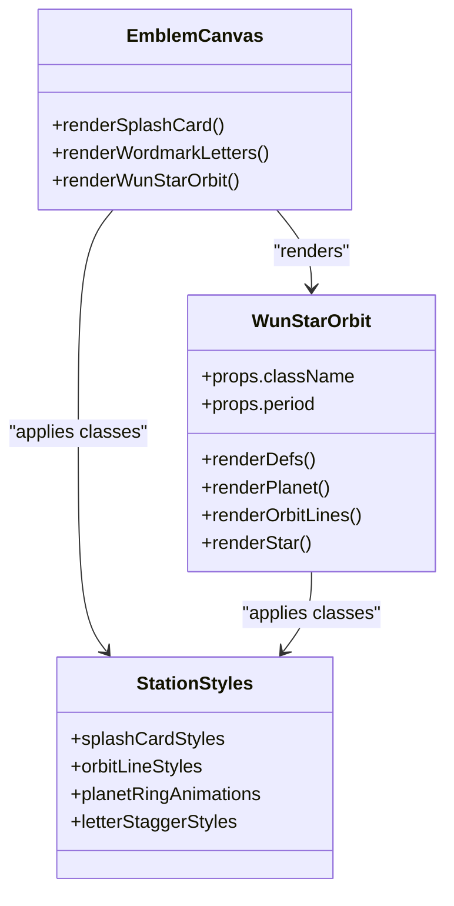
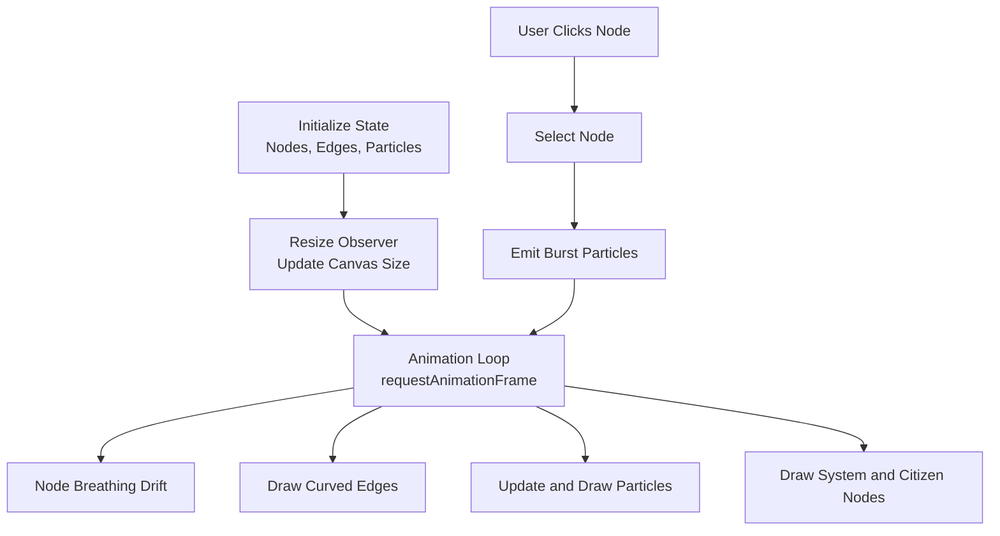
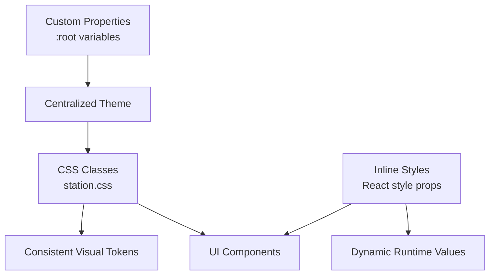
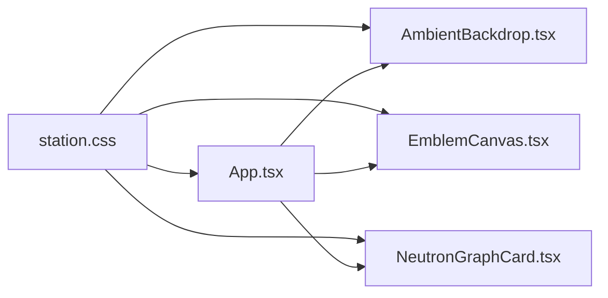

# Styling System

<cite>
**Referenced Files in This Document**
- [station.css](file://src/station.css)
- [App.tsx](file://src/App.tsx)
- [main.tsx](file://src/main.tsx)
- [AmbientBackdrop.tsx](file://src/AmbientBackdrop.tsx)
- [EmblemCanvas.tsx](file://src/EmblemCanvas.tsx)
- [NeutronGraphCard.tsx](file://src/NeutronGraphCard.tsx)
</cite>

## Table of Contents
1. [Introduction](#introduction)
2. [Project Structure](#project-structure)
3. [Core Components](#core-components)
4. [Architecture Overview](#architecture-overview)
5. [Detailed Component Analysis](#detailed-component-analysis)
6. [Dependency Analysis](#dependency-analysis)
7. [Performance Considerations](#performance-considerations)
8. [Troubleshooting Guide](#troubleshooting-guide)
9. [Conclusion](#conclusion)
10. [Appendices](#appendices)

## Introduction
This document explains the WUN Gazette styling system. It covers the CSS architecture, animation keyframes, responsive design patterns, theme variables, and accessibility considerations. The application uses a hybrid approach:

- Global CSS classes in `station.css` define layout, typography, colors, animations, and responsive behavior.
- React components in `App.tsx`, `AmbientBackdrop.tsx`, `EmblemCanvas.tsx`, and `NeutronGraphCard.tsx` compose UI elements and apply those classes.
- Inline styles are used sparingly for dynamic values such as interactive transforms and per-letter animation delays.
- Custom properties under `:root` provide a centralized theme for colors, radii, fonts, and color scheme.
- Accessibility is supported through semantic HTML, ARIA attributes, focus-visible outlines, and `prefers-reduced-motion` handling in both CSS and JavaScript.

The goal is to help developers add new styles consistently, maintain performance for animations, and keep the visual system coherent across the site.

## Project Structure
At the top level, the entry point mounts the React application and imports the global stylesheet. The main application component composes sections, reusable cards, and animated visuals.



**Diagram sources**
- [main.tsx:1-11](file://src/main.tsx#L1-L11)
- [App.tsx:149-568](file://src/App.tsx#L149-L568)
- [AmbientBackdrop.tsx:13-101](file://src/AmbientBackdrop.tsx#L13-L101)
- [EmblemCanvas.tsx:128-377](file://src/EmblemCanvas.tsx#L128-L377)
- [NeutronGraphCard.tsx:87-396](file://src/NeutronGraphCard.tsx#L87-L396)
- [station.css:1-41](file://src/station.css#L1-L41)

**Section sources**
- [main.tsx:1-11](file://src/main.tsx#L1-L11)
- [App.tsx:149-568](file://src/App.tsx#L149-L568)

## Core Components
The styling system is organized around these core areas:

| Area | Responsibility | Key Implementation |
| --- | --- | --- |
| Theme variables | Centralized colors, radii, fonts, and dark mode configuration | `:root` custom properties |
| Base layer | Reset-like defaults, focus visibility, body typography | Global selectors and `body` rules |
| Layout primitives | Container width, grid systems, spacing tokens | `.container`, `.bento-grid`, section wrappers |
| Component classes | Reusable UI building blocks like buttons, cards, pills, badges | `.btn-*`, `.copy-card`, `.room-pill`, `.bento-*` |
| Animation system | Keyframes, motion timing, reduced-motion fallbacks | `@keyframes` blocks and media queries |
| Canvas/SVG layers | Animated backgrounds, graphs, and emblem graphics | `AmbientBackdrop`, `EmblemCanvas`, `NeutronGraphCard` |
| Inline dynamic styles | Per-frame transforms, computed widths, staggered delays | `style={{ ... }}` in React components |

**Section sources**
- [station.css:1-41](file://src/station.css#L1-L41)
- [station.css:132-147](file://src/station.css#L132-L147)
- [station.css:215-288](file://src/station.css#L215-L288)
- [station.css:1047-1120](file://src/station.css#L1047-L1120)
- [station.css:1441-1555](file://src/station.css#L1441-L1555)

## Architecture Overview
The styling architecture follows a layered model:

1. **Theme layer**: Custom properties define the brand palette, surface tones, borders, text hierarchy, border radii, and font families.
2. **Base layer**: Global resets, typography, link/button normalization, and focus-visible outline.
3. **Layout layer**: Responsive container, grid systems, and section spacing.
4. **Component layer**: Buttons, cards, pills, badges, mini UI panels, and graph controls.
5. **Animation layer**: Keyframes for hero reveals, ambient drift, splash card shapes, orbit rings, and star pulses.
6. **Runtime layer**: Canvas and SVG animations driven by JavaScript or SMIL, with reduced-motion guards.



[No diagram sources needed since this diagram shows conceptual architecture rather than direct code mapping]

## Detailed Component Analysis

### Theme Variables and Color System
The theme is defined at the root level using CSS custom properties. This includes:

- Background layers: base background, secondary background, tertiary background, and translucent surfaces.
- Borders: subtle default border and stronger accent border.
- Text tokens: primary, secondary, and muted text colors.
- Accent colors: violet, gold, and cyan.
- Radius tokens: small, medium, and large border radii.
- Font tokens: display serif and sans-serif stacks.
- Color scheme: explicit dark mode declaration.

These variables are reused throughout buttons, cards, sections, and interactive states.

**Section sources**
- [station.css:1-21](file://src/station.css#L1-L21)

### Base Typography and Accessibility Defaults
The base layer sets:

- Box sizing normalization.
- Smooth scrolling and horizontal overflow control.
- Body background, text color, font family, font size, line height, and antialiasing.
- Link and button inheritance to avoid inconsistent defaults.
- Focus-visible outline using the accent violet token.

This ensures consistent baseline behavior and accessible keyboard navigation.

**Section sources**
- [station.css:23-56](file://src/station.css#L23-L56)

### Layout Primitives and Responsive Containers
The layout system centers content and constrains maximum width while allowing responsive margins. The container class is used by most sections. Sections use padding and top borders to separate content visually.

A 12-column bento grid supports flexible card spans. Cards use glassmorphism-style backgrounds with backdrop blur and subtle borders.

**Section sources**
- [station.css:132-138](file://src/station.css#L132-L138)
- [station.css:1047-1120](file://src/station.css#L1047-L1120)
- [station.css:1088-1120](file://src/station.css#L1088-L1120)

### Button System
The button system defines three sizes for the primary button variant, plus secondary and ghost variants. Common behaviors include:

- Flex alignment and gap-based icon spacing.
- Border radius from theme tokens.
- Hover transitions for transform and shadow.
- Secondary button hover state using border-strong and subtle violet background.
- Ghost button hover state for subtle text emphasis.

**Section sources**
- [station.css:215-288](file://src/station.css#L215-L288)

### Hero Section and Title Animations
The hero section combines:

- A two-column grid layout.
- An eyebrow pill, kicker, title lines, support copy, operator note, and decorative rule.
- A light beam overlay.
- A signal pulse dot with ripple pseudo-elements.
- Word-level reveal animations with staggered delays.
- Shimmer gradient on title words.
- Reduced-motion fallback that disables animations and restores readable text.

```mermaid
sequenceDiagram
participant Page as "Showcase Page"
participant Hero as "Hero Copy Block"
participant Title as "Title Words"
participant Beam as "Light Beam"
participant Pulse as "Signal Pulse"
participant User as "User"
User->>Page : Load page
Page->>Hero : Render hero structure
Hero->>Title : Apply word reveal animations
Hero->>Beam : Start drifting light beam
Hero->>Pulse : Start ripple effect
Note over Title,Pulse : Animations run continuously
User->>Hero : Interact with signal tuner
Hero-->>User : Update active signal label
```

**Diagram sources**
- [App.tsx:214-288](file://src/App.tsx#L214-L288)
- [station.css:290-539](file://src/station.css#L290-L539)

**Section sources**
- [App.tsx:214-288](file://src/App.tsx#L214-L288)
- [station.css:290-539](file://src/station.css#L290-L539)

### Ambient Backdrop and Aurora Orbs
The ambient backdrop provides:

- A fixed full-screen container behind all content.
- Three aurora orbs with different positions, sizes, gradients, and animation durations.
- A canvas-based starfield with twinkling dots and faint constellation lines.
- Performance-conscious rendering using `requestAnimationFrame`.

The aurora orbs use CSS animations, while the starfield is rendered in JavaScript.

**Section sources**
- [station.css:69-130](file://src/station.css#L69-L130)
- [AmbientBackdrop.tsx:13-101](file://src/AmbientBackdrop.tsx#L13-L101)

### Emblem Canvas and Splash Card
The emblem system includes:

- A splash card with radial gradient background, glassmorphism, and decorative shapes.
- A star-shaped mark composed of polygons.
- An orbital ring with front/back clipping and animated shimmer.
- Planet rings with ice bands and opacity animations.
- SMIL-based animations for orbit motion, pattern translation, and sheen movement.
- Staggered letter animations for the wordmark.
- Inline animation delays applied per character.



**Diagram sources**
- [EmblemCanvas.tsx:128-377](file://src/EmblemCanvas.tsx#L128-L377)
- [station.css:657-921](file://src/station.css#L657-L921)

**Section sources**
- [EmblemCanvas.tsx:128-377](file://src/EmblemCanvas.tsx#L128-L377)
- [station.css:657-921](file://src/station.css#L657-L921)

### Neutron Graph Card
The Neutron graph card is a canvas-driven visualization with:

- Nodes representing system features and citizen accounts.
- Curved edges with different stream kinds: sync, reward, trade.
- Continuous ambient particles flowing along edges.
- Burst particles triggered by user interaction.
- Filter pills to highlight specific stream types.
- Selected node highlighting with halo and edge emphasis.
- Inline canvas drawing logic for performance-critical animation.



**Diagram sources**
- [NeutronGraphCard.tsx:87-310](file://src/NeutronGraphCard.tsx#L87-L310)
- [NeutronGraphCard.tsx:312-396](file://src/NeutronGraphCard.tsx#L312-L396)

**Section sources**
- [NeutronGraphCard.tsx:87-396](file://src/NeutronGraphCard.tsx#L87-L396)
- [station.css:1441-1555](file://src/station.css#L1441-L1555)

### Hybrid Styling Approach: Classes, Inline Styles, and Custom Properties
The application mixes three styling approaches:

1. **CSS classes**: Used for layout, theming, hover states, and animations.
2. **Inline styles**: Used for dynamic runtime values such as:
   - Interactive 3D tilt transform on the passport card.
   - Per-letter animation delay in the splash wordmark.
   - Dynamic progress bar width based on friendship score.
3. **Custom properties**: Used for theme tokens so colors, radii, and fonts remain consistent.



**Diagram sources**
- [App.tsx:367-399](file://src/App.tsx#L367-L399)
- [EmblemCanvas.tsx:357-374](file://src/EmblemCanvas.tsx#L357-L374)
- [station.css:1-21](file://src/station.css#L1-L21)

**Section sources**
- [App.tsx:367-399](file://src/App.tsx#L367-L399)
- [EmblemCanvas.tsx:357-374](file://src/EmblemCanvas.tsx#L357-L374)
- [station.css:1-21](file://src/station.css#L1-L21)

### Animation Keyframes and Motion Design
The animation system includes:

- Aurora drift for background orbs.
- Hero title word reveal and shimmer.
- Hero light beam sweep.
- Signal pulse ripple.
- Splash card shape entrance and drift.
- Orbit ring shimmer.
- Star pulse and fade-in.
- Rule draw animation.
- Letter stagger animation.

All long-running or decorative animations have reduced-motion fallbacks.

**Section sources**
- [station.css:120-130](file://src/station.css#L120-L130)
- [station.css:477-519](file://src/station.css#L477-L519)
- [station.css:831-921](file://src/station.css#L831-L921)

### Responsive Design Patterns
Responsive behavior is achieved through:

- Fluid typography using `clamp()` for title sizes and padding.
- Flexible grid layouts with percentage-based columns.
- Container constraints with `min()` and percentage margins.
- Media query for reduced motion.
- Canvas resizing via `ResizeObserver` and device pixel ratio handling.

**Section sources**
- [station.css:322-333](file://src/station.css#L322-L333)
- [station.css:389-398](file://src/station.css#L389-L398)
- [station.css:1088-1120](file://src/station.css#L1088-L1120)
- [NeutronGraphCard.tsx:155-175](file://src/NeutronGraphCard.tsx#L155-L175)

### Accessibility Considerations
Accessibility is implemented through:

- Semantic HTML elements such as header, main, section, article, nav, and address.
- ARIA roles and labels for interactive regions and decorative elements.
- Focus-visible outline for keyboard navigation.
- `aria-hidden` on decorative animations and non-essential visuals.
- `prefers-reduced-motion` support in CSS and JavaScript.
- Explicit labels for images and landmarks.

**Section sources**
- [station.css:53-56](file://src/station.css#L53-L56)
- [station.css:521-539](file://src/station.css#L521-L539)
- [station.css:847-851](file://src/station.css#L847-L851)
- [App.tsx:190-198](file://src/App.tsx#L190-L198)
- [App.tsx:253-265](file://src/App.tsx#L253-L265)
- [EmblemCanvas.tsx:109-121](file://src/EmblemCanvas.tsx#L109-L121)
- [EmblemCanvas.tsx:181](file://src/EmblemCanvas.tsx#L181)
- [EmblemCanvas.tsx:335](file://src/EmblemCanvas.tsx#L335)

## Dependency Analysis
The styling dependencies flow from global styles into components and runtime animations.



**Diagram sources**
- [station.css:1-2252](file://src/station.css#L1-L2252)
- [App.tsx:149-568](file://src/App.tsx#L149-L568)
- [AmbientBackdrop.tsx:13-101](file://src/AmbientBackdrop.tsx#L13-L101)
- [EmblemCanvas.tsx:128-377](file://src/EmblemCanvas.tsx#L128-L377)
- [NeutronGraphCard.tsx:87-396](file://src/NeutronGraphCard.tsx#L87-L396)

**Section sources**
- [station.css:1-2252](file://src/station.css#L1-L2252)
- [App.tsx:149-568](file://src/App.tsx#L149-L568)

## Performance Considerations
To keep animations smooth and efficient:

- Prefer CSS animations for simple, declarative effects such as aurora drift, shimmer, and pulse ripples.
- Use `transform` and `opacity` for GPU-accelerated animations where possible.
- Avoid heavy layout-triggering properties inside animation loops.
- Keep canvas animations bounded by frame rate and avoid unnecessary redraws.
- Use `ResizeObserver` for canvas resizing instead of frequent window resize handlers.
- Respect `prefers-reduced-motion` to disable expensive or unnecessary motion.
- Limit inline style recalculations by batching state updates in React.
- Use `will-change` sparingly and only on elements that will animate frequently.

**Section sources**
- [station.css:335-347](file://src/station.css#L335-L347)
- [AmbientBackdrop.tsx:42-90](file://src/AmbientBackdrop.tsx#L42-L90)
- [NeutronGraphCard.tsx:177-310](file://src/NeutronGraphCard.tsx#L177-L310)
- [EmblemCanvas.tsx:109-121](file://src/EmblemCanvas.tsx#L109-L121)

## Troubleshooting Guide
Common styling issues and how to resolve them:

| Symptom | Likely Cause | Resolution |
| --- | --- | --- |
| Animations feel janky on low-end devices | Too many simultaneous animations or heavy canvas work | Reduce animation count, respect reduced motion, optimize canvas draw loop |
| Text becomes unreadable during shimmer | Gradient text animation overrides default color | Ensure reduced-motion fallback restores solid text color |
| Interactive card does not respond smoothly | Excessive re-renders from pointer events | Batch tilt state updates and avoid unnecessary React renders |
| Canvas looks blurry on high-DPI screens | Missing device pixel ratio scaling | Scale canvas dimensions and context transform by DPR |
| Focus indicator is missing | No focus-visible rule or overridden styles | Add or restore focus-visible outline using theme accent |
| Reduced motion not respected | Missing media query or JS guard | Add `@media (prefers-reduced-motion: reduce)` and check matchMedia in components |

**Section sources**
- [station.css:521-539](file://src/station.css#L521-L539)
- [station.css:847-851](file://src/station.css#L847-L851)
- [EmblemCanvas.tsx:109-121](file://src/EmblemCanvas.tsx#L109-L121)
- [NeutronGraphCard.tsx:155-175](file://src/NeutronGraphCard.tsx#L155-L175)

## Conclusion
The WUN Gazette styling system combines a strong CSS foundation with targeted React-driven interactivity. Theme variables ensure consistency, CSS classes provide reusable components, and inline styles handle dynamic runtime values. Animations are layered carefully, with explicit reduced-motion support for accessibility. For future changes, prefer extending existing classes and custom properties, keep animations performant, and maintain semantic markup and ARIA attributes.

## Appendices

### Guidelines for Adding New Styles
- Define new colors, radii, or fonts as custom properties under `:root` if they should be theme-wide.
- Create component-specific classes under the relevant section in `station.css`.
- Avoid adding inline styles unless the value must change dynamically at runtime.
- Use existing tokens for spacing, colors, and typography to maintain visual consistency.
- Add reduced-motion fallbacks for any new animations.
- Test keyboard navigation and focus-visible behavior for new interactive elements.

**Section sources**
- [station.css:1-21](file://src/station.css#L1-L21)
- [station.css:521-539](file://src/station.css#L521-L539)

### Animation Checklist
- Is the animation necessary for understanding the interface?
- Does it respect `prefers-reduced-motion`?
- Does it use performant properties like transform and opacity?
- Are durations and delays reasonable?
- Does it degrade gracefully to a static presentation?

**Section sources**
- [station.css:120-130](file://src/station.css#L120-L130)
- [station.css:477-519](file://src/station.css#L477-L519)
- [station.css:831-921](file://src/station.css#L831-L921)