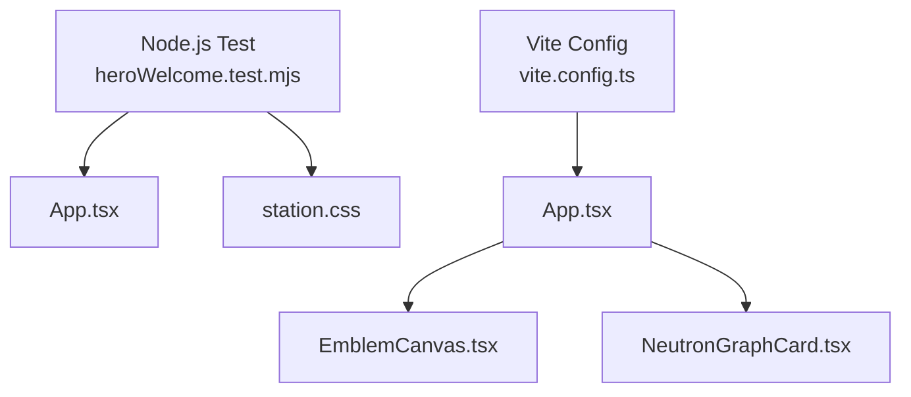
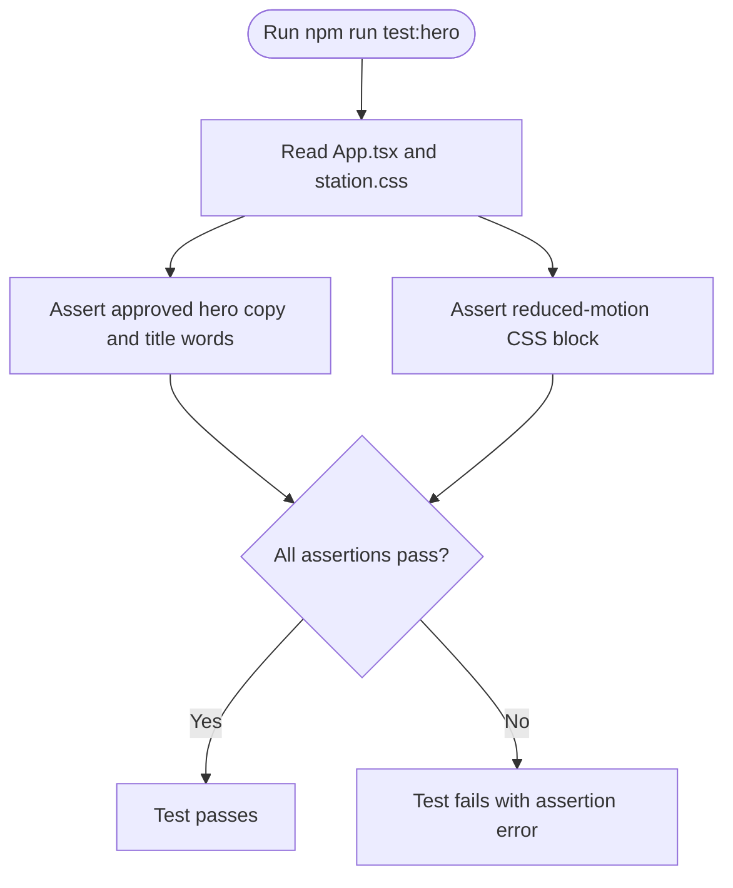
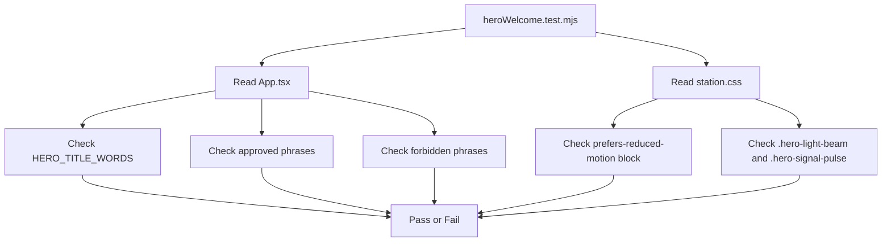
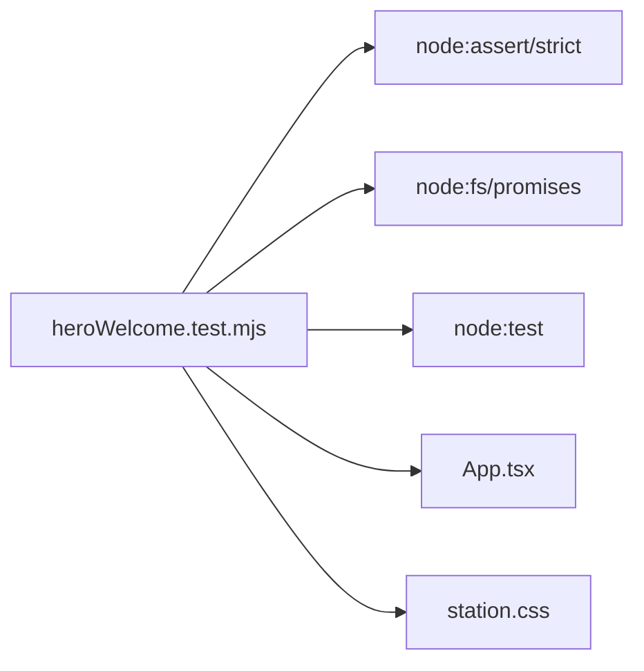

# Testing Strategy

<cite>
**Referenced Files in This Document**
- [heroWelcome.test.mjs](file://src/heroWelcome.test.mjs)
- [package.json](file://package.json)
- [App.tsx](file://src/App.tsx)
- [EmblemCanvas.tsx](file://src/EmblemCanvas.tsx)
- [NeutronGraphCard.tsx](file://src/NeutronGraphCard.tsx)
- [station.css](file://src/station.css)
- [vite.config.ts](file://vite.config.ts)
</cite>

## Table of Contents
1. [Introduction](#introduction)
2. [Project Structure](#project-structure)
3. [Core Components](#core-components)
4. [Architecture Overview](#architecture-overview)
5. [Detailed Component Analysis](#detailed-component-analysis)
6. [Dependency Analysis](#dependency-analysis)
7. [Performance Considerations](#performance-considerations)
8. [Troubleshooting Guide](#troubleshooting-guide)
9. [Conclusion](#conclusion)
10. [Appendices](#appendices)

## Introduction
This document explains the testing strategy for the WUN Gazette application, focusing on:
- The current contract-testing approach for the hero welcome section.
- How to execute tests with Node.js test runner.
- Best practices for testing React components, user interactions, animations, and canvas operations.
- Guidance for expanding coverage and adding additional test frameworks.

The repository currently uses a lightweight, file-contract test for the hero welcome content and CSS motion behavior. It does not yet include runtime UI or canvas tests.

## Project Structure
The testing-relevant parts of the project are small and focused:
- A Node.js test file under `src` that reads source files and asserts their contents.
- A Vite-based React application with TypeScript.
- A CSS stylesheet defining hero animations and reduced-motion fallbacks.
- React components for the app shell, emblem animation, and Neutron graph visualization.

**Diagram sources**
- [heroWelcome.test.mjs:1-31](file://src/heroWelcome.test.mjs#L1-L31)
- [App.tsx:1-571](file://src/App.tsx#L1-L571)
- [EmblemCanvas.tsx:1-378](file://src/EmblemCanvas.tsx#L1-L378)
- [NeutronGraphCard.tsx:1-397](file://src/NeutronGraphCard.tsx#L1-L397)
- [station.css:1-800](file://src/station.css#L1-L800)
- [vite.config.ts:1-7](file://vite.config.ts#L1-L7)

**Section sources**
- [heroWelcome.test.mjs:1-31](file://src/heroWelcome.test.mjs#L1-L31)
- [package.json:1-26](file://package.json#L1-L26)
- [vite.config.ts:1-7](file://vite.config.ts#L1-L7)

## Core Components
### Current Contract Test for Hero Welcome
The existing test is a contract test. It reads the source files as text and asserts:
- Approved hero copy is present.
- The approved title word array matches the expected wording.
- The joined title sentence matches the intended phrase.
- Disallowed copy patterns are absent.
- Reduced-motion CSS exists for `.hero-title-word`.
- Key visual classes exist in the stylesheet.

This approach protects brand copy and accessibility-related motion behavior without rendering the UI.

**Section sources**
- [heroWelcome.test.mjs:1-31](file://src/heroWelcome.test.mjs#L1-L31)
- [App.tsx:23-23](file://src/App.tsx#L23-L23)
- [App.tsx:217-239](file://src/App.tsx#L217-L239)
- [station.css:521-539](file://src/station.css#L521-L539)

### Test Execution with Node.js Test Runner
The project defines a script that runs the hero test using Node’s built-in test runner. The package is configured as an ES module, so the test file can use native ESM imports.

Key points:
- Use `npm run test:hero` to execute the current test.
- The test uses `node:test`, `node:assert/strict`, and `node:fs/promises`.
- No external test framework is required for this contract test.

**Section sources**
- [package.json:4-10](file://package.json#L4-L10)
- [heroWelcome.test.mjs:1-6](file://src/heroWelcome.test.mjs#L1-L6)

## Architecture Overview
The current testing architecture is intentionally minimal:
- Contract tests validate static source artifacts.
- Runtime UI tests are not yet implemented.
- Canvas and animation behaviors are validated indirectly through CSS and component structure.

**Diagram sources**
- [package.json:9-9](file://package.json#L9-L9)
- [heroWelcome.test.mjs:5-30](file://src/heroWelcome.test.mjs#L5-L30)

## Detailed Component Analysis

### Hero Welcome Contract Testing
The hero welcome test validates two concerns:
1. Copy contract:
   - Confirms the presence of approved phrases.
   - Ensures the exact title word array remains unchanged.
   - Prevents disallowed copy patterns from being reintroduced.
2. Motion contract:
   - Ensures a reduced-motion media query disables animations for `.hero-title-word`.
   - Checks that key visual elements remain defined in the stylesheet.

Recommended expansion:
- Add assertions for other hero sections such as the signal tuner and call-to-action links.
- Add assertions for accessibility attributes like `aria-label` and `role`.
- Add assertions for structural class names used by the hero grid.

**Diagram sources**
- [heroWelcome.test.mjs:8-30](file://src/heroWelcome.test.mjs#L8-L30)
- [App.tsx:23-23](file://src/App.tsx#L23-L23)
- [App.tsx:217-239](file://src/App.tsx#L217-L239)
- [station.css:521-539](file://src/station.css#L521-L539)

**Section sources**
- [heroWelcome.test.mjs:8-30](file://src/heroWelcome.test.mjs#L8-L30)
- [App.tsx:23-23](file://src/App.tsx#L23-L23)
- [App.tsx:217-239](file://src/App.tsx#L217-L239)
- [station.css:521-539](file://src/station.css#L521-L539)

### Testing User Interactions
The application contains several interactive areas:
- Signal tuner tabs in the hero section.
- Friend bonus checklist toggles.
- Callsign input field.
- Passport tilt interaction via pointer events.
- Module action deck buttons.
- Neutron graph filter pills, impulse button, and canvas click handling.

Best practices:
- For simple state changes, prefer unit-style tests around component logic where possible.
- For DOM-driven interactions, consider a browser-based test setup once a UI test framework is added.
- Assert both visible state changes and accessibility attributes.

Example interaction targets:
- Signal tuner buttons update the active signal index.
- Checklist buttons toggle checked state and affect derived values.
- Input updates callsign state.
- Pointer events update tilt state.
- Neutron graph filters and impulse actions update selected node and particle count.

**Section sources**
- [App.tsx:149-159](file://src/App.tsx#L149-L159)
- [App.tsx:253-271](file://src/App.tsx#L253-L271)
- [App.tsx:326-362](file://src/App.tsx#L326-L362)
- [App.tsx:365-434](file://src/App.tsx#L365-L434)
- [App.tsx:450-484](file://src/App.tsx#L450-L484)
- [NeutronGraphCard.tsx:87-126](file://src/NeutronGraphCard.tsx#L87-L126)
- [NeutronGraphCard.tsx:325-392](file://src/NeutronGraphCard.tsx#L325-L392)

### Testing Animation Behaviors
Animations appear in two forms:
- CSS animations for hero title words, light beam, signal pulse, and splash effects.
- SVG and canvas animations for the emblem and Neutron graph.

Current validation:
- The contract test checks reduced-motion CSS for `.hero-title-word`.
- The stylesheet includes a `prefers-reduced-motion` block disabling animations.

Recommended validation:
- Extend contract tests to assert other reduced-motion rules.
- When adding UI tests, verify that animations do not run when reduced motion is preferred.
- For SVG animations, assert that `<animate>` or `<animateMotion>` elements are omitted or disabled under reduced motion.

**Section sources**
- [heroWelcome.test.mjs:22-30](file://src/heroWelcome.test.mjs#L22-L30)
- [station.css:521-539](file://src/station.css#L521-L539)
- [EmblemCanvas.tsx:109-121](file://src/EmblemCanvas.tsx#L109-L121)
- [EmblemCanvas.tsx:164-178](file://src/EmblemCanvas.tsx#L164-L178)
- [EmblemCanvas.tsx:210-265](file://src/EmblemCanvas.tsx#L210-L265)

### Testing Component Rendering
The main app renders:
- Header navigation and actions.
- Hero section with title, support text, signal tuner, and CTA links.
- Emblem canvas component.
- Neutron graph card.
- Friend bonuses simulator.
- Module action deck.
- FAQ accordion.
- Footer.

Recommended rendering tests:
- Verify that the hero title contains the correct number of word spans.
- Verify that the signal tuner shows four items.
- Verify that the passport preview reflects the callsign and friend tier.
- Verify that module cards render with expected labels and buttons.
- Verify that FAQ triggers expand and collapse answers.

These tests should be written after adding a React testing library and a browser-like environment.

**Section sources**
- [App.tsx:176-568](file://src/App.tsx#L176-L568)
- [EmblemCanvas.tsx:333-377](file://src/EmblemCanvas.tsx#L333-L377)
- [NeutronGraphCard.tsx:312-394](file://src/NeutronGraphCard.tsx#L312-L394)

### Testing Canvas Operations
The Neutron graph uses a canvas element to draw nodes, edges, and animated particles. It also handles:
- Resize events via `ResizeObserver`.
- Frame loop via `requestAnimationFrame`.
- Click detection against node positions.
- State updates for selected node, filter kind, and pulse count.

Recommended canvas tests:
- Mock or stub canvas context methods if testing drawing logic directly.
- Assert that clicking near a node selects it and emits a burst.
- Assert that filter buttons update the displayed edge types.
- Assert that the impulse button increments the pulse count.
- Assert that resize updates canvas dimensions and scales node positions.

For robustness, isolate canvas logic into smaller functions and test those functions rather than the full React lifecycle.

**Section sources**
- [NeutronGraphCard.tsx:87-126](file://src/NeutronGraphCard.tsx#L87-L126)
- [NeutronGraphCard.tsx:128-175](file://src/NeutronGraphCard.tsx#L128-L175)
- [NeutronGraphCard.tsx:181-310](file://src/NeutronGraphCard.tsx#L181-L310)
- [NeutronGraphCard.tsx:357-373](file://src/NeutronGraphCard.tsx#L357-L373)

### Testing Event Handling and State Changes
Key stateful behaviors:
- Signal index selection.
- Checked quest records.
- Callsign string.
- Passport tilt coordinates.
- Triggered modules map.
- Open FAQ index.
- Selected node ID, filter kind, and pulse count in the Neutron graph.

Recommended event tests:
- Simulate clicks on buttons and assert state transitions.
- Simulate input changes and assert updated values.
- Simulate pointer movement and assert tilt state.
- Simulate canvas clicks and assert selected node and particle emission.

When adding a UI test framework, prefer testing observable outcomes:
- Updated text content.
- Changed class names.
- Disabled or enabled states.
- Accessibility attributes.

**Section sources**
- [App.tsx:149-159](file://src/App.tsx#L149-L159)
- [App.tsx:253-271](file://src/App.tsx#L253-L271)
- [App.tsx:326-362](file://src/App.tsx#L326-L362)
- [App.tsx:365-434](file://src/App.tsx#L365-L434)
- [App.tsx:450-484](file://src/App.tsx#L450-L484)
- [App.tsx:499-516](file://src/App.tsx#L499-L516)
- [NeutronGraphCard.tsx:87-126](file://src/NeutronGraphCard.tsx#L87-L126)
- [NeutronGraphCard.tsx:325-392](file://src/NeutronGraphCard.tsx#L325-L392)

## Dependency Analysis
The current test depends only on Node.js built-ins and reads source files directly. There is no dependency on React testing libraries or browser APIs.

**Diagram sources**
- [heroWelcome.test.mjs:1-6](file://src/heroWelcome.test.mjs#L1-L6)

**Section sources**
- [heroWelcome.test.mjs:1-6](file://src/heroWelcome.test.mjs#L1-L6)

## Performance Considerations
- Keep contract tests fast and deterministic; they read files and perform regex assertions.
- Avoid heavy DOM or canvas operations in contract tests.
- When adding UI tests, mock timers, canvas contexts, and network calls to keep tests stable.
- Prefer asserting final rendered output over internal implementation details.
- For animation tests, avoid relying on timing unless necessary; prefer reduced-motion assertions.

[No sources needed since this section provides general guidance]

## Troubleshooting Guide
Common issues and resolutions:
- Running tests fails because the script name is wrong:
  - Use `npm run test:hero`.
- Tests fail due to changed hero copy:
  - Update the contract test to match the new approved copy.
  - Treat copy changes as intentional contract updates.
- Reduced-motion assertions fail:
  - Ensure the stylesheet still contains the `prefers-reduced-motion` block for `.hero-title-word`.
  - Confirm that animations are disabled and background/text styles are reset.
- Adding UI tests requires a browser environment:
  - Install a React testing library and a test runner compatible with your build toolchain.
  - Configure a DOM environment before running component tests.

**Section sources**
- [package.json:9-9](file://package.json#L9-L9)
- [heroWelcome.test.mjs:22-30](file://src/heroWelcome.test.mjs#L22-L30)
- [station.css:521-539](file://src/station.css#L521-L539)

## Conclusion
The WUN Gazette application currently uses a focused contract-testing approach for the hero welcome section. This protects brand copy and accessibility-related motion behavior with minimal overhead. To grow test coverage:
- Expand contract tests to cover more hero and layout contracts.
- Add UI tests for user interactions, state changes, and rendering.
- Add targeted tests for canvas operations and animation behavior.
- Introduce a React testing framework and browser-like environment.
- Keep tests deterministic, accessible, and aligned with the application’s design goals.

[No sources needed since this section summarizes without analyzing specific files]

## Appendices

### Recommended Next Steps for Test Expansion
- Add a React testing library and configure a DOM environment.
- Write component-level tests for:
  - Hero signal tuner.
  - Friend bonus checklist.
  - Passport preview.
  - Module action deck.
  - FAQ accordion.
  - Neutron graph controls.
- Add canvas-specific tests for:
  - Node hit detection.
  - Filter behavior.
  - Pulse count updates.
  - Resize scaling.
- Add animation tests for:
  - Reduced-motion behavior.
  - SVG animation suppression.
  - Canvas frame loop cleanup.

[No sources needed since this section provides general guidance]